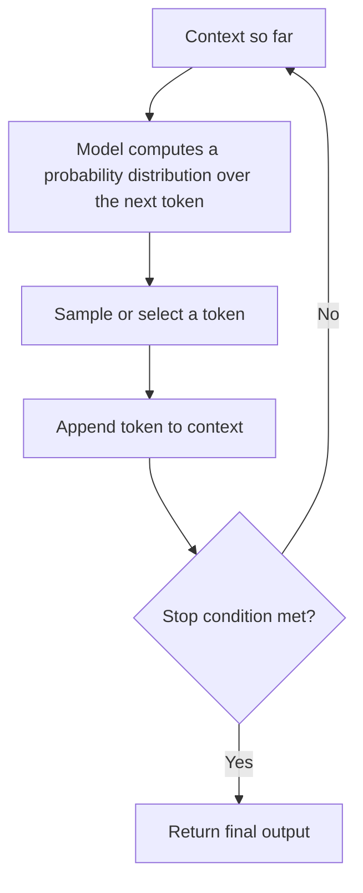

# Fundamentals of LLMs
{: .no_toc }

*Read duration: 16:21*

Every architectural decision you'll make as a Claude Certified Architect — how much context to give a model, whether to trust it with an autonomous multi-step task, how to structure a prompt, when to add a verification step — traces back to a small set of facts about how large language models actually work. This lecture builds that foundation. It's not a deep-dive into transformer math; it's the level of mechanical understanding an architect needs to reason correctly about capability, reliability, and cost.

## What a large language model is

A **large language model (LLM)** is a neural network trained to predict the next token in a sequence of text, given everything that came before it. That single sentence is more consequential than it sounds, and almost everything else in this course is a downstream implication of it. An LLM like Claude is not a database of facts, not a search engine, and not a rule-based reasoning system. It is a very large statistical function that has learned, from enormous amounts of text, the patterns of what token plausibly comes next given a context.

Modern LLMs, including Claude, are built on an architecture called the **transformer**, introduced in 2017. Before transformers, sequence models processed text step by step, one word after another, which made it hard to capture long-range relationships between words far apart in a sentence or document. Transformers changed this with a mechanism called **self-attention**: for every token being processed, the model computes how much "attention" to pay to every other token in the current context, all at once. This lets the model weigh the relevance of "the cat that chased the mouse across the yard was" against a word many tokens earlier ("cat") when predicting what comes next ("hungry" versus "green," for instance). Attention is what lets LLMs handle long, structured, context-dependent text well — and it's also why context windows have a computational cost that scales with length, which matters when you're designing systems that stuff large amounts of context into a single call.

A transformer is built from stacked layers, each combining self-attention with simple feed-forward transformations, repeated many times (Claude models, like other frontier LLMs, have on the order of tens of layers, each refining a representation of the input). The "large" in large language model refers to the number of parameters — the learned numeric weights inside these layers — which for frontier models runs into the hundreds of billions. You don't need to know exact parameter counts for the exam; you need to understand that scale (more parameters, more training data, more compute) is one of the primary levers that has driven capability gains across model generations, and that different Claude models (Haiku, Sonnet, Opus) represent different points on the cost/latency/capability trade-off curve rather than fundamentally different technologies.

## Tokens and context windows

LLMs don't process raw characters or whole words directly. They process **tokens** — chunks of text produced by a tokenizer, where a token might be a whole common word ("the"), a fragment of a longer word ("token" + "ize" + "r"), a punctuation mark, or even part of a Unicode character. As a rough rule of thumb for English text, one token is about four characters, or roughly three-quarters of a word. This matters architecturally for two reasons. First, everything you pay for and everything the model can "see" is measured in tokens, not words or characters — cost estimates, rate limits, and context budgeting all happen in token terms. Second, tokenization affects behavior in subtle ways: unusual formatting, rare words, and certain languages tokenize less efficiently, which can affect both cost and the model's fluency with that content.

The **context window** is the maximum number of tokens a model can attend to in a single request — the input (your prompt, any conversation history, tool results, retrieved documents) plus the output the model generates, combined. Claude models support very large context windows (into the hundreds of thousands of tokens for current generations), which is what makes it practical to hand Claude an entire codebase, a long document, or an extended multi-turn agent transcript in one call. But a large context window is not free capability. Two things you'll see tested and that matter in real system design:

- **Cost and latency scale with tokens processed.** A call with 150,000 input tokens costs more and takes longer than one with 1,500, even if the actual question is short — because attention computation and token generation both scale with sequence length.
- **Not all positions in a long context are used equally well.** Empirically, models are more reliable at using information placed at the very start or very end of a long context than information buried in the middle — sometimes called a "lost in the middle" effect. This is a direct, practical reason why the Context layer of this course (curation, compaction, structuring what you feed the model) is its own domain rather than an afterthought: a bigger context window does not substitute for deliberate context engineering.

Every conversation with Claude, and every agentic loop Claude Code runs, is fundamentally bounded by the context window. When an agent runs long enough that its accumulated conversation history, tool outputs, and file contents approach that limit, something has to give — older content gets summarized, dropped, or compacted. Understanding this is why context management is treated as an architectural discipline, not a background implementation detail.

## Training versus inference

It's worth being precise about two distinct phases in an LLM's life cycle, because they have very different implications for what you can and can't do as an architect.

**Training** is the (extremely expensive, offline) process of adjusting the model's parameters so that it gets better at predicting next tokens across a massive corpus of text, followed by additional stages — commonly including techniques like reinforcement learning from human feedback — that shape the model toward being helpful, harmless, and honest, and toward following instructions well rather than just continuing text in a statistically likely way. This is where the model's knowledge, its general reasoning patterns, and its behavioral tendencies get baked in. Training happens once (per model version), takes place on Anthropic's infrastructure, and is not something you as an API user or Claude Code user ever perform directly.

**Inference** is what happens every time you send a request to Claude: the trained, frozen model processes your input and generates output tokens one at a time. Inference is what you're actually doing when you call the API, run a prompt, or watch Claude Code execute a task. Critically, the model's parameters don't change during inference — **Claude doesn't "learn" from your conversation** in the way a human would remember it for next time. Anything that looks like the model "getting better" as a session goes on is really the model conditioning its next-token predictions on a growing context (the conversation transcript, tool results, files it has read), not the underlying weights updating. This is why context — what's actually present in the input at the moment of a given inference call — is the entire mechanism by which you influence Claude's behavior in a running session. There is no side channel; everything the model "knows" about your specific situation at inference time is either baked into its trained weights or explicitly present in the context you provide.

| | Training | Inference |
|---|---|---|
| When it happens | Offline, before a model is released | Every time you send a request |
| What changes | Model parameters (weights) get adjusted | Nothing in the model changes; only the context grows |
| Who performs it | Anthropic, on its own infrastructure | You, on every API call or Claude Code turn |
| Frequency | Once per model version | Continuously, per request |
| Rough analogy | Writing the textbook | Reading the textbook to answer a question |

This distinction is also why capabilities like memory across sessions, retrieval-augmented generation, and Claude Code's use of files like CLAUDE.md all exist: they're mechanisms for re-injecting relevant information into context at inference time, because the model itself has no persistent, mutable memory of its own.

{: .important }
> Training and inference are separate, sequential phases — not something happening at once. The model's weights are frozen at inference time, so nothing that happens in a conversation ever updates Claude's underlying knowledge. What looks like "learning" during a session is really the model conditioning on a growing context, and that context disappears once the session ends.

## LLMs are probabilistic next-token predictors — and what that implies

The single most important mental model to walk away with is this: at each step, **Claude is computing a probability distribution over possible next tokens**, and then sampling (or picking, depending on settings) from that distribution to decide what to output next. It repeats this one token at a time until it decides to stop.

This is fundamentally different from executing a fixed algorithm or looking up a guaranteed-correct answer, and it has several concrete architectural implications:

- **Outputs are not deterministic by default.** Because the next token is sampled from a distribution rather than always the single highest-probability choice, the same prompt can produce different outputs on different runs. Lowering randomness (temperature) narrows this variance but doesn't eliminate the underlying probabilistic nature of generation.
- **Reliability is a property of the whole system, not a guarantee from the model alone.** Because Claude is generating a plausible continuation rather than executing verified logic, well-architected systems build in verification, structured output formats, tool use for anything that needs to be exact (arithmetic, data lookups, code execution), and human or automated review for high-stakes decisions — rather than trusting a single unstructured generation.
- **Prompting works because it shapes the probability distribution.** A clear, well-structured prompt with relevant examples and explicit constraints narrows the space of plausible next tokens toward what you actually want. This is the entire mechanistic reason prompt engineering works at all — you are literally conditioning next-token probabilities, not "convincing" a reasoning agent through persuasion.
- **Hallucination is a natural consequence, not a bug in the traditional sense.** When the model has no strong signal about the true answer, it still must emit some plausible-sounding next tokens — that pressure to always produce fluent continuations is exactly what produces confident-sounding but incorrect output. This is why grounding (retrieval, tool use, citations) is an architectural pattern and not just a nice-to-have.
- **Longer autonomous chains compound uncertainty.** If each generation step has some probability of a small error, a long unsupervised chain of agentic actions has more opportunities for errors to accumulate or compound than a single, tightly-scoped generation does. This is a core reason the Agentic and Workflow layers of this course spend so much time on guardrails, checkpoints, and choosing the right degree of autonomy for a task.

## Why it matters for the exam

Expect exam questions that test whether you can connect a system-design symptom back to this underlying mechanism — for example, recognizing that inconsistent outputs across runs are expected probabilistic behavior rather than a bug, that a model "forgetting" earlier instructions in a long session is a context-window or attention effect rather than the model failing to learn, or that a proposed architecture needs a verification step because generation alone doesn't guarantee correctness. Everything downstream in this course — prompting technique, tool design, context curation, and agent autonomy — is really just architecture built in response to these fundamental properties of how LLMs work.

<!-- prevnext:start -->

---

| [&larr; Previous: Module Intro](01-module-intro) | [Next: Fundamentals of Claude API & Claude Code &rarr;](03-fundamentals-of-claude-api-and-claude-code) |
|:---|---:|

<!-- prevnext:end -->
