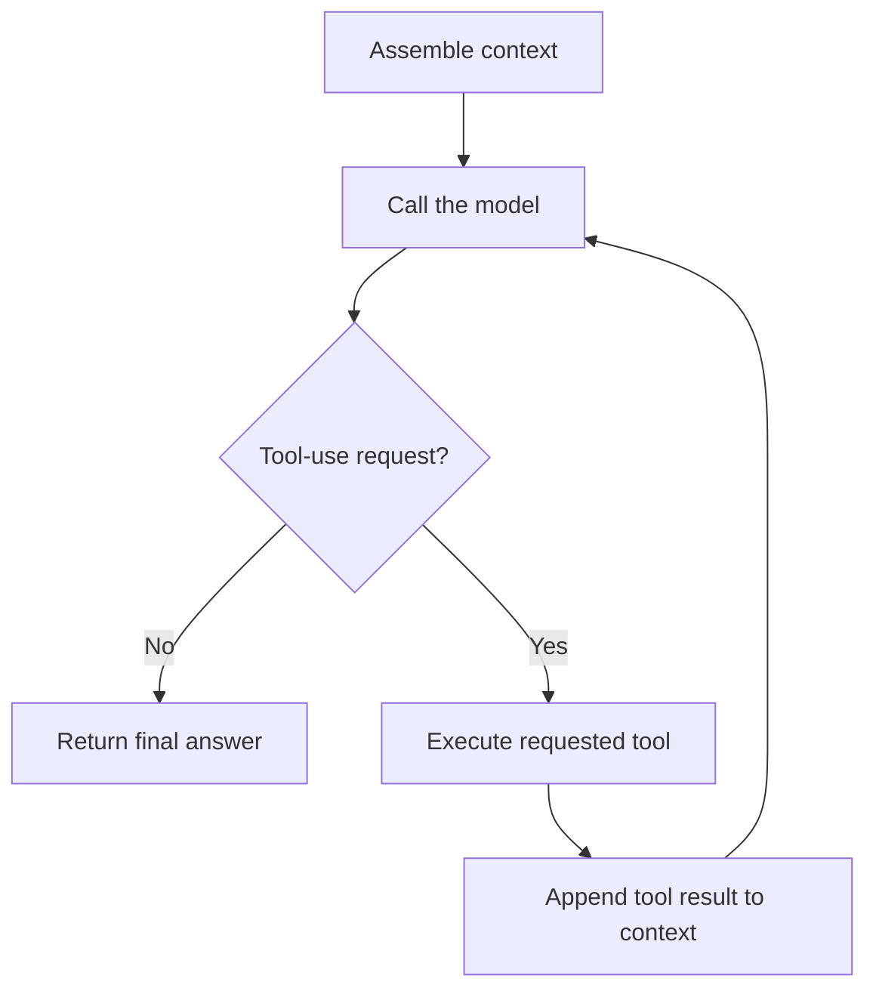

# Fundamentals of Agents and Tools
{: .no_toc }

*Video duration: 15:59*

"Agent" is one of the most overused words in the current AI landscape, and it means something fairly specific and testable in the context of the CCA-F. This lecture defines it precisely, defines "tool" precisely, and walks through the orchestration loop that connects them — the mechanical pattern that underlies the entire Agentic and Tool layers of this course.

## What an agent is, architecturally

Strip away the marketing, and an **agent** is: an LLM operating in a loop, where at each step it can choose to take an action (via a tool) rather than only produce a final text response, it observes the result of that action, and it uses that observation to decide its next step — continuing until it determines the task is complete or some stopping condition is reached. That's the whole definition. There's no separate "agent module" bolted onto the model; the model itself is doing the same thing it always does (predicting the next tokens given context), except now some of what it predicts is a structured request to invoke a tool, and your surrounding system is built to detect that, actually execute the requested action, and feed the result back in as new context for the next round of generation.

This reframing matters because it demystifies a lot of what looks like emergent intelligence. An agent that reads a bug report, searches a codebase, opens the relevant file, edits it, runs the test suite, sees a failure, and tries again is not running some separate "planning engine" — it is the same next-token-prediction process from the LLM Fundamentals lecture, called repeatedly, each time conditioned on an ever-growing context that now includes the results of its own prior actions. The "intelligence" of the agent is really the combination of (a) the model's ability to decide, from context, what a sensible next action is, and (b) the scaffolding around it that lets those actions actually touch the real world (files, shells, APIs, databases) and reports the results back.

Contrast this with a plain LLM call, which is a single request/response: you send a prompt, you get text back, and nothing the model "decides" during that generation can reach outside the conversation to affect anything else. An agent is distinguished specifically by the presence of a loop with real actions and real observations in between generations — not by being "smarter" in some vague sense.

## What tools are

A **tool** is a structured, well-defined action that the model can request the surrounding system to perform on its behalf. Mechanically, this is often called **function calling** or **tool use**: you (the developer) describe a set of available tools to the model — typically as a name, a natural-language description of what the tool does and when to use it, and a schema (usually JSON Schema) describing what inputs it takes — and include those tool definitions alongside your prompt. When the model determines that using a tool is the right next step, instead of producing ordinary conversational text it produces a structured request specifying which tool it wants to call and with what arguments, matching the schema you provided.

Crucially, the model does not execute the tool itself. It cannot reach out and touch a file system, run a shell command, or hit a database directly — it only ever produces tokens. What actually happens is: your application (or, in Claude Code's case, the built-in harness) recognizes that the model's output is a tool-use request, parses the structured arguments, executes the corresponding real action in your actual system, captures the result, and sends that result back to the model as a new message in the conversation, formatted as a tool result. The model then continues generating, now with that result available as context, and either takes another action or produces a final answer.

A minimal example makes this concrete. Suppose you define a tool called `get_weather` that takes a `location` string and returns current conditions. A user asks, "Should I bring an umbrella in Seattle today?" The model, seeing the `get_weather` tool available and recognizing it's relevant, emits a tool-use request like `get_weather(location="Seattle")` instead of a direct text answer. Your application intercepts this, calls whatever real weather API or database backs that tool, gets back "light rain, 60°F," and sends that back to the model as a tool result. The model, now with that fact in context, produces its final natural-language answer: "Yes, there's light rain expected in Seattle today — bring an umbrella." The model never touched the weather service. It only ever decided, based on the tool description you gave it, that calling this particular structured action with these particular arguments was the right move — and then, after seeing the result, turned that result into a helpful natural-language reply.

This is the mechanism behind everything Claude Code does with files, bash, and search: `Read`, `Write`, `Edit`, `Bash`, `Grep`, and similar built-in tools are exactly this pattern, with tool definitions and execution logic already built into the Claude Code harness. When you extend Claude with the Model Context Protocol (MCP) — covered in depth in the Tool layer of this course — you are doing the same thing: registering additional tool definitions (this time pointing at an external MCP server) so the model has more real-world actions it can choose to request.

It's worth being precise about one more detail that trips people up: the quality of a tool call depends heavily on the quality of the tool's description and schema, not just on the model's raw capability. A tool named `get_weather` with a vague description ("gets weather stuff") and a loosely typed input gives the model less signal to decide when and how to call it correctly than one with a precise description of its purpose, its expected inputs, its output format, and any constraints or edge cases. This is why tool design is treated as a first-class architectural skill in this course's Tool layer rather than an afterthought: a poorly specified tool can cause a perfectly capable model to call it at the wrong time, with malformed arguments, or not call it when it should have — not because the model is confused about the underlying task, but because the tool's interface didn't give it enough to work with.

## The orchestration loop

Putting agents and tools together gives you the core orchestration loop that every agentic system, including Claude Code, implements in some form:

1. **Assemble context.** Gather the system prompt, conversation history, available tool definitions, and any other relevant information (files, prior tool results) into the input for the next model call.
2. **Call the model.** Send that context to Claude via the Messages API and get back a response.
3. **Branch on the response type.** If the model produced a final text response with no tool-use request, the loop is done for this turn — return the answer. If the model produced one or more tool-use requests, continue to step 4.
4. **Execute the requested tool(s).** Run the actual corresponding action(s) in the real system — read the file, run the shell command, call the external API — and capture the result (including errors, if the action failed).
5. **Append the tool result to context.** Add the tool call and its result as new messages in the conversation.
6. **Repeat from step 2.** Call the model again with the updated context, and let it decide the next step given what it now knows.

This loop continues until the model stops requesting tools and produces a final answer, or until some external stopping condition is hit — a maximum number of iterations, a timeout, a budget limit, or a human-in-the-loop approval gate that pauses execution. That last point matters architecturally: because each iteration of the loop is a real action with real side effects (writing a file, executing a command, calling a paid API, sending an email), well-designed agentic systems don't let this loop run unbounded and unsupervised by default. Permission systems (like the approval prompts you've likely seen in Claude Code itself), scoped tool access (only exposing the specific tools a given task actually needs), and iteration limits are all standard architectural guardrails wrapped around this loop, not optional extras.

It's also worth being precise about where "reasoning" happens in this loop. There is no separate planning module deciding the sequence of tool calls in advance. Each decision — which tool to call, with what arguments, or whether to stop and answer — is made fresh at each step 2, by the model generating tokens conditioned on everything accumulated in context so far. This is why context quality directly drives agent quality: an agent with a cluttered, poorly organized, or token-starved context will make worse decisions at each step of this loop than one with clean, relevant, well-structured context — the same probabilistic-generation mechanics from the LLM fundamentals lecture apply at every single iteration.

## Single actions versus multi-step autonomy

It's useful to place "agent" on a spectrum rather than treat it as binary. A single Messages API call with no tools is not an agent — it's a one-shot generation. A call with tools available, where the model might invoke exactly one tool and then answer, is a minimal agent — one pass through the loop. A Claude Code session working through a multi-file refactor across dozens of tool calls, checking its own work by running tests along the way, is the same architecture running for many more iterations, with more autonomy and more compounding risk if something goes wrong (recall from the LLM fundamentals lecture that longer autonomous chains compound the probability of an error somewhere in the sequence). The Agentic layer of this course is largely about reasoning correctly along this spectrum: how much autonomy a given task warrants, what guardrails scale with that autonomy, and when a fixed, predictable workflow (explicit, developer-defined steps) is actually the better architectural choice than letting the model decide the sequence of actions itself — a distinction the Workflow layer develops further.

## Why it matters for the exam

Expect the exam to test whether you can correctly identify, given a system description, whether something is "an agent" in this precise sense (an LLM in a loop, deciding its own next actions via tool calls) versus a fixed pipeline that merely calls an LLM as one step among predetermined ones. You should also be able to walk through the mechanics of a tool-use exchange precisely: the model never executes anything itself: it emits a structured request, your system executes it and returns a result, and the model incorporates that result into its next generation. Getting this mechanism exactly right is foundational to reasoning correctly about every later topic involving tool design, orchestration patterns, and agent autonomy.

<!-- prevnext:start -->

---

| [&larr; Previous: Claude Code vs... The API?](04-claude-code-vs-the-api) | [Next: Intro to the Hands-On Labs &rarr;](06-intro-to-the-hands-on-labs) |
|:---|---:|

<!-- prevnext:end -->
