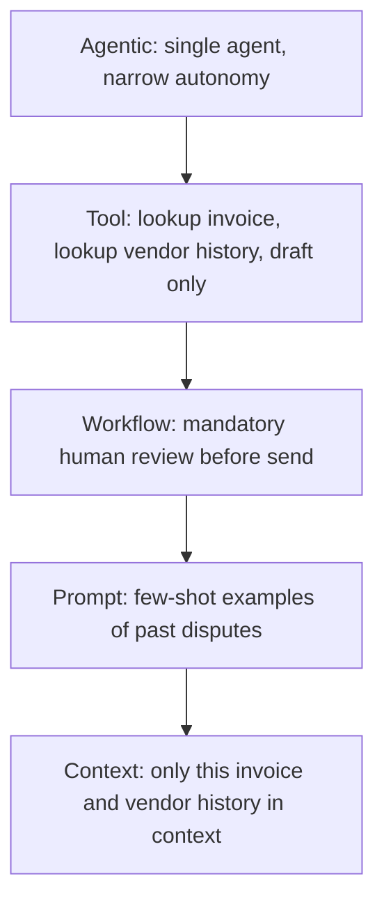

# The Five Domains
{: .no_toc }

*Video duration: 21:39*

The CCA-F exam is not a trivia test about Claude's feature list. It is a test of architectural judgment — whether you can look at a business problem and make sound decisions about how a Claude-powered system should be built, at every level from "should this even be an agent" down to "what exactly goes in the context window at this step." Anthropic organizes that judgment into five domains, and this course mirrors that structure directly: modules 4 through 8 are named **The Agentic Layer**, **The Tool Layer**, **The Workflow Layer**, **The Prompt Layer**, and **The Context Layer**. This lecture is your first full pass across all five before you go deep on any one of them, so you can see how they relate to each other before you see how each one works in isolation.

Think of the five domains as answering five different questions about the same system:

- **Agentic architecture** asks: *who decides what happens next?*
- **Tool design** asks: *what can the model actually do, and how does it know how to do it?*
- **Workflow design** asks: *how much of this process is fixed, and how much is left to judgment?*
- **Prompt design** asks: *how do we communicate intent, format, and constraints to the model?*
- **Context management** asks: *what does the model actually see when it's asked to act?*

Every real-world Claude system answers all five questions, whether its designer thought about them explicitly or not. The point of the CCA-F is to certify that you think about them explicitly, and that you make defensible choices rather than defaults you never examined.

## Domain 1: Agentic Architecture

Agentic architecture is the domain of control flow at the highest level. It covers the fundamental decision of whether a task should be handled by a single agent, a workflow with no agentic judgment at all, or a coordinated team of multiple agents — and, if multiple agents are involved, how they're organized (a single orchestrator delegating to specialized subagents, a pipeline of agents each handling one stage, or peer agents that negotiate). This is the domain most closely tied to the "agent loop" itself: the repeating cycle of the model receiving context, deciding on an action (respond, call a tool, or stop), that action executing, and the result flowing back into context for the next iteration.

An architect working in this domain is expected to know when agentic autonomy is the right tool and when it is a liability. Autonomy is valuable when a task's steps can't be fully enumerated in advance — when the right next action depends on what was just discovered, the way a support agent's next question depends on the customer's last answer. Autonomy is a liability when the task is well-understood, repeatable, and where the cost of an unpredictable path is high — in those cases, **a fixed workflow beats an autonomous agent**, because it's cheaper, faster, and easier to audit. The CCA-F expects you to reason about that trade-off from first principles, not to reflexively reach for "add an agent" as the answer to every automation problem.

This domain also covers multi-agent coordination: when to decompose a single agent's responsibility into a team, how subagents are instantiated and scoped, how results get consolidated back to a coordinator, and how to prevent multi-agent systems from becoming expensive, hard-to-debug messes that don't outperform one well-designed agent. Session management — how state persists (or deliberately doesn't) across a conversation, a single task, or a long-running background process — also lives here, since it's fundamentally about who is responsible for tracking what across time. Expect scenario questions that describe a business process and ask you to choose between "single agent," "fixed workflow," and "multi-agent system," where the correct answer hinges on details like whether steps are predictable, whether specialized expertise is needed at different stages, and whether the cost of coordination overhead outweighs the benefit of decomposition.

## Domain 2: Tool Design

If agentic architecture is about who decides, tool design is about what the decider is actually capable of doing. A **tool**, in Claude's architecture, is a defined capability — a function with a name, a description, and a structured input schema — that the model can choose to invoke mid-conversation. Tool design is the domain of building and governing that capability surface: which tools exist, how they're named and described, what their inputs and outputs look like, how they fail, and how those failures are communicated back to the model.

An architect in this domain thinks about tools the way a good API designer thinks about endpoints — except the "caller" is a language model reading natural-language descriptions rather than a human developer reading API documentation. That reframing has real consequences. Tool names and descriptions have to be unambiguous enough that the model reliably picks the right tool among several similar ones. Input schemas have to be structured enough to produce valid, parseable calls, but not so rigidly over-specified that the model can't express legitimate variation. And the boundary between "structure" (rigid schemas, enums, required fields) and "prose" (free-text fields the model can use its judgment on) is itself a design decision with real trade-offs, not a default to leave unexamined.

Error response design is a major piece of this domain and one of the most commonly underestimated. A tool that fails silently, or returns an error message written for a human stack trace rather than for a reasoning model, actively degrades the whole system — the model may retry blindly, hallucinate a workaround, or give up prematurely. Good tool errors are **specific, actionable, and phrased so the model can decide what to do next**: what went wrong, why, and often what a valid alternative input would look like. This domain also covers MCP (Model Context Protocol) architecture and governance — how tools get exposed to Claude through standardized MCP servers, how access to those servers is scoped and permissioned, and how an organization keeps a growing tool ecosystem from becoming unmanageable or insecure. Expect exam questions that present a malformed or ambiguous tool definition and ask you to identify what's wrong with it, or that describe a tool failure and ask what the *tool's* error response should have said.

## Domain 3: Workflow Design

Workflow design is the domain that governs how work is actually organized across multiple steps, whether or not any individual step involves agentic judgment. Where agentic architecture asks the big-picture "agent vs. workflow vs. multi-agent" question, workflow design goes a level deeper: given the architecture you've chosen, how is the actual sequence of work structured, configured, and safeguarded?

This domain covers the configuration surfaces that shape how Claude behaves consistently across a team or a codebase — most notably `CLAUDE.md` files, which encode project-specific conventions, constraints, and context that should apply automatically rather than being repeated in every prompt, and Skills, which package reusable, invokable procedures (with their own instructions, and sometimes their own bundled tools or scripts) that an agent can draw on for a well-defined sub-task. An architect is expected to know when to reach for a `CLAUDE.md` entry versus a Skill versus a full subagent, and when persistent project configuration is the wrong tool entirely and a piece of information belongs in retrieved knowledge (RAG) instead, because it's too voluminous, too dynamic, or too specific to a single query to live in a static file that's loaded every time.

Workflow design also covers how workflows are safeguarded and integrated into real engineering practice: validation and review gates placed at points where the cost of an error is high, and integration into CI/CD pipelines so that Claude-driven steps — code review, test generation, documentation updates — participate in the same automated, auditable process as everything else in a software delivery pipeline. A recurring exam theme in this domain is recognizing that workflow decisions are frequently *local*: a convention or safeguard that makes sense for one repository, one team, or one workflow doesn't automatically generalize, and part of the architect's job is knowing what should be centralized versus what should be left to individual workflows to decide for themselves.

## Domain 4: Prompt Design

Prompt design is the domain most people assume they already understand coming into this exam, and it's also where the CCA-F pushes hardest past that assumption. This is not "how to write a good ChatGPT prompt." It's the domain of treating prompts as an architectural artifact: versioned, tested, reused, and engineered with the same rigor as code, because in an agentic system a prompt is effectively part of the system's logic.

This domain covers prompting best practices at the structural level — clear task framing, explicit success criteria, appropriate use of system versus user content, and the discipline of keeping instructions unambiguous rather than relying on the model to infer intent. It covers few-shot prompting: when examples improve reliability more than additional instructions do, how to choose examples that cover the *range* of expected inputs without overfitting the model to one narrow pattern, and the risk of examples that accidentally teach the wrong lesson through some incidental detail. It covers techniques for achieving reliably structured output — schema-constrained generation, explicit format instructions, and the general principle that the more a downstream system depends on parseable output, the more that constraint needs to be enforced at the prompt (and often the tool-call) level rather than hoped for through polite phrasing.

Quality and feedback enforcement also lives in this domain: techniques like asking the model to check its own work, providing rubrics or constitutions it should self-evaluate against, and structuring prompts so that low-quality output is caught before it propagates downstream rather than after. Batch processing and multi-pass review patterns — running the same task multiple times with variation, or splitting generation from review into separate passes so one pass isn't grading its own homework — round out the domain. An architect is expected to know not just prompting *techniques* but when each technique is worth the added cost and latency it introduces, since more passes and more validation are never free.

## Domain 5: Context Management

Context management is the domain of what the model actually sees, and it is arguably the most consequential of the five, because every other domain's decisions ultimately manifest as tokens in a context window. Claude's context window is large but finite, and everything competes for space inside it: system instructions, `CLAUDE.md` content, tool definitions, conversation history, retrieved documents, and tool results. Context management is the discipline of deciding what belongs in that limited space, what gets summarized or dropped, and how information flows between agents, sessions, and tools without corrupting or overwhelming the model's working set.

An architect in this domain is expected to know concrete techniques for managing a growing context: summarization and compaction strategies for long-running sessions, deliberate context isolation between subagents so one agent's noisy intermediate work doesn't pollute another's reasoning, and patterns for working with large codebases or large document sets where the full corpus can never fit in context and retrieval has to do the work of narrowing it down. This domain also covers **data provenance** — tracking where information in context came from, how trustworthy it is, and what to do when two sources in context disagree — and the design of human review checkpoints, since a well-placed human-in-the-loop gate is itself a context management decision about when the model should stop and defer rather than press forward on incomplete or ambiguous information.

Escalation and ambiguity handling is a major exam theme here: what should an agent do when the context doesn't contain enough information to proceed safely? **The wrong answer is almost always "guess and continue."** The right answer usually involves recognizing the ambiguity, choosing an appropriately granular option (including the option to explicitly do nothing and ask), and preventing a single bad inference from propagating into everything downstream. Preventing error propagation — making sure a mistake made early in a session doesn't get compounded and amplified by subsequent turns that trust it uncritically — is one of the domain's central concerns and a frequent source of scenario questions.

Before moving on, here's a quick reference for how the five domains line up:

| Domain | Core Question | Representative Concerns |
|---|---|---|
| Agentic Architecture | Who decides what happens next? | Single agent vs. fixed workflow vs. multi-agent team, session management |
| Tool Design | What can the model do, and how does it know how to do it? | Schema design, error response design, MCP governance |
| Workflow Design | How much of this process is fixed, and how much is judgment? | `CLAUDE.md` vs. Skills vs. RAG, review gates, CI/CD integration |
| Prompt Design | How do we communicate intent, format, and constraints? | Few-shot examples, structured output, self-checking prompts |
| Context Management | What does the model actually see when it acts? | Summarization, data provenance, escalation, error propagation |

## How the Domains Interact

{: .important }
> Don't assume a scenario question is testing the domain its surface details suggest. The exam tests the seams between domains as often as it tests any one domain alone — a tool-layer symptom, an agentic-layer misstep, and a context-layer gap are frequently three views of the same underlying failure.

None of these domains operates in isolation, and the exam will test the seams between them as often as it tests any one domain alone. A tool with a poorly designed error response (Tool) can cause an agent to make a bad autonomous decision (Agentic) that pollutes context for the rest of the session (Context). A workflow that skips a review gate (Workflow) puts more pressure on the prompt to get output right on the first try (Prompt). A context window crowded with irrelevant retrieved documents (Context) can cause the model to follow the wrong instruction among several plausible ones (Prompt). Learning to reason across these boundaries — not just within a single domain — is what separates someone who has memorized five lists of facts from someone who can actually architect a Claude-based system.

Consider a single worked example that touches all five domains at once. A finance team builds a Claude-based system to draft first-pass responses to vendor invoice disputes. At the Agentic layer, the architect decides this should be a single agent with narrow autonomy, not a fixed workflow, because disputes vary too much to enumerate every path in advance — but also not a multi-agent system, because the task doesn't actually require distinct specialized expertise at different stages. At the Tool layer, that agent is given a small set of tightly scoped tools: look up an invoice, look up a vendor's dispute history, and draft (but not send) a response — deliberately excluding a "send email" tool, which keeps the highest-stakes action outside the agent's reach entirely. At the Workflow layer, the drafted response is routed through a mandatory human review step before anything reaches the vendor, and that gate is written into the surrounding process rather than left as an assumption. At the Prompt layer, the drafting instructions include a few well-chosen examples of past disputes and their resolutions, so the agent's tone and structure stay consistent rather than drifting. And at the Context layer, only the specific invoice and that vendor's history are pulled into context — not the entire invoice database — because more information isn't better information if most of it is irrelevant to the dispute at hand. Every one of those five decisions was made independently, using that domain's own vocabulary, but together they produce one coherent, defensible system. That's the kind of reasoning the exam is actually testing.

**Why it matters for the exam:** Nearly every scenario question on the CCA-F is written to test one specific domain, and the fastest way to find the right answer is to first correctly identify which domain the question is actually probing before you evaluate the options. A question that sounds like it's about "which tool to use" may really be testing workflow design (should this even be a tool call, or a fixed step?) or context management (does the agent have enough information to choose correctly?). The next lecture gives you a concrete mental model for making that identification quickly and reliably.

<!-- prevnext:start -->

---

| [&larr; Previous: Module Intro](01-module-intro) | [Next: The Five-Layer Mnemonic &rarr;](03-the-five-layer-mnemonic) |
|:---|---:|

<!-- prevnext:end -->
