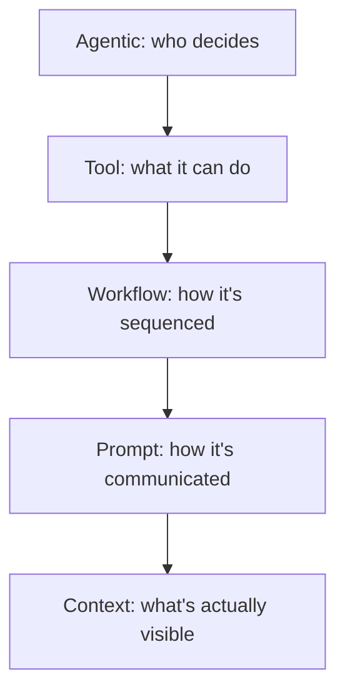
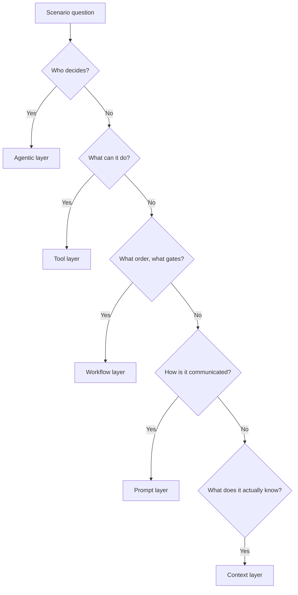

# The Five-Layer Mnemonic
{: .no_toc }

*Video duration: 10:03*

Five domains, five names, and under exam pressure it is surprisingly easy to blur them together — to read a scenario question about a tool failure and start reasoning about workflow design instead, simply because the question is long and your brain grabs the first plausible-sounding concept. This lecture gives you a mental model built specifically to prevent that: a way of stacking the five domains so that, given any scenario, you can quickly ask "which layer is this actually about?" before you start evaluating answer choices.

## The Stack, Top to Bottom

The five domains are not a flat, unordered list. They form a natural stack, running from high-level orchestration at the top down to raw information at the bottom:

1. **Agentic** — who decides what happens next
2. **Tool** — what the decider is capable of doing
3. **Workflow** — how multi-step work is sequenced and safeguarded
4. **Prompt** — how instructions and intent are communicated
5. **Context** — what information is actually visible when a decision gets made

Read top to bottom, each layer answers a narrower, more concrete question than the one above it. The Agentic layer is the most abstract: it's about control flow and who — a single agent, a fixed workflow, a coordinated team of agents — is steering the ship. The Tool layer narrows that down to what actions are even available to whoever is steering. The Workflow layer narrows further, into how those actions get sequenced, gated, and safeguarded across an actual multi-step process. The Prompt layer narrows further still, into the literal words and structure used to communicate a task at any single step. And the Context layer is the floor everything else sits on: the actual tokens — instructions, history, retrieved data, tool output — present in the model's working memory the moment it has to act.

Crucially, information flows *down* this stack in influence and *up* it in consequence. A decision made at the Agentic layer (should this be autonomous or fixed?) shapes what the Tool layer needs to expose. Tool design shapes what the Workflow layer has to sequence and safeguard. Workflow structure shapes what has to be said in each Prompt. And every layer above ultimately manifests as tokens sitting in the Context layer at the bottom — which is why a mistake anywhere in the stack tends to show up as a context problem downstream, even when the root cause was three layers up.

## Anchoring It: ATWPC

The five layer names — Agentic, Tool, Workflow, Prompt, Context — give you the acronym **ATWPC**. On their own, five unordered abstract nouns are hard to hold in working memory during a stressful multiple-choice exam, so it helps to hang them on a short phrase where each word's first letter cues the layer in order:

**"Ambitious Teams Write Precise Contracts."**

- **Ambitious** → **Agentic**: an ambitious system reaches for autonomy and delegation.
- **Teams** → **Tool**: a team's capability is defined by the tools members carry.
- **Write** → **Workflow**: writing is a sequence, a process with steps in order.
- **Precise** → **Prompt**: precision is exactly what a good prompt demands.
- **Contracts** → **Context**: a contract is the ground-truth record everyone has to work from — much like context is the ground truth the model works from.

You don't need to love the phrase — you need it to be *yours*. If a different five-word sentence sticks better in your head, build your own; the acronym order (A-T-W-P-C, top-down) is the part that matters, because it mirrors both the course's module order (4 through 8) and the natural decision order an architect actually works through when designing a system.

## The "Architect on a Job Site" Picture

Because this certification is literally named "Architect," it's worth leaning into that image directly, since it maps onto the stack almost too neatly to be a coincidence.

Picture an architect running a construction project. The **Agentic** layer is the architect (or general contractor) deciding, day to day, what needs to happen next — bring in the electricians now, or wait until the framing is done? Delegate this decision to the site foreman, or make it personally? The **Tool** layer is the actual equipment available on site — cranes, saws, levels, each with a specific capability and a specific way it fails when misused. The **Workflow** layer is the build schedule: the sequence of phases, the inspection checkpoints, the sign-offs required before the next phase can start. The **Prompt** layer is the work order handed to a specific crew for a specific task today — precise enough that the electricians know exactly what's expected of them this afternoon. And the **Context** layer is the site itself: the materials actually delivered, the soil survey, the latest inspection report — the ground truth everyone on site is working from, whether or not it's accurate or current.

This picture is useful precisely because it exposes how failures cascade. A stale soil survey (bad Context) can lead to a work order that's technically well-written but wrong (a fine Prompt built on bad data). A missing checkpoint in the schedule (Workflow gap) can let a crew skip a step no tool would have caught on its own (Tool layer working exactly as designed, but in the wrong sequence). A contractor who insists on personally deciding everything, refusing to delegate to a trusted foreman even for routine calls, is making a bad Agentic-layer choice that will bottleneck the whole project regardless of how good the tools, schedule, or paperwork are.

## Using the Stack on Scenario Questions

The real payoff of this mental model is procedural: a quick diagnostic you can run against any scenario question before you touch the answer choices.

1. **Identify what actually broke or is being decided.** Strip the scenario's business framing (support tickets, invoice processing, code review — it doesn't matter) and ask what layer the described problem or decision lives in.
2. **Ask if it's a "who decides" question.** If the scenario is about whether to use an agent, a workflow, or multiple agents — and how much autonomy to grant — you're in the Agentic layer.
3. **Ask if it's a "what can it do" question.** If the scenario turns on a specific capability, its schema, or how it reports failure, you're in the Tool layer.
4. **Ask if it's a "what order and what gates" question.** If the scenario is about sequencing, checkpoints, CI/CD integration, or `CLAUDE.md`/Skill configuration, you're in the Workflow layer.
5. **Ask if it's a "how is this communicated" question.** If the scenario turns on wording, examples, output format, or self-checking instructions, you're in the Prompt layer.
6. **Ask if it's a "what does it actually know" question.** If the scenario is about information availability, staleness, conflicting sources, or context window pressure, you're in the Context layer.

Many questions will look like they straddle two layers, and that's deliberate — remember from the previous lecture that the domains interact constantly. When that happens, look for which layer the *root cause* sits in versus which layer merely shows the *symptom*. A model that "hallucinates a file path" is exhibiting a Context-layer symptom (missing or stale information) even though the visible failure is a Tool-layer error (a bad tool call). Trained instinct for that distinction — symptom versus root cause, and which layer each belongs to — is exactly what separates a quick, confident answer from a guess.

**Why it matters for the exam:** The ATWPC stack isn't decoration — it's a triage tool. Under time pressure, correctly sorting a scenario into the right layer before reading the answer choices eliminates a large share of plausible-sounding distractors immediately, because wrong answers are frequently correct-sounding statements about the *wrong* layer. Practice running the six-question diagnostic above against every scenario question you see, in this course's quizzes and beyond, until it's automatic.

<!-- prevnext:start -->

---

| [&larr; Previous: The Five Domains](02-the-five-domains) | [Next: Exam and Testing Process &rarr;](04-exam-and-testing-process) |
|:---|---:|

<!-- prevnext:end -->
