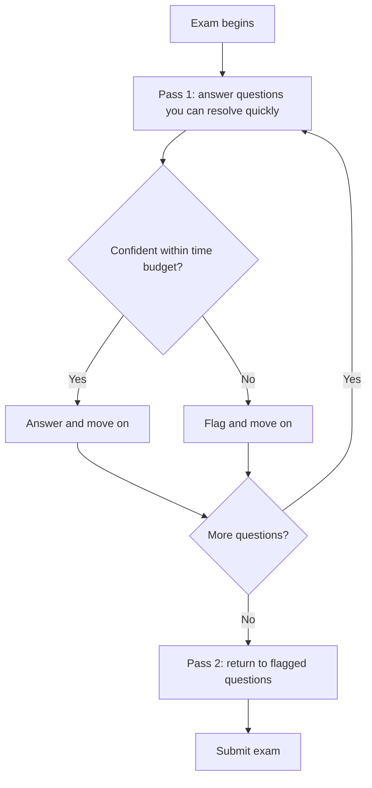

# Exam and Testing Process
{: .no_toc }

*Video duration: 15:10*

Understanding the five domains and the ATWPC mental model gets you ready intellectually. This lecture is about being ready practically: what the exam itself actually looks like, how to register for it, what to expect walking in, and how to manage your time and mindset once the clock starts. None of this replaces Anthropic's own documentation — treat everything here as a realistic, well-informed briefing, and confirm the specific, current details on the official CCA-F page before you schedule your sitting. Exam vendors change proctoring providers, fee structures, and question counts often enough that any third-party course, including this one, will eventually drift out of sync with the current specifics.

## Format: What Kind of Exam This Is

The CCA-F is a knowledge and judgment certification, not a hands-on lab practical, and its format reflects that. Expect a timed, multiple-choice exam delivered online, drawing on a mix of question styles rather than one repetitive pattern throughout:

- **Straight recall questions** test whether you know a definition or a fact outright — for example, correctly identifying what MCP stands for or what a tool's structured input schema is for.
- **"Which of the following is NOT" questions** invert the usual logic: three or four answer choices will be true, correct statements, and your job is to find the one that's false or inapplicable. These are deliberately designed to catch test-takers who pattern-match on "this sounds right" instead of reading carefully.
- **Scenario-based judgment questions** describe a realistic situation — a support automation system, a code review pipeline, a document processing workflow — and ask you to choose the architecturally soundest response among several plausible-looking options. These are the questions the ATWPC mental model from the previous lecture is built for, and they're where most of the exam's real difficulty lives, because more than one answer choice will usually be defensible and you're being asked to identify the *best* one, not merely a workable one.

| Question Type | What It Tests | Best Approach |
|---|---|---|
| Straight recall | Definitions and facts | Answer quickly within your time budget; don't overthink it |
| "Which is NOT" | Careful reading over pattern-matching | Read every option; watch for negation words |
| Scenario-based judgment | Architectural judgment across domains | Apply the ATWPC diagnostic before evaluating options |

Expect the exam to draw roughly proportionally from the five domains covered in this module plus the fundamentals and cross-cutting material covered elsewhere in the course, with scenario questions weighted toward the domains that carry the most architectural nuance — Tool design, Workflow design, and Context management tend to produce the richest scenario questions, since they involve the most trade-offs. This course's own practice materials — the Quiz Prep sets at the end of each domain module and the Full Sample Exam near the end of the course — are built to mirror this mix of question styles so you walk in having already practiced the format, not just the content.

## Registration and Logistics

Certification exams in this space typically follow a familiar pattern: create an account with the certification provider (in this case, through Anthropic's certification program), verify your identity, select and pay for an exam sitting, and schedule a time slot — either at a physical testing center or, more commonly for a credential like this, through remote online proctoring from your own computer. If remote proctoring is offered, expect requirements around your testing environment: a functioning webcam and microphone, a clear desk, a private room free of other people and unauthorized materials, and software that needs to be installed and tested in advance of your actual sitting. Do not leave that environment check until the morning of the exam — test your setup days ahead, because connectivity or software problems discovered at the last minute can cost you your slot.

{: .important }
> Test your remote-proctoring environment days before your sitting, not the morning of. A connectivity or software failure caught at check-in can cost you the entire slot — this is an avoidable operational risk, not a knowledge gap, and it's one of the easiest ways to lose exam time for reasons that have nothing to do with what you know.

Budget time for the registration process itself. Identity verification, payment processing, and scheduling around available slots can take longer than expected, particularly if the credential is in high demand shortly after launch. If your employer is sponsoring the certification or requires proof of completion for internal purposes, confirm what documentation you'll need well before exam day — some programs issue a digital badge or certificate automatically, others require you to request one.

## What to Expect on Exam Day

If you're sitting a remotely proctored exam, expect a check-in process before the timer starts: identity verification against a government-issued ID, a scan of your physical workspace (often via webcam, sometimes requiring you to show all four walls of the room), and confirmation that prohibited materials — notes, a second monitor, a phone — are out of reach. This process can take ten to twenty minutes on its own, so log in early rather than arriving at your exact start time. Once the exam begins, most systems lock you out of other applications, disable copy-paste, and monitor for prohibited behavior (looking away from the screen repeatedly, unexplained noise, another person entering the room), so treat the sitting as similar in seriousness to an in-person proctored test even though you're at home.

Have your government-issued ID ready, arrive rested, and treat the hour or two before the exam as you would before any high-stakes assessment: no cramming new material at the last minute, since at that point it's more likely to introduce doubt than add knowledge. A calm, familiar review of your own notes — including a file like this one — is a better use of that final hour than opening new material for the first time.

## Time Management Strategies

A multiple-choice exam with a mix of quick recall and slower scenario judgment questions rewards a specific pacing discipline: don't spend recall-question time on scenario questions, and don't spend scenario-question time on recall questions.

A practical approach is a two-pass strategy. On your first pass through the exam, answer every question you can resolve confidently within a short, fixed budget — say, sixty to ninety seconds for a straight recall question. If a question isn't resolving quickly, don't dig in immediately; flag it and move on. This ensures you bank every easy point before risking getting stuck on a single hard question and running out of time for the rest of the exam. On your second pass, return to flagged questions with whatever time remains, now able to spend it more generously on the genuinely hard judgment calls without the anxiety of an unknown number of easy questions still waiting.

Keep a rough mental (or, if permitted, written) checkpoint of pace against the clock — for example, "I should be roughly a third of the way through the question count by a third of the way through the time." If you notice you're falling significantly behind that pace during the first pass, that's a signal to tighten your per-question budget, not to panic; most exams are designed so that a well-prepared candidate has enough time if they pace deliberately rather than dwelling.

## General Best Practices

A handful of test-taking disciplines apply broadly to certification exams like this one, and they compound with the domain knowledge from the rest of this course:

- **Read the full question stem before looking at answer choices.** It's tempting to skim the scenario and jump to the options, but scenario questions are often written so that a detail in the second or third sentence changes which answer is correct. Read the whole stem, including any constraints ("with minimal added latency," "without introducing a new dependency"), before evaluating options.
- **Watch for negation and qualifiers.** Words like "NOT," "EXCEPT," "always," "never," and "best" change what you're looking for. A rushed read can invert the entire question.
- **Use process of elimination deliberately.** Even when you're not fully certain of the right answer, you can often be confident that one or two options are wrong — an option that describes the wrong domain entirely, or one that contradicts a principle you do know cold. Eliminating those first narrows a four-option question into a much more tractable two-option decision.
- **Be suspicious of extreme-sounding options.** Answer choices that describe an absolute, unconditional rule ("always use multiple agents for X," "never allow a tool to fail silently under any circumstances") are frequently distractors, because real architectural judgment is almost always conditional. That said, don't apply this as a blind rule either — some questions do have a genuinely correct absolute answer, so use it as a tiebreaker, not a shortcut.
- **Trust your first well-reasoned answer more than you trust a nervous second-guess.** Changing an answer on review should be driven by a specific realization ("oh, this constraint changes things"), not general anxiety. Studies on test-taking behavior consistently show that **most answer changes made purely out of doubt move a correct answer to an incorrect one, not the reverse**.
- **Flag and move on is a strategy, not a failure.** Getting stuck and burning five minutes on one question you're unsure of is a worse outcome than flagging it, banking the points you're confident about, and returning to it with a clearer head and a better sense of the remaining time budget.
- **Manage physical state, not just knowledge.** A short walk, water, and a few minutes away from screens before the exam starts will do more for your performance on a two-hour cognitive test than any last-minute review of a topic you're already reasonably comfortable with.

## After the Exam: Scoring, Results, and Retakes

Most certification programs in this category report a pass/fail result either immediately upon submission or within a short window afterward, sometimes alongside a domain-by-domain breakdown showing relative strength and weakness even when the overall result is a pass. If a detailed breakdown is offered, treat it as genuinely useful signal rather than something to glance at and discard — a pass with a visibly weak Context Management score, for instance, is worth revisiting even after the credential is earned, since it points at a real gap in your practical judgment, not just an exam artifact.

If you don't pass on your first attempt, don't treat that as a verdict on your competence — treat it as a data point. Review whatever domain breakdown you're given, revisit this course's material for the domains that scored weakest, and pay particular attention to whether your misses clustered around recall questions (a knowledge gap, fixable with review) or scenario questions (a judgment gap, better addressed by working through more practice scenarios and consciously applying the ATWPC diagnostic rather than re-reading definitions). Confirm the official retake policy — waiting periods and any additional fees — on Anthropic's CCA-F page, since these details are exactly the kind of thing that changes between cohorts and is not something a third-party course can reliably promise.

## A Note on Test Anxiety

It's worth naming directly: a proctored, timed, monitored exam is a genuinely different experience from working through practice questions at your own pace at home, even if the content is identical. Some amount of elevated nervousness on exam day is normal and does not mean you're unprepared. What matters is not letting that nervousness change your strategy mid-exam — sticking to the two-pass pacing plan, trusting process of elimination even when a question feels harder than it should, and resisting the urge to second-guess an answer you reasoned through carefully just because the environment feels high-stakes. Familiarity is the best antidote available to you: the more your practice sessions with this course's Quiz Prep sets and Full Sample Exam actually simulate exam conditions — timed, without pausing to look things up, in one sitting — the less unfamiliar the real thing will feel when you get there.

**Why it matters for the exam:** Knowing the material and being able to retrieve it correctly under a ticking clock are different skills, and the second one is trainable independently of the first. The pacing and elimination strategies above are exactly what this course's Quiz Prep sets and the Full Sample Exam are designed to help you practice — treat those practice sessions as dress rehearsals for exam-day behavior, not just knowledge checks.

<!-- prevnext:start -->

---

| [&larr; Previous: The Five-Layer Mnemonic](03-the-five-layer-mnemonic) | [Next: CCA-F Official Webpage &rarr;](05-cca-f-official-webpage) |
|:---|---:|

<!-- prevnext:end -->
