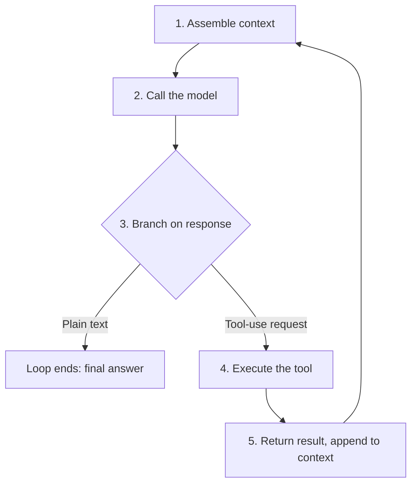

# The Orchestration Loop
{: .no_toc }

*Video duration: 14:16*

If you take one diagram away from the entire CCA-F curriculum, make it this one. Every agentic system you'll be asked to reason about on the exam — a single Claude Code session, a research pipeline, a multi-agent customer-support system — is the same small loop, running at some scale, wrapped in some amount of scaffolding. This lecture takes that loop apart step by step and treats each step as a place where real engineering decisions, real cost, and real failure live.

## The five-step loop, precisely

Stated mechanically, the orchestration loop is:

1. **Assemble context.** The system prompt, conversation history, available tool definitions, and any other relevant material (files, prior results, retrieved documents) are gathered into the input for the next model call. This step is invisible in most diagrams but it's where most of the Context and Prompt layers of this course actually apply — what goes into this bundle, and how it's organized, determines how well the model reasons in the next step.
2. **Call the model.** That assembled context is sent to Claude via a single Messages API request. The model generates a response conditioned entirely on what it was given — it has no access to anything outside this call.
3. **Branch on the response.** The response is either ordinary text (in which case, for a single turn, the loop is done) or one or more **tool-use requests** — structured, schema-conforming instructions specifying which tool to call and with what arguments. If it's tool-use requests, continue.
4. **Execute the requested tool(s).** The surrounding system — the Claude Code harness, an Agent SDK application, or your own orchestration code — actually performs the requested action: reads a file, runs a shell command, queries an API, writes a database row. This is the only step in the loop where anything actually happens outside the model. The model itself **never touches the file system, the network, or a database**; it only ever emits tokens describing what it wants done.
5. **Return the result and repeat.** The output of that execution — success data, an error, a partial result — is appended to the conversation as a tool result message, and the loop returns to step 2. The model now generates its next response with that new information in context, and either requests another tool call or produces a final answer.

Nothing about this is exotic. It's the same next-token-prediction mechanism from LLM fundamentals, called repeatedly, where each call is conditioned on an ever-growing transcript that now includes the consequences of the model's own prior choices. There is no separate planner deciding the whole sequence up front — each decision is made fresh, at each pass through step 2, using only what's currently in context.

## Termination conditions

A loop that runs forever isn't useful, and a well-architected agentic system needs explicit answers to "when does this stop?" There are several distinct termination conditions, and **conflating them is a common source of exam-trap questions**:

- **Natural completion.** The model produces a text response with no tool-use request, signaling it believes the task is done. This is the default, happy-path termination — the model itself decides it has what it needs.
- **Iteration or turn limits.** The orchestrating system caps how many passes through the loop are allowed, regardless of what the model wants to do next. This protects against runaway loops caused by a model that keeps calling tools without making progress — a real failure mode, not a hypothetical one.
- **Token or cost budgets.** Because every pass through the loop is a full model call, and context tends to grow with each iteration, a system can be configured to stop once cumulative token usage or dollar cost crosses a threshold, independent of iteration count.
- **Time-based timeouts.** Wall-clock limits guard against a loop that's technically making progress but too slowly to be useful — a tool call hanging, or a model taking pathologically long generating each response.
- **External signals.** A human-in-the-loop approval gate, a cancellation request, or an upstream system deciding the goal is no longer relevant can all halt the loop from outside, regardless of what step it's on.
- **Error escalation.** A tool failing in a way the model cannot recover from (a permissions error, a malformed request the harness rejects, a downstream service that's down) can be configured to stop the loop and surface the failure rather than let the model retry indefinitely.

| Termination condition | What triggers it | Example |
|---|---|---|
| Natural completion | Model returns text with no tool-use request | The model states its final answer |
| Iteration/turn limit | Orchestrating system caps loop passes | A hard cap of 25 iterations |
| Token/cost budget | Cumulative usage crosses a threshold | The loop halts once spend passes $2 |
| Time-based timeout | A wall-clock limit is exceeded | A hanging tool call times out |
| External signal | A human or upstream system intervenes | An approval gate declines, or the task is cancelled |
| Error escalation | An unrecoverable tool failure occurs | A permissions error is surfaced instead of retried |

Good architecture treats these as layered defenses, not alternatives. A production agentic system typically has all of them active simultaneously: the model's own judgment is the primary mechanism, but iteration caps, budgets, and timeouts are the backstops that fire when that judgment fails or when the model is simply wrong about how close it is to done.

{: .important }
> Termination conditions are layered defenses, not interchangeable alternatives. A production agentic system runs natural completion, iteration caps, budgets, timeouts, external signals, and error escalation simultaneously — relying on the model's own judgment alone to know when to stop is not sufficient by itself.

## Why this loop is the fundamental unit of "agentic" behavior

It's worth being explicit about why this loop — and specifically the presence of real actions with real observations feeding back into the next generation — is what separates "agentic" from "not agentic," rather than some vaguer notion of intelligence or sophistication.

A single Messages API call, even one that produces a long, well-reasoned answer, is not agentic: it's one pass through step 2 with nothing before or after it. A pipeline that calls the model once to classify a support ticket, then routes it based on a fixed if/else structure, is not agentic either — the LLM is a component in the pipeline, but there's no loop where the model's own output shapes what the model itself sees next. What makes something agentic is specifically that steps 3 through 5 exist and feed back into step 1 of the next iteration: the model's decision changes what it observes, which changes its next decision. That closed loop — decide, act, observe, decide again — is the entire architectural signature of "agentic," and it is the thing the exam expects you to identify in a system description, independent of how impressive or autonomous the system looks on the surface.

This also clarifies why the loop, not the model, is the right unit of analysis for architecture questions. The same underlying model (say, Claude) can be the "brain" of a one-shot classifier, a bounded three-step workflow, or a fifty-iteration autonomous coding session. What differs across those three isn't the model's capability — it's how the loop around it is built: what tools are exposed, what triggers termination, and how much of steps 1 through 5 the surrounding system controls versus leaves to the model's own judgment.

## Architectural implications: latency

Every additional pass through the loop adds, at minimum, one full model round trip — and typically more, once you account for tool execution time. A single tool call that hits an external API, runs a test suite, or performs a large file search can easily dominate the wall-clock time of an iteration, meaning the model's own generation time is often not the bottleneck. This has a direct design consequence: minimizing the number of loop iterations required to complete a task, and choosing tools that resolve in reasonable time, matters as much for user-perceived latency as model choice does. Architectures that let a model "explore" with many small, cheap tool calls will feel slow even if each individual call is fast, purely from iteration count; architectures that give the model fewer, higher-leverage tools that do more per call tend to finish in fewer iterations at the cost of more complex tool implementations. This tradeoff — call granularity versus iteration count — reappears throughout the Tool layer.

## Architectural implications: cost

Cost in an agentic system is not the cost of one model call; it's the cost of every model call across every iteration of the loop, and — critically — context tends to grow monotonically as the loop runs, since each tool result gets appended to the transcript that's re-sent on the next call. A ten-iteration loop where context grows by a few thousand tokens per turn is not paying for ten calls at a fixed price — it's paying for ten calls at increasing prices, because most API pricing is a function of the tokens actually processed on each call, and each call resends the accumulated history. This is precisely why context management (covered in depth in the Context layer) is not a separate housekeeping concern from the orchestration loop — it is a direct lever on the cost of running that loop, and letting a loop run for many iterations without any summarization or trimming strategy is one of the most common cost blowouts in agentic system design.

## Architectural implications: failure modes at each step

Each of the five steps has its own characteristic way of breaking, and being able to name where a given failure originates is a practical exam skill:

- **Context assembly (step 1)** fails when the wrong information — or too much information — is gathered: stale files, missing tool definitions, an oversized history crowding out what's actually relevant to the current step.
- **The model call (step 2)** fails through ordinary LLM failure modes: hallucinated details, misreading the task, or — specific to this loop — deciding to call a tool that doesn't apply, or deciding to stop when it shouldn't have.
- **The branch (step 3)** fails when the harness misparses the model's output — treating a tool-use request as plain text, or vice versa — which is largely mitigated by the structured tool-calling formats covered in the next lecture.
- **Tool execution (step 4)** fails the way any real system call fails: permission denials, network errors, timeouts, or a tool that "succeeds" but returns data that's wrong or misleading for reasons the model has no way to detect from the result alone.
- **Result propagation (step 5)** fails when the result returned to the model is malformed, truncated, or so large that it crowds out everything else in context — a problem substantial enough to get its own short lecture later in this module.

Because a single loop typically runs many iterations, these failures compound: an agent that has a five percent chance of a meaningful error at each step has a much higher chance of at least one error somewhere across a fifteen-step task. This is the same compounding-error logic from LLM fundamentals, now applied specifically to the orchestration loop rather than to a single generation — and it's the core justification for the safeguarding patterns (checkpoints, approval gates, bounded blast radius) covered later in this module.

## Why it matters for the exam

Expect scenario questions that describe a system and ask you to identify which step of the loop is responsible for an observed problem — slow responses (step 4, tool latency, or too many iterations), ballooning cost (step 1/5, unmanaged context growth), or an agent that "goes off the rails" (step 2, a bad decision compounding across iterations with no termination condition catching it). Being able to map a symptom back to a specific step, rather than describing the loop only in the abstract, is exactly the kind of precision the CCA-F rewards.

<!-- prevnext:start -->

---

| [&larr; Previous: Module Intro](01-module-intro) | [Next: Just Like a Server &rarr;](03-just-like-a-server) |
|:---|---:|

<!-- prevnext:end -->
