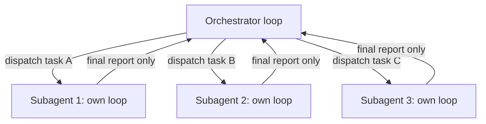

# Multi-Agent Coordination
{: .no_toc }

*Video duration: 17:52*

Everything so far in this module has described a single loop: one model, deciding its own next action, iteration after iteration. Most real systems eventually outgrow that shape — not because a single agent becomes incapable, but because a single, ever-growing context becomes the wrong container for the work. Multi-agent coordination is the architectural response: splitting work across more than one loop, each with its own context, and defining how those loops communicate and combine their results.

## Why split work across agents at all

Before cataloguing patterns, it's worth being precise about the actual motivations for going multi-agent, because "add more agents" is not automatically an improvement, and the exam will test whether you can distinguish a genuine multi-agent use case from one that's better served by a single agent with more tools or a longer context window.

The legitimate reasons to split work across agents are:

- **Context isolation.** A task that requires reading enormous amounts of intermediate material — crawling dozens of files, running many exploratory searches — but only needs to report a small, distilled result upward benefits from doing that exploration in a separate context that never has to be carried by the parent. The parent's context stays clean; the exploration's noise is contained and discarded once the subagent reports back.
- **Parallelism.** Independent subtasks with no data dependency between them — reviewing three unrelated files, researching three unrelated topics — can run concurrently as separate agents rather than sequentially as one agent's growing to-do list, reducing wall-clock time.
- **Specialization.** Different subtasks may benefit from different tool sets, different system prompts, or even different models — a fast, cheap model for simple classification steps and a stronger model for the parts that need real judgment. A single monolithic agent configuration is a compromise across all of its subtasks; separate agents can each be configured for exactly their piece.
- **Role separation for reliability.** Having one agent produce work and a distinct agent review it (with a different prompt, and ideally without the first agent's exploratory noise in context) catches a class of errors that a single agent reviewing its own immediately-preceding work tends to miss, because it isn't reasoning from a fresh, unbiased context.

None of these reasons is "the task is hard" by itself. A long, hard, but fundamentally linear task — where each step genuinely depends on the full context of everything before it — is usually still best served by one agent with a well-managed context, not by splitting it arbitrarily. Multi-agent systems introduce real overhead (covered below), and that overhead has to be justified by one of the actual benefits above, not by an intuition that more agents feels more sophisticated.

{: .important }
> "The task is hard" is not, by itself, a reason to go multi-agent. A tightly coupled, fundamentally linear task is usually still best served by one agent with well-managed context — splitting it arbitrarily only adds the coordination overhead covered below without any of the four legitimate benefits.

## The orchestrator/subagent hierarchy

The dominant pattern in practice — and the one Claude Code itself implements with its subagent feature — is a hierarchy: one **orchestrator** (or "parent," or "lead") agent holds the overall task and decides how to decompose it, and one or more **subagents** are invoked to handle discrete pieces of that decomposition, each running its own independent orchestration loop, each with its own context, and each reporting a result back to the orchestrator when done.

Architecturally, this is not a fundamentally new mechanism — it's the same tool-use pattern from the previous lecture, one level up. From the orchestrator's point of view, "delegate this research task to a subagent" is a structured tool call like any other: it has a name, it takes arguments (typically a task description and some scoping information), and it returns a result that gets appended to the orchestrator's context as a tool result. The orchestrator doesn't see the subagent's internal loop — its tool calls, its intermediate reasoning, its own context accumulation — any of that. It sees only the final, distilled output the subagent chooses to report. This is precisely the context-isolation benefit described above, made concrete: the subagent can burn through tens of thousands of tokens of exploration internally, and none of that pollutes the orchestrator's context — only the summary does.

This hierarchy can, in principle, nest: a subagent can itself act as an orchestrator for further subagents. In practice, most production systems keep this shallow — one or two levels — because coordination overhead and failure surface (discussed below) compound with depth, and because a deeply nested hierarchy makes it genuinely hard for a human to reason about what's happening at any given moment, which cuts against the observability and safeguarding goals covered later in this module.

## Parallel versus sequential coordination

Once you've decided to delegate to more than one subagent, a second architectural decision follows immediately: do those subagents run **in parallel** or **in sequence**?

**Sequential coordination** runs subagents one after another, where a later subagent's task, or its input, depends on an earlier subagent's output. A "research, then write, then fact-check" pipeline is sequential by necessity — the writer needs the researcher's findings, and the fact-checker needs the writer's draft. Sequential coordination is conceptually simple (it's just the orchestrator making one delegation tool call after another, incorporating each result before deciding the next step) but pays the full latency cost of each subagent's own loop, one after another, with no overlap.

**Parallel coordination** runs multiple subagents concurrently, when their subtasks are independent of each other — reviewing three separate files for style issues, or gathering pricing data from three unrelated sources. This can substantially reduce wall-clock time, since the subagents' individual loops overlap rather than stack. The cost is that the orchestrator now has to reconcile multiple results that arrive without any ordering guarantee, and has to handle the case where one of several parallel subagents fails, is slow, or returns a result that conflicts with another's — problems that simply don't arise in a strictly sequential pipeline, where each step's output is validated (implicitly, by the next step consuming it) before the next one starts.

| | Sequential coordination | Parallel coordination |
|---|---|---|
| Fits | A genuine data dependency between subtasks | Independent subtasks with no data dependency |
| Latency | Full cost of each subagent's loop, stacked | Reduced wall-clock time, loops overlap |
| Reconciliation | Simple — each step validates the last before proceeding | Harder — results arrive with no ordering guarantee |
| Main risk | Stacked latency | Conflicting results, hidden dependencies missed |

A useful exam-relevant heuristic: default to sequential when there's a genuine data dependency between subtasks, and reach for parallel only when the subtasks are truly independent and the latency savings are worth the added reconciliation complexity. Reflexively parallelizing everything "for speed" without checking for hidden dependencies is a common design mistake, and one that produces subtly wrong results rather than obvious failures — a subagent working from a stale or incomplete view of what its sibling subagents are also touching.

## When to split work across agents versus keep it in one

Given the motivations above, a practical decision rule looks like this. Keep the work in a single agent when:

- The steps are tightly coupled and each genuinely needs the full accumulated context of the steps before it.
- The total context required, even including intermediate exploration, comfortably fits within a well-managed context window.
- There's no meaningful opportunity for parallelism — the work is inherently linear.
- The overhead of defining a subagent's scope, tools, and reporting format would cost more engineering and runtime complexity than it saves.

Split work across agents when:

- A subtask requires heavy exploration whose *volume* would be disproportionate to its *relevance* to the overall task — you want the noise contained.
- Independent subtasks exist and can genuinely run concurrently.
- Different subtasks call for meaningfully different tool access, instructions, or model capability, such that a one-size-fits-all agent configuration would be a compromise for all of them.
- You want a structurally independent reviewer — a second perspective not anchored to the first agent's own context and potential blind spots.

This is a judgment call, not a formula, and the exam is more likely to present a scenario and ask you to justify a choice than to ask for the rule verbatim — so practice reasoning through the tradeoffs above against a described task rather than memorizing the bullet points.

## Communication patterns beyond strict hierarchy

The orchestrator/subagent hierarchy is the dominant pattern, but it's worth naming the handful of variations you may encounter in system descriptions, since the exam can present a coordination pattern without naming it explicitly.

**Hub-and-spoke** is the hierarchy described above in its purest form: one orchestrator, several subagents, no direct communication between subagents at all — every result flows back through the hub. This is the easiest pattern to reason about and safeguard, because there's exactly one place (the orchestrator) where reconciliation and validation happen.

**Pipeline** coordination — sequential coordination, essentially, given a name of its own — chains agents so each one's output is the next one's input, with no orchestrator holding the full picture at once beyond passing state along. This trades the orchestrator's reconciliation burden for a rigid ordering: a pipeline is simple to reason about but brittle if a step's output doesn't match the next step's expected input format.

**Shared-state (or "blackboard") coordination** has multiple agents reading from and writing to a common piece of persisted state — a shared document, a shared task list, a shared data store — rather than passing results directly to each other through an orchestrator. This pattern shows up in systems where agents work somewhat independently but need visibility into each other's progress, such as several agents each updating their portion of a shared project plan. It buys flexibility at a real cost: because there's no single point reconciling updates, conflicting writes and race conditions become the system's problem to solve explicitly, in a way the hub-and-spoke pattern avoids by construction.

For most tasks, and for most of what Claude Code's subagent feature is built around, hub-and-spoke is both the simplest and the safest default — it keeps a single point of accountability, makes context isolation and reporting contracts (from the previous lecture) straightforward to enforce, and avoids the race-condition and reconciliation problems that shared-state coordination introduces. Reach for pipeline coordination when the task is genuinely linear. Reach for shared-state coordination only when the coordination need genuinely can't be served by a hub reconciling discrete reports — it's the pattern with the most moving parts to get wrong.

## Coordination overhead

Every one of the benefits above is bought with cost, and being able to name that cost precisely is as testable as naming the benefit.

**Latency overhead.** Spinning up a subagent means, at minimum, one additional orchestration loop's worth of setup and at least one full model round trip, on top of whatever the subagent's own task requires. For simple subtasks, this fixed overhead can dwarf the actual work being delegated — dispatching a subagent to answer a question a single well-placed tool call could have answered directly is a net latency loss, not a gain.

**Cost overhead.** Each subagent runs its own model calls, billed independently, and if the orchestrator's prompt or context is duplicated into every subagent's starting context, that duplication is paid for repeatedly. A five-subagent parallel fan-out isn't one task's worth of tokens — it's the sum of five agents' worth, plus the orchestrator's own overhead for dispatching and reconciling them. This is explored further in the next short lecture on scaling.

**Coordination and reconciliation complexity.** The orchestrator has to define what a "done" report from a subagent looks like, has to handle a subagent that fails, times out, or returns an ambiguous result, and — in parallel coordination specifically — has to reconcile results that may be incomplete, conflicting, or arrive in an order that doesn't match dispatch order. None of this complexity exists in a single-agent loop, where there's exactly one thread of decision-making to reason about.

**Failure attribution.** When a multi-agent system produces a wrong final answer, diagnosing *which* agent introduced the error is harder than diagnosing a single agent's mistake, precisely because the orchestrator by design doesn't see the subagent's internal reasoning — only its final report. If that report is confidently wrong, the orchestrator has no built-in way to detect that beyond whatever validation you've explicitly built in. This is a genuine reliability risk of hierarchy: information loss at each level of delegation is one-directional, and errors can hide inside a subagent's compressed summary just as easily as useful detail can be lost there.

**Emergent inconsistency.** When subagents run with different, independently-assembled contexts (by design — that's the isolation benefit), they can reach different, mutually inconsistent conclusions about overlapping subject matter, in a way a single agent working from one consistent context wouldn't. Reconciling this is squarely the orchestrator's job, and a system that doesn't explicitly plan for it will surface these inconsistencies as confusing, hard-to-reproduce output quality issues.

## Why it matters for the exam

Expect the exam to present a task description and ask whether it warrants a multi-agent architecture, a single agent, or a fixed multi-step workflow (a distinction developed further in the Workflow layer) — and to test whether you can name the specific coordination overhead (latency, cost, reconciliation, failure attribution) that a proposed multi-agent design would introduce. The exam rewards precision here over enthusiasm: correctly identifying that a task does *not* need multiple agents, and explaining why the overhead wouldn't be justified, is just as testable as correctly identifying a case that does.

<!-- prevnext:start -->

---

| [&larr; Previous: Results Polluting the Context?](05-results-polluting-the-context) | [Next: Think of Scaling &rarr;](07-think-of-scaling) |
|:---|---:|

<!-- prevnext:end -->
