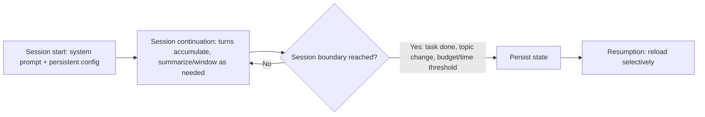

# Session Management
{: .no_toc }

*Video duration: 17:58*

Every lecture so far has zoomed in on a single loop, a single delegation, a single workflow. This one zooms out to the container all of those run inside over time: the **session** — the full, ongoing multi-turn interaction a user or system has with an agent, potentially spanning many orchestration-loop iterations, many tool calls, and, in longer-lived systems, many hours or days. Session management is the discipline of keeping that container coherent, affordable, and useful as it grows — and it's where the "server request-response" analogy from earlier in this module needs one important addition: statelessness per call, but state that persists *somewhere* across calls.

## What a session actually is

Recall the server analogy: each individual model call is stateless, like a single request handler invocation — it knows only what's in the context it was given for that call. A **session** is the accumulated record that makes multi-turn interaction possible at all: the growing transcript of user messages, model responses, tool calls, and tool results that gets reassembled and re-sent as context on every subsequent call. Nothing about the model itself remembers anything between calls; the *session state*, held and managed by the surrounding application (or, in Claude Code's case, the harness), is what creates the illusion of an ongoing, memory-having conversation.

This distinction matters architecturally because it locates responsibility correctly. If a multi-turn conversation seems to "forget" something from ten turns ago, that's not a model memory failure in any literal sense — it's a session management outcome, determined by whatever the surrounding system chose to keep in, or drop from, the context that got re-sent. Session design is, in large part, deciding what stays in that re-sent context as the session grows, and what doesn't.

## Conversation history growth

Left unmanaged, session history grows monotonically: every user turn, every model response, every tool call, and every tool result gets appended, and — because most implementations re-send the full accumulated history on every subsequent call — that growth compounds the same way described in the orchestration loop lecture, except now across an entire multi-turn session rather than within a single task's loop. A session that starts light can, after enough turns, be dominated by token volume it's paying to re-send and re-process on every single call, most of which may no longer be relevant to what the user is currently asking about.

This growth has three concrete costs. **Cost** scales with tokens processed, and a session re-sending an ever-larger history pays more per call as it goes on, even if the actual new content of each turn is small. **Latency** scales similarly — larger inputs take longer to process before the model can begin generating a response. **Quality** can degrade too, not just cost: a context stuffed with turns that are no longer relevant to the current question competes for the model's attention with what actually matters right now, and — as established in the Fundamentals module — worse context tends to produce worse decisions at every subsequent step, whether that's a single generation or every iteration of an ongoing agentic loop running inside the session.

Because of this, unmanaged growth isn't a minor inefficiency to clean up eventually — it's a compounding problem that gets more expensive to fix the longer it's ignored, and good session design treats managing it as a first-class concern from the start rather than a later optimization.

## When and how to summarize or reset context

Two main strategies address history growth, and they're not mutually exclusive — mature systems typically use both, applied at different points.

**Summarization** replaces a portion of the older, verbose transcript with a shorter, distilled representation that preserves what's still relevant while discarding what isn't. This might mean condensing the last twenty turns of a debugging session into a few sentences capturing what was tried and what was learned, or replacing a large tool result that's already been acted on with a one-line note that it happened. Summarization keeps continuity — the session still "knows," in compressed form, what came before — at the cost of some detail loss, and at the cost of the summarization step itself being a real operation with its own risk (a summary that drops something that turns out to matter later is a real failure mode, not a hypothetical one). Good summarization is selective, not uniform: recent turns, and turns that established still-active constraints or decisions, generally deserve to stay closer to full fidelity, while older, resolved, or superseded turns are the best candidates for aggressive compression.

**Resetting** — starting a new session, or explicitly clearing accumulated history — trades continuity for a clean slate: token cost drops back to baseline, and there's no risk of stale, superseded, or irrelevant history crowding the model's attention, but anything not explicitly carried forward is genuinely gone, not just compressed. This is the right move when a session has drifted so far from its original purpose that reconstructing a useful summary would cost nearly as much reasoning as just restating the current goal fresh — or when a task is genuinely complete and a new, unrelated task is starting, where carrying forward the old session's history would only be noise.

A practical middle ground, common in real systems, is a **rolling window plus persistent summary**: keep full fidelity for some recent number of turns, and maintain a running, periodically-updated summary of everything older than that window, so the session never re-sends its entire raw history but also never fully resets useful continuity. This is conceptually similar to how a human keeps a working memory of the last few minutes of a conversation in full detail while retaining only a gist of what was discussed twenty minutes earlier — full detail isn't needed that far back, but the gist still shapes present understanding.

## Multi-turn session lifecycle design

Zooming out further, a session has a lifecycle of its own, distinct from any individual task running inside it, and designing that lifecycle deliberately is a session-management responsibility in its own right.

**Session start** establishes the initial context: system prompt, any persistent instructions or configuration (a CLAUDE.md-style project context, in Claude Code's case), and whatever state, if any, is being restored from a prior session. A session that starts with a bloated or poorly organized initial context is fighting an uphill battle for its entire lifetime, since that baseline context is present on every single call for as long as the session runs.

**Session continuation** is the steady state — turns accumulating, tasks completing, history growing — where the summarization and windowing strategies above are actively doing their job. This is also where a session can host multiple, sequential tasks: a single ongoing session might handle a user's request to fix a bug, then, in the same session, handle an unrelated follow-up request to add a small feature, both sharing the same accumulated context whether or not that's actually beneficial for the second task.

**Session boundaries** are the explicit decision points about where one session ends and a new one begins. Common triggers include a task genuinely completing with no expected follow-up, a user or system explicitly starting a new topic, an elapsed-time threshold suggesting the prior context is stale, or the accumulated cost/token budget for the session crossing a threshold that makes a reset more economical than continued summarization. Systems that never draw this boundary — that let a single session run indefinitely across entirely unrelated tasks — tend to accumulate exactly the kind of stale, irrelevant history that degrades both cost and quality over time, for no benefit, since the tasks weren't actually related enough to need the shared context in the first place.

**Session persistence and resumption** matters for any system where a user might return to a task after a gap — closing a Claude Code session and reopening it later to continue the same piece of work, for instance. This requires the session's state to be durably stored somewhere between the end of one interaction and the start of the next, and requires a decision about how much of that stored state to reload versus re-derive when the session resumes — reloading everything defeats any economizing done during the original session, while reloading too little can leave the resumed session missing context it actually needs to continue coherently.

## Session state versus durable memory

It's worth drawing one more distinction precisely, because it's a common source of confused terminology: a **session** is not the same thing as **durable memory**. A session is the transcript and working state for one ongoing interaction — it can be long, but it's still fundamentally bounded to that interaction, and it's the thing summarization, windowing, and eventual boundaries all apply to. Durable memory is different in kind: information deliberately extracted from a session and persisted somewhere outside it specifically so it can inform *future*, separate sessions — a user's stated preferences, a project's established conventions, a fact learned once that shouldn't need re-discovering every time. Claude Code's CLAUDE.md file is a concrete instance of durable memory: it's not part of any one session's transcript, it's loaded fresh into the initial context of every session, functioning as accumulated knowledge that outlives any individual conversation.

The practical reason to keep these separate is that they call for different management strategies. Session state is disposable by design — it's fine, even correct, for a completed session's raw transcript to eventually be discarded or archived, since its job was to support that one interaction. Durable memory is the opposite: it's specifically the subset of information judged valuable enough to deliberately extract and keep past the session's end, and deciding what qualifies is an active editorial decision, not a byproduct of forgetting to clean up. A system that conflates the two — either treating every session as permanent (accumulating unbounded, largely irrelevant history forever) or discarding everything when a session ends (losing genuinely useful, reusable information every time) — has gotten this distinction wrong in one direction or the other.

| | Session state | Durable memory |
|---|---|---|
| Scope | One ongoing interaction | Persists across future, separate sessions |
| Lifespan | Bounded to that interaction | Deliberately kept past the session's end |
| Disposability | Fine to discard once the session ends | An active editorial decision to retain |
| Example | The transcript of today's debugging conversation | A CLAUDE.md-style project convention |

## Sessions versus the other timelines in this module

It's worth being precise about how a session relates to the other units of time this module has introduced, because the exam will expect you to place events on the right timeline. A single orchestration-loop iteration is the shortest unit — one model call and, if applicable, one tool execution. A task (in the workflow-decomposition sense) might span many loop iterations but is itself bounded — it starts, and it has a defined completion condition. A subagent's own lifespan is bounded similarly — it's dispatched, runs its own loop for some number of iterations, and terminates when it reports back. A session is the longest and least strictly bounded of these: it can contain many tasks, many subagent dispatches, and, if never explicitly closed, can in principle run indefinitely. This nesting — loop iterations inside a task, tasks inside a session — is the organizing structure the next short lecture makes explicit, and it's a common source of exam confusion when a question blurs "the agent forgot" (usually a session-management or context-window issue) with "the task failed" (usually an orchestration-loop or workflow-decomposition issue), when the actual cause sits on a different timeline than the question implies.

## Why it matters for the exam

Expect the exam to test whether you can correctly attribute a described symptom — rising cost over a long conversation, degraded response quality partway through a long session, an agent that seems to have "lost track" of an earlier instruction — to the right session-management cause: unmanaged history growth, a missing summarization strategy, or a session that should have been reset or boundary-drawn but wasn't. You should also be comfortable distinguishing a session-level problem from a single-task or single-loop problem, since they can present with superficially similar symptoms but call for entirely different fixes.

<!-- prevnext:start -->

---

| [&larr; Previous: Back to the Server Analogy...](13-back-to-the-server-analogy) | [Next: Separation of Timelines &rarr;](15-separation-of-timelines) |
|:---|---:|

<!-- prevnext:end -->
