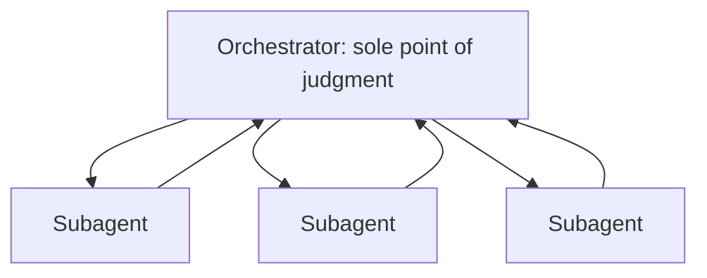
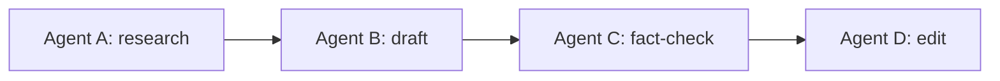
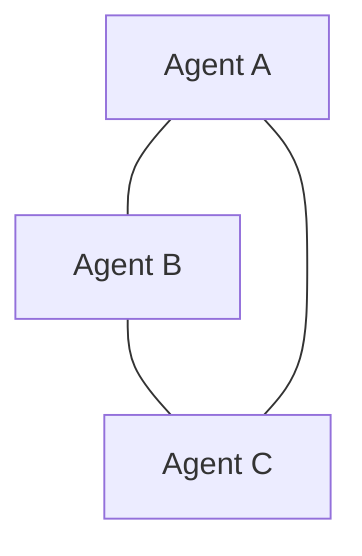

# Orchestration Topologies: Hub-and-Spoke, Pipeline, and Peer-to-Peer
{: .no_toc }

*Video duration: 13:00*

The multi-agent coordination lecture established *why* you'd ever split work across more than one agent, and named hub-and-spoke, pipeline, and shared-state coordination in passing as the shapes that split work can take. This lecture stops in on that naming and treats it as the architectural decision it actually is. Once you've decided a task genuinely warrants more than one agent, the next question isn't "how many agents" — it's "how do they talk to each other, and who's allowed to decide what happens next?" That question has three common answers, and each one trades coordination overhead for a different kind of flexibility, in ways the exam expects you to reason through against a described scenario rather than recite from memory.

## Hub-and-spoke: one place where judgment happens

**Hub-and-spoke** is the orchestrator/subagent hierarchy from subagent instantiation, seen at the level of the whole system rather than one dispatch at a time: a single orchestrating agent holds the task, decides how to decompose it, dispatches subagents to handle discrete pieces, and every subagent's result flows back through that same central point. No subagent talks to another subagent directly — every path in and out of the system runs through the hub.

The defining property of hub-and-spoke is that exactly one component ever has the full picture. The orchestrator is the only agent that sees every subagent's report, the only agent that reconciles conflicting or incomplete results, and the only agent whose judgment determines the next step. This concentration is precisely what makes hub-and-spoke the easiest topology to reason about, safeguard, and debug: if the final output is wrong, there's one place to look for the reconciliation decision that produced it, and if a subagent's report was misleading, the orchestrator's own context is the one place that decision's downstream consequences are visible.

That concentration is also hub-and-spoke's characteristic weakness. The orchestrator is a **single point of failure** in two distinct senses: if the orchestrator's own reasoning goes wrong — it misreads a subagent's report, it reconciles conflicting results poorly, it decomposes the task badly in the first place — nothing downstream catches that, because nothing downstream has enough visibility to. And because every result has to pass through the hub before anything else can happen, the orchestrator's own throughput is a ceiling on how much benefit parallelism among the spokes can actually deliver; a hub reconciling ten subagent reports one at a time is still bottlenecked at the hub, even though the ten subagents themselves ran concurrently.

A support-escalation system is a clean example: one triage agent receives an incoming ticket, dispatches a billing-lookup subagent and an account-history subagent in parallel, waits for both, and decides — itself, as the single point of judgment — whether the ticket needs a human. Nothing about that decision is delegated further; the two subagents never see each other's output, and the triage agent is the only place "what should happen to this ticket" is ever decided.

## Pipeline: sequence as the coordination mechanism

**Pipeline** (or sequential) coordination replaces the hub with an ordering: agent A's output becomes agent B's input, B's output becomes C's input, and so on, with no single agent holding the whole task at once beyond passing state forward. A "research, draft, fact-check, edit" chain is a pipeline by necessity — each stage genuinely needs its predecessor's output and nothing more, and no stage needs a bird's-eye view of the whole task the way a hub-and-spoke orchestrator does.

Pipelines suit problem shapes with a genuine, one-directional data dependency: the writer can't usefully start before the researcher has findings to write from, and the fact-checker can't usefully start before there's a draft to check. Where that dependency is real, a pipeline is often the *simplest* topology available, not merely an alternative to hub-and-spoke — there's no reconciliation logic to write at all, because there's nothing to reconcile. Each stage's job is narrow: consume what the previous stage produced, do one well-scoped thing to it, hand the result to the next stage.

The brittleness this trades for that simplicity shows up at the seams between stages. A pipeline has no central agent checking that stage B's output is actually in the shape stage C expects — if the researcher's findings come back in a format the writer's prompt didn't anticipate, that mismatch propagates directly into a bad draft, and nothing in the topology itself catches it before the fact-checker inherits the problem too. Debugging a pipeline that produced a wrong final answer means walking the chain backward, stage by stage, because there's no hub with a synthesized view of the whole task to consult — only a sequence of increasingly transformed intermediate artifacts, each of which has to be inspected on its own terms.

## Peer-to-peer: coordination without a coordinator

**Peer-to-peer** coordination removes the central hub entirely: agents communicate directly with each other, negotiating, exchanging partial results, or dividing up remaining work among themselves, with no single agent designated to hold the authoritative view or make the final call. Where hub-and-spoke concentrates judgment and pipeline concentrates ordering, peer-to-peer concentrates neither — coordination is an emergent property of however the agents' individual interactions happen to resolve.

This shape earns its overhead in narrower circumstances than the other two. It suits problems where the agents genuinely need to negotiate rather than simply report — several agents each representing a different stakeholder's constraints in scheduling a shared resource, for instance, where no single agent has enough information up front to dictate the answer, and the correct outcome only emerges from the agents actually exchanging positions with each other. It's a poor fit for anything that can be decomposed cleanly in advance, because that's exactly the case hub-and-spoke or pipeline handles more cheaply and more legibly.

The cost is the steepest of the three. With no hub reconciling results and no fixed order constraining who acts when, peer-to-peer coordination reintroduces every problem shared-state coordination raises — race conditions between agents acting on the same information at different times, one agent proceeding on a since-superseded understanding of what another has already decided, and genuine difficulty determining after the fact *why* the system landed where it did, since the emergent negotiation itself is the explanation and there's no single transcript that captures it end to end. Debugging a peer-to-peer system means reconstructing a multi-party conversation rather than reading one orchestrator's reasoning or walking one pipeline's stages — meaningfully harder in both cases, and rarely justified unless the problem's actual shape is a negotiation, not a decomposition.

## Matching topology to problem shape

The decision among these three should follow directly from the shape of the underlying task, **not from an intuition about which topology sounds more sophisticated**. Ask, in order: Does one component need to hold the whole picture and decide what happens next based on several independent inputs? That's hub-and-spoke. Does the task have a genuine, one-directional chain of dependencies where each stage only needs its immediate predecessor's output? That's a pipeline. Does the task require agents to negotiate or reconcile conflicting partial views with no single agent positioned to arbitrate? Only then does peer-to-peer's added complexity pay for itself.

| Topology | Who holds the full picture | Strength | Weakness | Best fit |
|---|---|---|---|---|
| Hub-and-spoke | The orchestrator, always | Easy to reason about, safeguard, debug | Orchestrator is a single point of failure and a throughput ceiling | Most multi-agent tasks; the default |
| Pipeline | No one — state passes forward | Simplest option when it fits; no reconciliation logic | Brittle at stage boundaries; no one checks a mismatched handoff | A genuine, one-directional dependency chain |
| Peer-to-peer | No one — coordination is emergent | Flexible; suits genuine negotiation | Race conditions, hardest to debug, no single transcript | Rare cases requiring real negotiation among agents |

{: .important }
> Peer-to-peer coordination should be reserved for genuine negotiation among agents with no single arbiter — not reached for because a problem "seems complex." Its race conditions and loss of a single reconciliation point make it the most expensive topology to debug, and that cost doesn't shrink just because the task felt sophisticated enough to warrant it.

In practice, hub-and-spoke is the correct default for the overwhelming majority of multi-agent designs — it's what Claude Code's own subagent feature is built around, and it's the topology that best supports the safeguarding patterns (scoped tool access, checkpoints, a single reconciliation point) covered elsewhere in this module. Pipelines are the right call specifically when the dependency is genuinely linear and there's no reconciliation work to do. Peer-to-peer should be reserved for the rare case where the coordination need is itself a negotiation, because its debugging and reconciliation costs are real and don't shrink just because the problem seemed to call for something more distributed.

It's also worth naming that these topologies aren't always mutually exclusive in a single system. A hub-and-spoke orchestrator might dispatch one subagent that internally runs a small pipeline of its own; a pipeline's later stage might itself be a hub coordinating a couple of parallel sub-checks. What matters for the exam is being able to identify, at whatever level a scenario describes, which of the three patterns is governing communication at that level — not insisting a whole system fits exactly one topology end to end.

## Why it matters for the exam

Expect the exam to describe a multi-agent system — sometimes explicitly naming a topology, sometimes just describing how agents pass information — and ask you to identify which of the three patterns is in play, or to evaluate whether a described topology fits the task's actual shape. You should be able to name, for a given scenario, the specific tradeoff a chosen topology makes: hub-and-spoke's single point of failure versus its easy reconciliation, a pipeline's simplicity versus its brittleness at stage boundaries, or peer-to-peer's flexibility versus its debugging cost. Correctly recommending hub-and-spoke or a pipeline over peer-to-peer for a task that doesn't actually require negotiation is exactly the kind of judgment call this domain rewards.

<!-- prevnext:start -->

---

| [&larr; Previous: Lab: AI Workforce Allocation Simulator](16-lab-ai-workforce-allocation-simulator) | [Next: Designing Agent-to-Agent Message Schemas &rarr;](18-designing-agent-to-agent-message-schemas) |
|:---|---:|

<!-- prevnext:end -->
