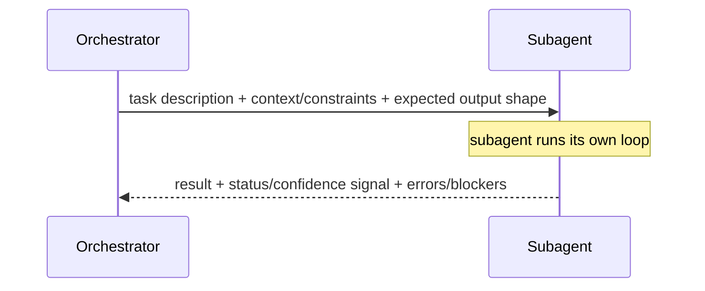

# Designing Agent-to-Agent Message Schemas
{: .no_toc }

*Video duration: 11:00*

Subagent instantiation covered *what* to hand a subagent and *what* to withhold, in prose terms — a task description, curated context, a defined tool set, a reporting format. This lecture treats that handoff the way the Tool Layer treats a tool definition: not as a loose bundle of good intentions, but as a schema that deserves the same design rigor as any other structured interface in the system. An agent-to-agent message is, mechanically, just another payload crossing a boundary — and every argument for treating tool inputs and outputs as structured, well-specified data applies here with equal force, because a subagent reading an underspecified dispatch has exactly the same problem a model reading an underspecified tool schema does: it has to guess, and guesses fail unpredictably.

## Why "just write a good prompt" isn't enough

It's tempting to treat a subagent dispatch as nothing more than a well-written natural-language instruction — after all, the subagent is itself a model, and models are good at parsing prose. But this is precisely the reasoning that leads to loose tool schemas too: a tool *could* accept a single free-text string and have the model figure out the structure internally, and it would work sometimes, and fail silently the rest of the time, for the same reason a vague `input_schema` does. A dispatch that's just a paragraph of prose forces the receiving subagent to infer structure that was never made explicit — what's the actual scope of the task, what's genuinely a constraint versus incidental color, what shape is the caller expecting back — and every one of those inferences is a place a capable model can still land on a reasonable-sounding but wrong answer. Structuring the dispatch as an explicit schema doesn't make the subagent smarter; it removes an entire category of ambiguity the subagent would otherwise have to resolve by guessing, exactly as a well-designed tool schema does for a tool call.

## The outbound message: what the orchestrator sends

A well-designed dispatch schema has three components, each answering a question the receiving subagent would otherwise have to infer.

**Task description.** Not a restatement of the orchestrator's own overall goal, but a specific, bounded statement of what this particular subagent is being asked to produce, phrased so that "done, correctly" is checkable rather than a matter of interpretation. The failure mode here mirrors tool-description ambiguity precisely: a vague task field ("look into the shipping delay") produces the same guessing problem as a vague tool description does for tool selection — the subagent has to decide for itself how broad an investigation is warranted, and different reasonable guesses produce wildly different amounts of work and different final reports.

**Context and constraints.** The curated slice of the orchestrator's own knowledge the subagent actually needs and can't cheaply rediscover — a specific order ID, a prior finding, a hard constraint ("do not contact the customer directly"). This field is where the temptation to over-include is strongest, and where the discipline from subagent instantiation about *what to withhold* applies most directly: every piece of context included here is context the subagent's own loop will carry for its entire run, and irrelevant inclusions cost exactly what an irrelevant tool definition costs — competing for attention at every step, with no offsetting benefit.

**Expected output shape.** What a correct response looks like structurally, not just substantively — a specific set of fields, a pass/fail verdict plus supporting evidence, a word-limited summary. Leaving this unspecified reproduces, at the agent-to-agent level, the exact problem an unspecified tool response schema causes: the caller can't reliably parse or act on a reply whose shape varies dispatch to dispatch, and the subagent, left to its own judgment about what's worth including, tends toward either bloated over-inclusion or terse under-inclusion, neither of which the orchestrator can consistently build on.

## The inbound message: what the subagent returns

The return trip deserves the same rigor, and it's the half of this exchange most often left informal. A well-designed subagent report has three components too.

**The result itself**, in the shape the dispatch's expected-output field specified — not a transcript of how the subagent got there, but the distilled answer the orchestrator actually needs, consistent with the context-pollution discipline covered elsewhere in this module.

**A status or confidence signal**, distinguishing a clean success from a partial, uncertain, or degraded one. This is the agent-to-agent analog of the retryable/non-retryable distinction from tool error design: an orchestrator that receives every subagent report as an undifferentiated "here's what I found" has no principled way to tell a confident, well-supported conclusion from a best-effort guess the subagent itself wasn't sure about, and will treat both with the same weight unless the schema itself forces the subagent to say which one it's returning.

**Errors or blockers encountered**, named explicitly rather than silently absorbed into a vaguer-than-warranted "success." A subagent that hit a permissions wall partway through its task and quietly reported only what it *did* manage to find, without flagging that a chunk of the intended scope was never actually covered, hands the orchestrator a report that looks complete but isn't — a failure mode directly analogous to a tool silently returning partial data with no error signal at all.

## What loose handoffs cost, concretely

The reliability cost of skipping this rigor is the same cost loose tool schemas impose, just harder to see because the "caller" here is a person writing a dispatch prompt in natural language rather than a JSON Schema. An orchestrator that dispatches subagents with inconsistent, ad hoc instructions gets back inconsistently shaped reports, and then has to reconcile those informally too — reintroducing, by hand, exactly the disambiguation work a schema exists to eliminate. Worse, when a multi-agent system produces a subtly wrong final answer, an unstructured handoff gives you nothing to inspect: no expected-shape field to check the report against, no status flag to reveal that a subagent was uncertain, no explicit error field distinguishing "task succeeded" from "task quietly failed partway through." Structured messages aren't bureaucratic overhead layered onto multi-agent design — they're what makes a multi-agent system's failures legible after the fact, the same way a well-designed tool error is what makes a single tool call's failure legible.

## A worked comparison

Consider an orchestrator dispatching a subagent to check whether a customer's refund request is valid. An unstructured dispatch might read: "Look into whether this refund should go through." The subagent has to guess what "look into" means, what counts as sufficient evidence, and how to phrase whatever it finds. A structured dispatch instead specifies a task description ("Determine whether order #48213 is eligible for a refund under the standard 30-day policy"), curated context (the order's purchase date, the refund policy's exact terms, and nothing else about the customer's broader account history, which isn't relevant to this determination), and an expected output shape (a boolean eligibility verdict, the specific policy clause it rests on, and any date discrepancy found).

The subagent's report mirrors that same rigor coming back: not "yes, it's eligible" on its own, but the result (eligible), a confidence signal (high — the purchase date and policy window are unambiguous), and an explicit errors field (empty, nothing blocked the check). If the order record had instead been missing a purchase date, a well-designed report would say so directly — status: blocked, error: "purchase date field absent from order record, cannot verify 30-day window" — rather than quietly reporting "not eligible" and leaving the orchestrator to assume that reflected the policy rather than a data gap. That distinction, cheap to build into the schema and expensive to reconstruct after the fact from a bare verdict, is exactly what structured agent-to-agent messages are for.

## Why it matters for the exam

Expect the exam to present a subagent dispatch or a subagent's report and ask what's missing — an unbounded task description, uncurated context, no defined output shape, or a report with no status signal distinguishing confidence from guesswork. The core insight to carry forward is that agent-to-agent communication is a structured-interface problem, not a prompting problem: the same rigor applied to tool schemas — explicit shape, honest signals about success and failure, no silent ambiguity — applies at the agent boundary too, and the exam expects you to draw that connection rather than treat the two as unrelated topics.

<!-- prevnext:start -->

---

| [&larr; Previous: Orchestration Topologies: Hub-and-Spoke, Pipeline, and Peer-to-Peer](17-orchestration-topologies-hub-and-spoke-pipeline-and-peer-to) | [Next: Handoff Protocols and Continuity Across Agents &rarr;](19-handoff-protocols-and-continuity-across-agents) |
|:---|---:|

<!-- prevnext:end -->
