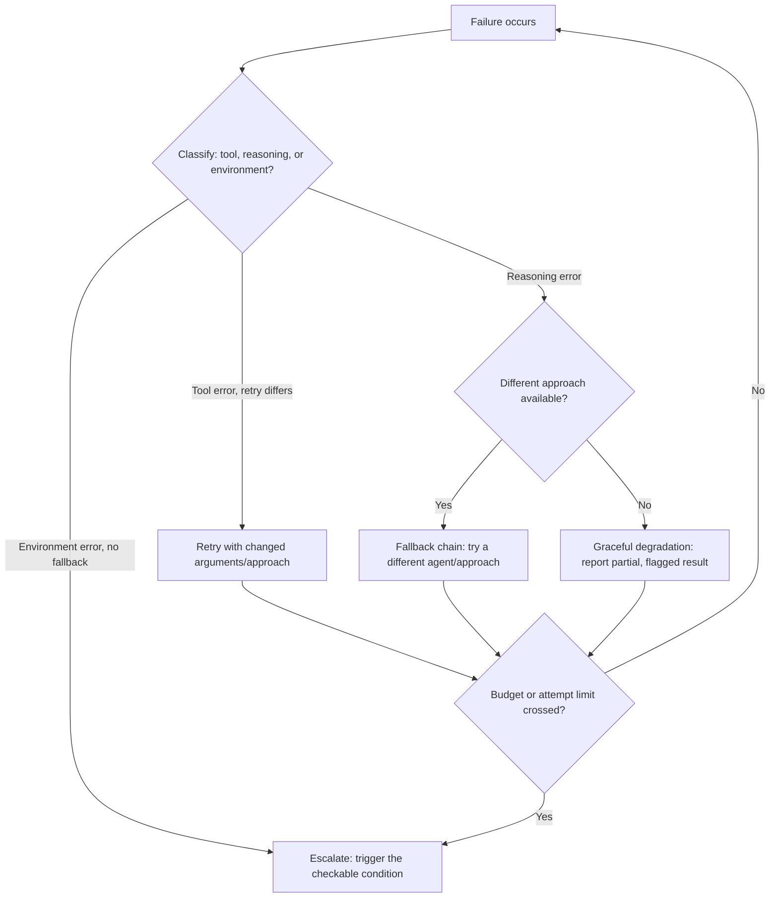

# Retry, Fallback, and Escalation Trigger Design
{: .no_toc }

*Video duration: 14:00*

The Tool Layer's lecture on effective error recovery worked out retry strategy, fallback tools, and escalation at the level of a single tool call inside one agent's loop. Workflow safeguarding worked out checkpoints, approval gates, and blast-radius control at the level of a decomposed workflow's steps. This lecture sits at the intersection and generalizes both: when a *multi-agent* system hits a failure — a subagent's own loop exhausted its recovery options, an orchestrator's chosen approach didn't pan out, a pipeline stage produced something the next stage can't use — what should the surrounding architecture do, and how do you design that decision in advance rather than leaving it to whatever the moment's reasoning happens to produce?

## Three failure classes, not one

The first discipline this lecture asks for is refusing to treat "something failed" as a single undifferentiated category, because the correct response differs sharply depending on *what kind* of failure occurred.

**Tool errors** are failures at the mechanical boundary between an agent and the outside world: a malformed request, a permission denial, a timeout, a resource that doesn't exist. These are the failures effective error recovery already covers in depth, and the retryable/non-retryable signal from error response design is the load-bearing piece of information for deciding what comes next. At the multi-agent level, a tool error inside a subagent's own loop should, in the overwhelming majority of cases, be handled *by that subagent*, using exactly the recovery discipline from the Tool Layer — it shouldn't need to propagate up to the orchestrator at all unless the subagent's own recovery budget is exhausted.

**Reasoning errors** are a different animal entirely: the agent's tools all worked exactly as designed, but the agent drew a wrong conclusion, misread its task, or pursued an approach that was never going to succeed. A subagent that correctly executes every search it runs but keeps searching in the wrong part of a codebase because it misunderstood the bug report has suffered a reasoning error, not a tool error — nothing failed mechanically, and no error message told it to stop, because from the tools' point of view every call succeeded. Reasoning errors are the hardest of the three to detect automatically, precisely because they don't announce themselves the way a tool error does; they usually surface only when a downstream consumer — an orchestrator, a reviewing agent, a human — notices the output doesn't actually solve the stated problem.

**Environment errors** sit outside any individual agent's control entirely: a downstream service is genuinely down for an extended window, a shared resource is locked by something outside the system's own scope, an external dependency has changed in a way nothing in the current task caused. These resemble tool errors in symptom but differ in an important way — no amount of retrying, and no fallback *within* the current system's own tools, resolves them, because the problem isn't in how the task was approached, it's in the environment the task depends on.

| Failure class | What actually went wrong | Who should typically handle it | Does retrying help? |
|---|---|---|---|
| Tool error | Mechanical failure at the agent/world boundary | The subagent itself, using ordinary error recovery | Yes, if something about the retry differs |
| Reasoning error | Tools worked, but the agent drew a wrong conclusion | An orchestrator or reviewer that notices the output is wrong | No — repeating the same approach repeats the mistake |
| Environment error | A failure outside any agent's control | No agent — needs a fallback outside the system or a wait | No — nothing in the task caused it, so nothing in the task fixes it |

Conflating these three is the root of most badly designed multi-agent recovery: a system that responds to a reasoning error the way it would a transient tool error (retry the same subagent with the same instructions) gets the same wrong answer again, because nothing about the retry addresses what actually went wrong. A system that escalates every tool error immediately, without letting a subagent exhaust its own local recovery first, turns ordinary transient hiccups into constant unnecessary human interruptions.

{: .important }
> Retrying a reasoning error with the same subagent and the same instructions will reproduce the same wrong answer — nothing about the attempt changed. A retry only makes sense when something material differs from the prior attempt; otherwise it's motion without any real chance of a different outcome.

## When retrying helps, and when it's theater

Retrying makes sense exactly when something about the next attempt could plausibly differ from the last one — new arguments, more time for a transient condition to clear, a different tool. Retrying is theater — motion without any real chance of a different outcome — when the failure is deterministic: an identical call to an identical tool with identical arguments, against a condition that hasn't changed, will fail identically every time. This is the same retryable/non-retryable logic from the Tool Layer, but the multi-agent version of the mistake is subtler and easier to miss: an orchestrator that re-dispatches the *same subagent*, with the *same task description*, after that subagent already reported failure or an unsatisfying result, is running the identical-retry mistake one level up — nothing about the second dispatch differs from the first, so nothing about the outcome should be expected to either.

A genuinely useful retry at the multi-agent level changes something material: a revised task description that corrects a scoping error the first attempt's failure revealed, additional context that was missing the first time, or a different subagent — one with a different tool set or a different specialization — better suited to what the failure actually turned out to require. Retrying without changing any of these is just as pointless as retrying an unmodified tool call against a non-retryable error, and for the same reason: nothing about the attempt has actually changed, so nothing about its result plausibly will either.

## Fallback chains versus graceful degradation

Beyond retrying the same approach, a mature multi-agent design plans for the case where an entire approach — not just one call within it — doesn't work, and that planning splits into two related but distinct patterns.

A **fallback chain** substitutes a genuinely different approach when the first one fails outright: if a subagent tasked with extracting structured data from a document fails because the document doesn't match the expected format, dispatch a different subagent (or the same one, re-tasked) using a more general, less structured extraction approach instead. This mirrors the Tool Layer's fallback-tool pattern exactly, just applied at the level of an entire agent's approach rather than a single tool choice — the key design question is the same one, too: for a given failure, is there a genuinely different route to a similar outcome already available in the system, or does a failed primary approach simply dead-end?

**Graceful degradation** is a distinct move: rather than substituting a different approach that might fully succeed, deliberately accept and clearly communicate a *partial* or reduced-quality result rather than failing outright or endlessly chasing full success. A research task that can't reach three of ten intended sources within a reasonable budget might report findings from the seven it did reach, explicitly flagged as partial, rather than either silently presenting them as complete or refusing to report anything until all ten are covered. Degradation done well is honest about what was and wasn't achieved — this is exactly the status-signal discipline from agent-to-agent message design, applied to the failure path specifically — and done poorly, it quietly ships a partial result as if it were a complete one, which is arguably worse than an explicit failure, because it removes the receiving agent's or human's ability to even notice something was short.

Choosing between a fallback chain and graceful degradation depends on whether a genuinely different approach is actually available and worth the cost of attempting, versus whether the task's value survives being delivered in reduced form at all — a security audit that only checked seven of ten systems is not "mostly done," it's incomplete in a way that likely still requires the other three, while a competitive research summary covering seven of ten sources may be entirely usable as-is, with the gap simply noted.

## Designing escalation triggers you can actually check

The failure mode effective error recovery already named — a loop that never escalates because no one designed a path for it to — is worse, not better, at the multi-agent level, because a stuck subagent inside a larger system can burn an orchestrator's own turns reasoning about a report that was never going to resolve, and a stuck orchestrator can burn an entire session's budget on a task that needed a human three steps ago. The fix is the same discipline workflow safeguarding applies to risky actions, applied here to the recovery path itself: escalation should be a **concrete, checkable condition**, decided at design time, not a vague instruction to escalate "if something seems wrong."

Checkable escalation triggers look like: a fixed number of failed attempts or fallback exhaustions for a given subtask: a reasoning disagreement between an orchestrator and a subagent's report that a defined validation step actually catches, rather than one the orchestrator has to notice unprompted; a cost or turn budget, tracked explicitly, crossed before the task completed; or a failure classified — per the taxonomy above — as an environment error with no available fallback, where no further attempt by any agent in the system is going to change the outcome. Each of these is checkable by the surrounding harness without requiring any model to exercise subjective judgment about whether things have gone on "long enough" — which is exactly the property that makes an escalation trigger reliable rather than aspirational.

Vague triggers ("escalate if the agent seems stuck") fail for the same reason vague tool descriptions and vague task descriptions fail throughout this module: they hand a judgment call to a system component with no principled basis for making it consistently, and the practical result is a system that escalates too late in the cases that actually needed it and too early, or too often, in cases that didn't. A concrete trigger — three failed attempts, a defined validation check, an explicit budget — is checkable in exactly the way "seems stuck" is not, and that checkability is the entire point.

## Why it matters for the exam

Expect the exam to describe a multi-agent failure and ask you to classify it — tool error, reasoning error, or environment error — and to identify whether the described response (a retry, a fallback, an escalation) actually fits that classification, or whether it's a retry disguised as recovery that changes nothing material about the next attempt. You should also be able to evaluate whether a described escalation condition is concrete and checkable or merely a vague instruction to use judgment, since the distinction between the two is precisely what separates an escalation path that actually fires from one that exists only on paper. This lecture's classifications generalize the Tool Layer's error-recovery reasoning and workflow safeguarding's risk-bounding logic to the level of an entire multi-agent system, and the exam expects you to make that connection rather than treat the three lectures as unrelated.

<!-- prevnext:start -->

---

| [&larr; Previous: Handoff Protocols and Continuity Across Agents](19-handoff-protocols-and-continuity-across-agents) | [Next: Module Outro &rarr;](21-module-outro) |
|:---|---:|

<!-- prevnext:end -->
