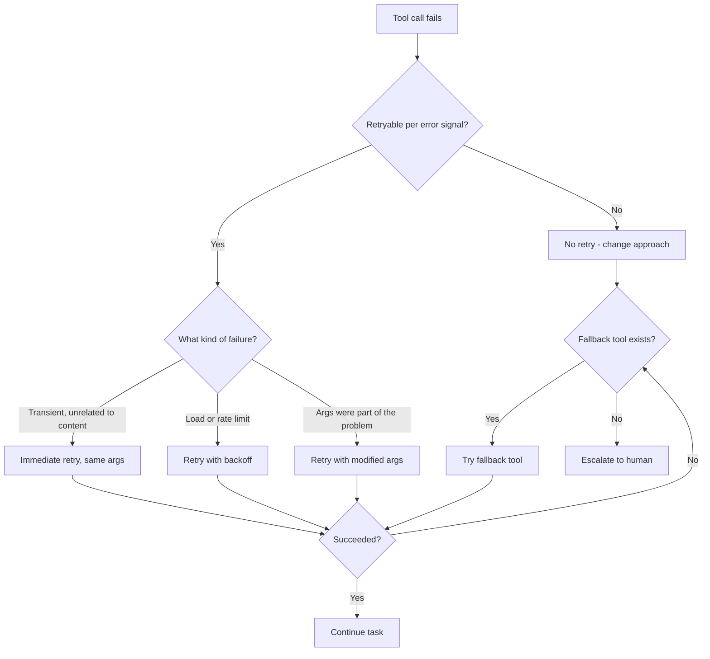

# Effective Error Recovery
{: .no_toc }

*Video duration: 18:46*

A well-designed error response, from the previous lecture, gives the model good information about a failure. This lecture is about what happens next: given that information, what should the model — or the surrounding system — actually *do*? Error recovery is where tool design meets the orchestration loop directly, because recovery isn't a property of a single tool call, it's a property of how the loop as a whole responds when one iteration doesn't go as planned. Good error messages are necessary for good recovery, but they aren't sufficient — you also need a recovery strategy for the loop to follow, and that strategy has to be designed as deliberately as the tools themselves.

## Recovery is a loop-level decision, not just a model-level one

It's tempting to think of error recovery as purely a model reasoning problem: the tool fails, the model reads the error, the model decides what to do next, end of story. In practice, effective recovery is a joint responsibility split between the model's reasoning and decisions the surrounding harness makes about how the loop itself behaves. The model decides *what* to try next, given an error; the harness decides things like how many total attempts are allowed, whether certain retries happen automatically without consuming a full model turn, and when to stop letting the loop continue at all. Both halves matter, and a system that gets only one right is still fragile.

This split matters because leaving 100% of recovery logic to the model's in-context reasoning has real costs. Every retry the model reasons through explicitly consumes a full loop iteration — another model call, another chunk of context, another chance for the model to get confused about what it already tried. Some recovery decisions are mechanical enough that they shouldn't cost a full reasoning turn at all: a request that failed with a clearly transient, retryable error (from the previous lecture's taxonomy) is often better handled by the harness silently retrying once or twice with a brief backoff, before ever surfacing a failure to the model. Reserve the model's reasoning for the cases that actually need judgment — non-retryable failures, ambiguous failures, or failures that persist past the harness's own automatic retry budget.

## Retry strategies

Not all retries are equal, and a recovery strategy needs to distinguish between them rather than treating "try again" as a single undifferentiated behavior.

**Immediate retry, unchanged.** Appropriate only for failures you're confident are purely transient and unrelated to the request's content — a momentary network blip, for instance. Retrying identical arguments after a non-transient failure (a malformed request, a missing resource) is pure waste: nothing about the world changed between attempts, so the outcome won't either. This is the most common failure mode of a *badly designed* recovery loop: a model (or a naive harness) retrying a doomed call several times because nothing in the error told it the retry was pointless. This is precisely why the retryable/non-retryable signal from the previous lecture is load-bearing — without it, the loop has no principled basis for deciding whether to retry at all.

**Retry with backoff.** For failures related to load or rate limits, an immediate retry often just hits the same congestion again. A brief, often increasing delay between attempts (exponential backoff is the standard pattern) gives the underlying condition time to clear. This is usually harness-level logic rather than something the model needs to reason about explicitly turn by turn — the model shouldn't need to decide to "wait a bit and try again," the harness should implement that as a mechanical policy triggered by a specific error signal, freeing the model's reasoning for decisions that actually require judgment.

**Retry with modified arguments.** This is the case that genuinely needs the model's reasoning, and it's the category error-message design in the previous lecture was most oriented toward supporting. A search that returned zero results might be retried with broader terms; a lookup that failed because an ID doesn't exist might be retried using a different tool (search rather than direct lookup) once the model has a corrected identifier. The quality of this kind of retry is directly downstream of how much the error message told the model — a message that names a close-match alternative turns this into a confident, likely-correct single retry; a bare "not found" turns it into a guess.

**No retry — this path is closed.** Some failures should end the current approach entirely rather than prompt any retry: a permission error where no available credential grants access, a business-rule violation where the requested action is fundamentally invalid (refunding an order that was never charged), a resource that's confirmed not to exist after a search already failed to find anything close. Recognizing when *not* to retry is as important a recovery skill as recognizing when to. A model that keeps attempting variations of a fundamentally impossible action isn't being persistent, it's burning turns and budget on a dead end — and a well-designed error response, per the previous lecture, is specifically meant to make this case unambiguous enough that the model doesn't have to discover it empirically through repeated failure.

The full recovery decision, tying retries, fallbacks, and escalation together, looks like this:

## Fallback tools

Beyond retrying the same tool, a mature recovery strategy often has a fallback: a different tool that can accomplish a related goal when the first choice fails outright. This connects directly to the "multiple pathways" principle — a tool set designed with more than one route to a given outcome gives a failed primary path somewhere to fall back to, rather than a dead end.

A concrete pattern: a `get_user_by_id` tool fails because the ID the model has is stale or was mistyped somewhere upstream in the conversation. If the only available tool for finding users is the by-ID lookup, that failure is a dead end — the model has no path forward except guessing at IDs or giving up. If a `search_users` tool also exists, the same failure becomes recoverable: the model can search by name or email instead, using whatever partial information it does have, and arrive at the correct user through a different route entirely. The direct lookup and the search aren't redundant — they're deliberately serving different situations (you know the exact ID; you don't), and the presence of both is precisely what turns a single point of failure into a recoverable one.

Designing fallback pathways deliberately, rather than hoping the model improvises something reasonable from whatever tools happen to exist, is a genuine design responsibility. When you're specifying a tool set, it's worth asking explicitly: *if this tool's primary path fails, is there another tool in this set that gets to a similar outcome by a different route?* If the answer is no for a tool whose failure is plausible and whose task genuinely matters, that's a gap worth closing before the tool set ships, not a problem to discover from a stream of stuck agent sessions in production.

## Escalation to a human

Not every failure should resolve through retries and fallbacks. Some failures should end with the loop stopping and a human being brought in — and recognizing when that's the right move is itself a recovery skill, not a failure of the recovery strategy. Escalation is appropriate when: every retryable and fallback path has been genuinely exhausted and the task still can't proceed; the failure reveals that the model's assumptions about the task were wrong in a way it can't resolve on its own (the resource it was asked to modify doesn't exist at all, suggesting the original request was based on stale information); or the failure sits adjacent to a high-blast-radius action where continuing to attempt variations without oversight is itself the risk, independent of whether one of those variations might eventually succeed.

A well-designed system treats escalation as a first-class outcome of the loop, not as an implicit "give up and print an error" default reached only when nothing else was specified. Concretely, this usually means: a defined budget (a number of failed attempts, or a wall-clock or turn limit) after which the loop stops attempting recovery on its own and instead produces a clear summary for a human — what was attempted, what failed and why, and what decision or information is needed to proceed. This is exactly the kind of checkpoint discussed in the Agentic Layer's workflow-safeguarding material, applied specifically to the failure path rather than the success path: safeguards aren't only about gating risky actions before they happen, they're also about knowing when to stop trying and ask, rather than grinding indefinitely on a task that isn't going to resolve itself.

The failure mode this guards against is a genuinely common one in poorly designed agentic systems: a loop that never escalates, because no one designed an escalation path, simply keeps trying — burning turns, tokens, and often real-world side effects (partial writes, repeated notifications, redundant API calls) — long after a human glancing at the situation would have recognized it as unrecoverable in seconds. The cost of that failure mode compounds directly with how much autonomy and turn budget the surrounding agentic architecture grants, which is exactly why error recovery design in the Tool layer and agentic architecture decisions in the Agentic layer aren't separable concerns in practice, even though this course treats them in separate modules for clarity.

## How the orchestration loop's design shapes what recovery is even possible

It's worth being explicit about a structural point: the recovery options available to an agent are bounded by decisions made when the surrounding loop was designed, not just by how good any individual tool's error message is. A loop with a hard cap of three total iterations gives a model very little room to retry, fall back, and still complete a task, regardless of how well-designed its errors are — the recovery strategy has to fit inside whatever budget the loop actually grants. A loop with no cap at all removes that constraint but reintroduces the risk of the runaway-retry failure mode described above, unless some other mechanism (a distinct escalation trigger, a cost ceiling) is doing that job instead.

Similarly, a loop where tool results are the *only* channel back to the model — no separate side-channel for the harness to inject a policy decision like "you've retried this three times, stop and report back" — puts the entire recovery burden on in-context reasoning, turn after turn, which is both slower and less reliable than a harness that can enforce a recovery policy structurally. Systems that handle this well typically build the retry budget, the backoff policy, and the escalation trigger into the harness itself, so those are guarantees rather than hopes about how the model will choose to behave when it re-reads the same kind of error for the fourth time in a row.

This is also where the earlier point about splitting responsibility between the model and the harness comes back around: a harness that transparently retries genuinely transient failures, escalates definitively unrecoverable ones, and reserves the model's own reasoning for the ambiguous middle ground — modified retries and fallback tool choices — produces a system that recovers faster, more cheaply, and more predictably than one that dumps every failure into the model's context and asks it to figure out the right response from scratch each time, no matter how well the individual error messages are written.

## Putting it together: a recovery decision in practice

Walk through a concrete case to see all of this operate together. An agent calling `update_inventory_count` gets back an error: "Update rejected: inventory count cannot go negative. Requested count: -12 (current: 8, requested delta: -20). This is not retryable with the same delta — check get_order_details for the correct quantity being removed, or use adjust_inventory for a delta-based update instead of set_inventory for an absolute one."

That single error response, well-designed per the previous lecture, hands the recovery loop nearly everything it needs: it's explicitly non-retryable as-is (so no wasted identical retry), it names the likely root cause (a delta miscalculation upstream), and it names two concrete fallback paths (re-check the source data, or use a different tool better suited to the situation). A well-designed harness lets the model reason through exactly one more turn — check the order details, discover the correct quantity, retry with corrected arguments — rather than either blindly retrying the same failed call or escalating a problem that a single well-informed retry could resolve on its own. If that corrected retry also failed, *then* escalation becomes the right call, because at that point persistence has stopped being productive and started being a sign that something about the task's premise, not just its arguments, is wrong.

**Why it matters for the exam:** Expect scenario questions that describe a chain of tool failures and ask what the agent should do next — retry, try a fallback, or escalate — based on details like whether the failure was flagged retryable, whether a fallback tool exists in the set, and how much of the recovery budget has already been spent. You should also be able to identify, given a description of a loop's design, which recovery behaviors that design structurally enables or forecloses, since that connects this lecture back to the orchestration loop itself rather than treating recovery as an isolated tool-level concern.

<!-- prevnext:start -->

---

| [&larr; Previous: Multiple Pathways](05-multiple-pathways) | [Next: Again, Granularity! &rarr;](07-again-granularity) |
|:---|---:|

<!-- prevnext:end -->
