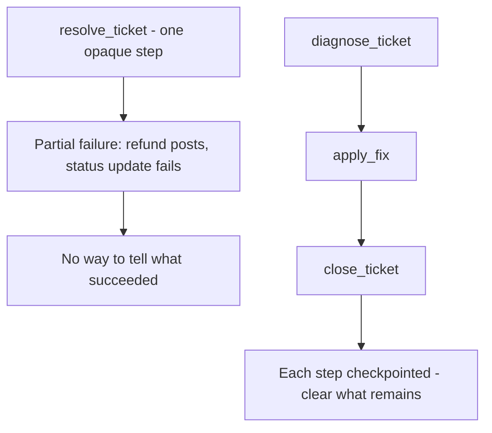

# Again, Granularity!
{: .no_toc }

*Video duration: 0:20*

Granularity keeps resurfacing because it's not a decision you make once at tool-definition time — it echoes through recovery, too. A tool too coarse (one giant "resolve_ticket" action) hides the intermediate options a model would need to recover gracefully from a partial failure; it either fully succeeds or fails opaquely. A tool too fine multiplies the number of calls and decision points needed to get anything done, and each additional call is another place selection or sequencing can go wrong. The same "match granularity to how distinct and how frequently combined the underlying operations are" heuristic from tool definition applies just as much when you're designing for recoverability.

Walk through the coarse failure mode concretely. `resolve_ticket` might internally diagnose the issue, apply a fix, and close the ticket in one opaque step. If the fix half-applies — say a refund posts but the ticket-status update fails — the model gets back a single error for the whole bundled operation, with no way to tell the caller (or itself) which part actually succeeded. **It can't safely retry, because retrying might re-issue the refund; it can't safely skip ahead, because it doesn't know whether closing is still needed.** Decomposing that same capability into `diagnose_ticket`, `apply_fix`, and `close_ticket` gives the model a checkpoint after each step — if `apply_fix` succeeds but `close_ticket` fails, the model (or a human reviewing the transcript) knows exactly what state the system is actually in and what remains to be done.

That said, decomposition has to stop somewhere, and this is where granularity's two failure directions meet in the same design decision. If `apply_fix` itself gets split into `identify_fix`, `validate_fix`, and `execute_fix`, the model now has three additional selection and sequencing points where it could stall or choose wrong, for a distinction that may not correspond to any real intermediate state worth checkpointing. The test carried over from the tool-definition lecture is the same one: split a step out only when it represents a genuinely distinct operation with its own meaningful success or failure state — not just because finer granularity feels safer in the abstract. This is the same tension explored in the multiple-pathways lecture earlier in this module: both principles push toward giving the model more surface area to work with, and both cap out at the same point — added surface area only helps once it maps onto a real distinction the model can act on, and stops helping the moment it's just more choices layered over the same underlying decision.

<!-- prevnext:start -->

---

| [&larr; Previous: Effective Error Recovery](06-effective-error-recovery) | [Next: MCP Architecture & Governance &rarr;](08-mcp-architecture-and-governance) |
|:---|---:|

<!-- prevnext:end -->
