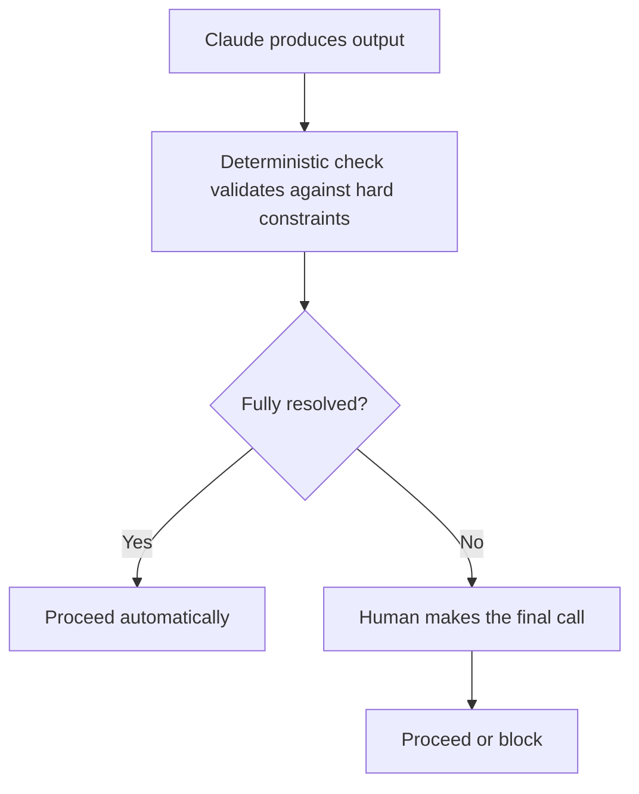

# CI/CD Integration
{: .no_toc }

*Video duration: 15:04*

Every workflow-layer mechanism covered so far in this module — `CLAUDE.md`, Skills, deliberate deterministic/agentic sequencing — exists to make Claude's behavior consistent and governable *within* a session someone deliberately starts. CI/CD integration is where that discipline extends further: it's what turns a Claude-driven step from something a person remembers to run into something the *pipeline itself* runs, every time, on a defined trigger, with the same visibility and accountability as every other step in software delivery.

This distinction — ad hoc versus pipeline-integrated — is the core idea of this lecture, and it's worth being precise about why it matters. A developer who occasionally asks Claude to review their PR in a side chat is getting a genuinely useful second opinion, but that review is invisible to the rest of the team, isn't guaranteed to happen consistently, isn't tied to any enforcement, and leaves no durable record beyond whatever the developer chooses to act on. A code-review step that runs automatically on every PR, posts its findings as a PR comment, and (optionally) blocks merge on certain classes of finding is a fundamentally different kind of thing — it's now a *governed* part of the process, not an optional extra someone might remember to use.

## What Gets Integrated

Three categories of Claude-driven work show up in CI/CD pipelines most often, and each has a slightly different integration shape:

**Automated code review.** A pipeline step that runs on every pull request, gives Claude the diff (and often relevant surrounding context — the changed files, applicable `CLAUDE.md` conventions, the PR description), and has it produce structured findings: correctness concerns, style deviations, missing test coverage, security-relevant patterns. The output is typically posted as PR comments or a summary check, and the pipeline can be configured to treat certain finding categories as blocking (say, anything flagged as a likely security issue) while treating others as advisory (a style suggestion that doesn't block merge).

**Test generation.** A step that, given a diff or a newly-added function, drafts unit tests covering the new logic — often run as a required step before merge is allowed, or as a nightly job that surfaces coverage gaps across the whole codebase. Because generated tests are code that will itself execute in the pipeline, this category has a distinctive safety property worth calling out: the tests can be validated by actually running them, which gives you a deterministic check on agentic output that many other CI-integrated tasks don't get for free.

**Documentation updates.** A step that detects when a merged change alters public API behavior, configuration options, or user-facing functionality, and drafts a corresponding documentation update — either as a follow-up PR for a human to review and merge, or, in higher-trust setups, as a direct commit gated by CI checks like a documentation linter or a broken-link checker.

Each of these follows the same underlying shape: something in the pipeline (a merged commit, an opened PR, a scheduled trigger) invokes Claude with a well-scoped task and enough context to do it well, Claude produces output, and that output is captured, surfaced, and — critically — subject to the same gates as any other pipeline artifact.

## What "Auditable and Automated" Actually Requires

Turning a Claude-driven task into a legitimate CI/CD participant, rather than a novelty automation, requires a handful of properties that plain ad hoc usage doesn't have by default.

**A defined trigger.** The step needs to run on something the pipeline understands natively — a PR opened or updated, a merge to a protected branch, a scheduled cron trigger — not "whenever someone remembers to kick it off." This is what converts a capability into a *process*.

**Scoped, reproducible input.** The pipeline needs to hand Claude a well-defined, deterministic input: this diff, these changed files, this specific commit range — not an ambient, loosely-defined "look at the repo and see what you think." Reproducible input is what makes a run explainable after the fact: if a finding looks wrong three weeks later, you need to be able to reconstruct exactly what Claude saw when it produced that finding.

**Captured, durable output.** Findings, generated tests, or drafted docs need to land somewhere durable and visible — a PR comment, a check run, a committed file, a build artifact — not a transient terminal session that disappears the moment the job ends. This is the difference between a record and a memory.

**Logging of the full interaction, not just the final result.** For genuine auditability, you generally want more than the final output; you want a trace of what was sent, what tools (if any) were invoked, and what came back, stored somewhere retrievable. This is what lets you debug a bad finding, demonstrate compliance with an internal policy, or simply understand *why* a particular test got generated the way it did.

**Explicit gating behavior.** The pipeline needs a defined answer to "what happens if this step's output says something is wrong" — does it block the merge, does it post an advisory comment and let a human decide, does it fail the build outright? Leaving this undefined is itself a decision, and usually the wrong one — it tends to mean findings get silently ignored because nothing in the pipeline actually enforces attention to them.

**Cost and latency awareness.** Unlike a deterministic lint step that finishes in milliseconds, an agentic CI step consumes tokens and takes real (if usually short) wall-clock time. A pipeline design has to decide deliberately which triggers justify that cost — every commit, only PRs, only PRs into protected branches, only nightly — rather than defaulting to "run on everything" and discovering the cost later.

## Review Gates and Where They Belong in the Pipeline

CI/CD integration is also where the Workflow layer's emphasis on validation gates becomes concrete. A gate is a point in the pipeline where output is checked — by a deterministic rule, a human reviewer, or both — before the pipeline is allowed to proceed. Placing gates well is largely about matching the gate's strictness to the cost of a mistake slipping through.

Low-stakes, easily-reversible output (a suggested docstring, an advisory style comment) can reasonably flow through with a soft gate — visible to a human, but not blocking. High-stakes or hard-to-reverse output (anything that touches security-sensitive code, anything that would auto-merge without a human ever reading it, a documentation change to a compliance-relevant page) warrants a hard gate: mandatory human sign-off, or at minimum a deterministic automated check (does the generated test actually pass? does the generated doc change pass a link checker and a schema validator?) before anything proceeds further. This is the same deterministic-step-bounds-agentic-step pattern from the workflow design lecture, applied specifically at pipeline boundaries: let Claude produce the judgment call, but don't let that judgment call take effect unchecked.

A common, well-tested pattern is what's sometimes called a "two-key" structure for the highest-stakes CI steps: Claude produces output, a separate deterministic check validates it against hard constraints, and a human makes the final call on anything the deterministic check doesn't fully resolve. No single point in that chain — not Claude's judgment alone, not the deterministic check alone — is trusted to be sufficient by itself.

## CI Steps vs. CD Steps

It's worth separating the two halves of "CI/CD," because Claude-driven work tends to cluster differently across them and the exam sometimes tests that distinction directly. **Continuous integration** steps run against every proposed change, before it merges — this is where automated code review, test generation, and pre-merge documentation drafting mostly live. Their job is to catch problems and produce artifacts *before* anything ships, and a failure here is cheap: it blocks a merge, not a running system.

**Continuous deployment** steps run after code has already merged, as part of getting a change into a real environment — staging, then production. Claude-driven work shows up here too, but the stakes and the required safeguards look different. A Claude-generated release note or changelog entry that gets attached to a deployment is a CD-stage task. A step that decides whether a canary deployment's error rates look healthy enough to proceed to full rollout is a CD-stage task with real consequences if it gets the judgment wrong — which is exactly why that kind of decision is usually better left to a deterministic threshold check (error rate under X%, latency under Y ms) than to an agentic judgment call, even though a model could plausibly reason its way to a similar-sounding answer. The general principle from workflow design — deterministic where the input fully specifies the correct answer, agentic where genuine judgment is required — applies just as much to CD gating decisions as it does to a single pipeline step.

This split also affects how failures should be handled. A CI-stage failure should block a merge and stop there; the cost of catching it is low and the blast radius is contained to one PR. A CD-stage failure needs an actual rollback path — the ability to revert a bad deployment quickly — because by definition something has already started running somewhere real. A Claude-driven CD step that lacks a rollback path if its output turns out to be wrong (a bad auto-generated config change, a mis-scoped feature flag) is a materially bigger risk than the equivalent mistake at the CI stage, and pipeline design should treat it that way.

## Staged Rollout for Claude-Driven Pipeline Steps

Because agentic CI/CD steps are new enough that teams often don't have years of track record with them the way they do with, say, a linter, it's common practice to roll them out the same way you'd roll out any other risky pipeline change: start advisory-only (post findings, block nothing) for a trial period, build confidence in the false-positive and false-negative rate, and only promote the step to a blocking gate once its reliability is actually established on real traffic. This mirrors the canary-deployment idea applied to the pipeline's own tooling rather than to application code — and it's a useful pattern to recognize on the exam, because a question that describes a *newly introduced* Claude-driven CI step defaulting straight to a hard blocking gate on day one is usually describing a design mistake, not a best practice.

## Why This Belongs in the Workflow Layer

It's worth being explicit about why CI/CD integration sits in this module rather than, say, the Tool layer or the Agentic layer. The tools Claude uses inside a CI-integrated step (reading a diff, running a linter, posting a comment) are Tool-layer concerns; whether an individual CI step is itself agentic or deterministic is a workflow-design question addressed in the previous lecture. What's specifically Workflow-layer about *integration* is the surrounding structure: the trigger, the sequencing relative to other pipeline steps, the gating logic, and the fact that all of this is configured once, as pipeline-as-code, and then applies automatically and consistently to every future run — the exact same "automatic, persistent, applies without anyone re-invoking it" property that made `CLAUDE.md` a workflow-layer concept in the first place, just expressed at the level of an entire delivery pipeline instead of a single session.

**Why it matters for the exam:** Expect questions that describe a Claude-driven capability being used informally (a developer manually pasting a diff into a chat for review) and ask what's missing to make it a legitimate CI/CD-integrated process — the answer usually touches triggers, reproducible input, durable output, and defined gating, not just "make it run automatically." Also expect questions that ask you to place a gate: given a described output's stakes and reversibility, should it be advisory, blocking, or blocking-plus-human-review? The reasoning is consistent with the deterministic-bounds-agentic pattern from workflow design — apply it here at the pipeline level rather than the single-step level.

<!-- prevnext:start -->

---

| [&larr; Previous: These Are Local!](07-these-are-local) | [Next: Just Another Good, Old Operation &rarr;](09-just-another-good-old-operation) |
|:---|---:|

<!-- prevnext:end -->
