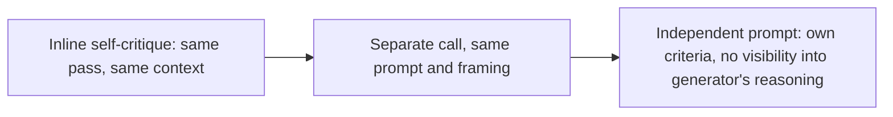

# Independent & Multi-Pass Review
{: .no_toc }

*Read duration: 16:07*

The quality-and-feedback lecture introduced self-checking as a way to catch bad output before it propagates. This lecture pushes on the weakest point of that idea: a model checking its own work, within the same pass, is still fundamentally the same reasoning process examining its own conclusions. If that reasoning process made an error rooted in a misunderstanding of the task, a flawed assumption about the input, or a blind spot in how it interpreted an ambiguous instruction, an inline self-critique performed by that same process, in the same context, with the same momentum, is unlikely to catch it — because **the thing doing the checking shares the exact same blind spot as the thing that produced the error.** This is the "grading its own homework" problem, and the fix is architectural: split generation and review into genuinely **independent passes**.

## What Makes a Review Pass Independent

Independence is a matter of degree, and understanding the spectrum matters more than treating it as binary. At the weak end, inline self-critique — "draft your answer, then review it" within a single generation — offers essentially no independence, because the review inherits every assumption and every piece of context the draft was built on, in the same continuous stream of reasoning. A step up from that is a separate model call that receives the completed draft and is asked to review it, but is still given the same system prompt, the same framing, and the same instructions the original generation used — this is meaningfully better, because it at least breaks the continuous reasoning chain and forces a fresh look, but it still risks the reviewer inheriting the same interpretive frame that produced the original error, since it's essentially the same prompt looking at its own output.

True independence goes further: a review pass with its own distinct prompt, often written by someone other than the author of the generation prompt, that doesn't see the generation prompt's instructions or reasoning at all — only the input and the output to be evaluated, plus its own separate criteria for what "good" looks like. This is the closest architectural analog to how independent code review works in software engineering: a reviewer who wasn't involved in writing the code, working from the code itself and a shared understanding of quality standards, not from the author's internal reasoning about why they made each choice. The reviewer catches things the author's own reasoning was structurally unable to catch, precisely because the reviewer isn't carrying the same assumptions into the evaluation.

A particularly effective version of this independence is giving the review pass a genuinely different vantage point on the task — not just a different prompt, but a different framing of what's being checked. If the generation prompt was framed as "produce a helpful response to this customer," an independent review prompt framed as "you are a strict quality auditor; find every way this response could go wrong" will surface different issues than a review prompt that's just a softer echo of the original task, because it's actively looking for problems rather than confirming a job well done.

## Why a Pass Shouldn't Grade Its Own Homework

The underlying reason this matters is that errors in language model output are frequently not random noise — they're systematic, arising from a specific way the model interpreted an ambiguous instruction, weighted conflicting priorities, or filled a gap in underspecified context. A systematic error, by definition, will tend to recur if the same reasoning process is asked to evaluate its own output using the same interpretive lens that produced the error in the first place. If a model consistently misreads "urgent" as "contains a dollar amount" — echoing the incidental-correlation problem from the few-shot lecture — asking that same reasoning to double check its own urgency classification won't surface the problem, because the flawed definition of "urgent" is baked into both the generation and the "independent" check alike.

An independent reviewer, working from its own separate framing and its own separate criteria, doesn't necessarily share that same systematic bias — and even when it might, giving it an explicitly different vantage point (a rubric-driven audit rather than a repeat of the generation task) makes it much less likely to reproduce the identical blind spot. This is precisely the same reasoning that justifies independent code review, independent audits in finance, and double-blind review in research: any single process, however careful, has systematic blind spots that are invisible to the process itself but visible from a genuinely different vantage point. The value of independence isn't that a second pass is smarter than the first — it's that it's differently positioned to catch what the first pass structurally cannot see about its own output.

## Designing an Independent Reviewer Prompt

A well-built reviewer prompt has a few consistent characteristics that distinguish it from a rehash of the generation prompt with "please check this" appended.

**It receives only what a reviewer should have.** The reviewer prompt should generally see the input and the output being evaluated, plus the criteria it's checking against — not the generation prompt's internal reasoning, and often not even the generation prompt's exact instructions verbatim. This forces the review to be genuinely output-focused: does this output hold up against the standard, independent of whatever reasoning produced it? A reviewer that's handed the generator's full chain of reasoning tends to evaluate the *reasoning* as plausible rather than independently verifying the *output* against ground truth or explicit criteria, which reintroduces exactly the inherited-assumption problem independence is meant to solve.

**It has its own explicit criteria.** Just as generation benefits from explicit success criteria, review benefits from an explicit rubric of its own — often the same rubric discussed in the quality-and-feedback lecture, but now applied by a process with no stake in having produced the thing being judged. A reviewer prompt that just says "is this good?" is exactly as vague and exactly as unreliable as a generation prompt that says "write something good" — the same discipline about explicit, checkable criteria applies on both sides of the split.

**It's adversarial in framing, not sycophantic.** A reviewer prompt that's gently framed — "does this look okay?" — tends to produce agreeable, low-value confirmations, because models (like people asked to review a colleague's work in a low-stakes, friendly framing) tend toward leniency absent an explicit mandate to be critical. Framing the reviewer's job explicitly as hunting for problems — "identify every way this output fails to meet the stated criteria; do not comment on things that are fine" — produces meaningfully more useful, more critical output than a softer framing, and is one of the highest-leverage single changes you can make to a reviewer prompt.

{: .important }
> A softly framed reviewer prompt ("does this look okay?") reliably produces agreeable, low-value confirmations. Always give a reviewer an explicit adversarial mandate — instructed to hunt for problems, not confirm a job well done — or the "independent" pass adds cost without adding real scrutiny.

**It produces a structured, actionable verdict.** Consistent with the structured-output discipline from earlier in this module, a reviewer's output is far more useful to your system when it's a parseable verdict — pass/fail per criterion, a list of specific issues with enough detail to act on — than a paragraph of prose a human has to re-read and interpret before anything can happen next. This is what lets an independent review pass actually gate a pipeline programmatically, rather than just producing commentary nobody structurally consumes.

## When Multiple Passes Are Worth the Cost

Every additional pass is an additional model call, and the honest accounting includes added latency, added token cost, and added engineering complexity — a second prompt to write, test, version, and maintain alongside the first. None of that is free, and the decision to add a genuinely independent review pass should be made the same way the quality-and-feedback lecture recommended: weigh the cost of the extra pass against the expected cost of an undetected error reaching production.

Multi-pass review earns its cost clearly in a few recurring situations. When the output is high-stakes and hard to reverse once it leaves the system — a customer-facing communication, a financial figure that feeds a report, a piece of generated code that will be merged without further human review — the cost of a miss is high enough that a second, independent pass is cheap insurance by comparison. When the task has a known systematic failure mode — a specific kind of error the team has already seen recur — an independent review pass targeted specifically at that failure mode is often far more cost-effective than trying to eliminate the failure mode entirely through generation-prompt tuning alone, since some errors are more efficiently caught after the fact than prevented before it. And when a pipeline has no human in the loop at all — fully automated, unattended — independent review is often the only quality gate that exists, which raises its value considerably compared to a pipeline where a human already reviews output before it's used.

Conversely, multi-pass review is often not worth it for low-stakes, high-volume, easily-reversible tasks, where a human downstream can absorb and correct the occasional miss more cheaply than a system-wide second pass could prevent it, and where the sheer per-item cost of doubling every model call doesn't pay for itself against a low, easily-tolerated error rate. As with every other technique in this module, the right call isn't "always add more review" — it's matching the level of independent verification to what's actually at stake if a bad output slips through unexamined.

## A Worked Example

Return to the invoice-extraction system from the structured-output lecture. Suppose the generation prompt occasionally misreads a handwritten annotation on a scanned invoice, extracting a plausible-looking but wrong dollar figure — the output is perfectly well-formed JSON, passes schema validation cleanly, and looks correct to anyone glancing at it, but the number itself is simply wrong. Schema enforcement, by design, cannot catch this, because the schema only guarantees shape, not correctness — a wrong number is just as schema-valid as a right one.

An inline self-critique added to the same generation pass — "review your extraction before finalizing it" — is weak protection here, because the same misreading of the handwriting that produced the wrong number in the first place is still sitting in the model's context when it "reviews" its own work; there's no new information available to the review step that would let it notice the original misread. An independent reviewer pass, by contrast, can be given a genuinely different task: not "did you extract correctly" but "given this extracted invoice record and the original document, does the extracted `unit_price` plausibly match this vendor's typical pricing, and does the total match the sum of the line items?" That's a different, checkable question — and because the reviewer isn't anchored to the generator's original reading of the handwriting, it has a real chance of catching a total that doesn't sum correctly, or a unit price wildly outside the vendor's historical range, even without being able to re-read the handwriting itself.

Given the stakes — this feeds an accounts-payable system where a wrong number becomes a wrong payment — the added cost of a second pass on every invoice is easy to justify. A lower-stakes task with the same architecture (say, extracting metadata from internal meeting notes for a searchable archive) would more likely route only borderline cases to review, using a confidence signal from the generation pass itself to decide which invoices are worth the second call, rather than reviewing all of them.

**Why it matters for the exam:** Expect questions distinguishing genuinely independent review passes from inline self-critique that only appears independent, and questions asking why a reviewer prompt sharing the generator's exact framing and instructions is less effective than one with its own separate criteria and an adversarial mandate. Also expect scenario questions asking whether a described pipeline actually justifies the cost of a second pass, given the stakes and volume described — recognizing when multi-pass review is *not* worth it is tested just as often as recognizing when it is.

<!-- prevnext:start -->

---

| [&larr; Previous: The Docker Containers of Agentic Workflow Steps](11-the-docker-containers-of-agentic-workflow-steps) | [Next: Conway's Law for Multi-Pass Execution? &rarr;](13-conway-s-law-for-multi-pass-execution) |
|:---|---:|

<!-- prevnext:end -->
