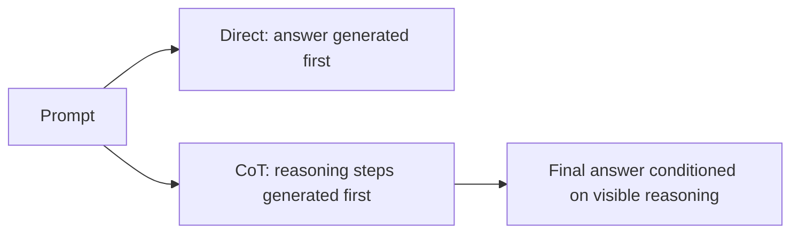

# Chain-of-Thought: Prompting for Visible Reasoning
{: .no_toc }

*Read duration: 13:00*

Ask a model to answer a multi-step word problem directly, and it will sometimes jump straight to a plausible-looking number that's wrong — not because it lacks the underlying capability to solve the problem, but because **generating a final answer as the very first tokens of a response forces the reasoning to happen implicitly**, compressed and invisible, with no opportunity to catch an early mistake before it propagates into everything that follows. **Chain-of-thought prompting** is the technique of instructing a model to work through its reasoning step by step, in visible text, before committing to a final answer. It is one of the simplest prompting techniques in this course and also one of the most consequential, because it changes not just *what* the model outputs but *how* it arrives there.

## What Chain-of-Thought Prompting Is

At its core, chain-of-thought (often abbreviated CoT) prompting asks the model to externalize intermediate reasoning — the sub-calculations, the intermediate conclusions, the "if this, then that" logic — as part of its response, rather than skipping straight to a final answer. A prompt without chain-of-thought might read "What is the total shipping cost for this order?" and receive a single number in response. The same task with chain-of-thought framing — "Work through this step by step: first identify the weight tier, then the destination zone, then apply the tier's per-pound rate, then add any surcharges, and only then state the final total" — produces a response that shows each of those steps explicitly before arriving at the number.

This matters architecturally because language models generate output one token at a time, left to right, with no ability to revise a token once it's been produced and no separate "scratch space" hidden from the transcript unless the prompt explicitly creates one. If a model's very first tokens commit to a final answer, every later token is generated *conditioned on* that already-stated answer — the model has no mechanism to quietly reconsider and no room to walk back an early misstep once it's part of the visible context. Chain-of-thought prompting works by giving the model somewhere to put the reasoning *before* the commitment happens, so that each intermediate step is available as context for the steps that follow it, and the final answer is generated only after the supporting logic already exists in the transcript to condition on.

## Why It Improves Accuracy on Hard Tasks

The accuracy gain from chain-of-thought prompting isn't uniform across all tasks — it's concentrated specifically in problems that require multiple dependent steps or genuine judgment calls, and it's largely absent (or even mildly negative, due to added cost with no benefit) on tasks that are simple enough to answer correctly in one leap. A single-fact lookup — "what is the capital of the country described in this paragraph?" — doesn't benefit meaningfully from being walked through step by step, because there's no intermediate structure to expose; the model either knows the answer or it doesn't; visible reasoning offers no extra information the model wasn't already going to use.

Multi-step arithmetic, multi-hop reasoning over a document, and judgment-heavy classification are a different story. Consider a contract-review task: "Does this clause violate the company's standard indemnification policy?" Answering that well requires identifying the relevant clause, identifying the relevant policy provision, checking several conditions against each other, and only then rendering a verdict. Asked to answer directly, a model risks conflating steps, applying the wrong provision, or reaching a verdict that doesn't actually follow from a careful reading — because nothing in the generation process forced it to lay the comparison out explicitly. Asked to reason step by step first, the model is effectively forced to build the supporting argument in view, which both makes errors more visible (to a downstream reviewer, and often to the model itself) and reduces the odds that it will skip a step it would otherwise have skipped silently. This is the same underlying logic as showing your work on a math test: not because the grader needs the intermediate steps for their own sake, but because writing them down changes how carefully you're forced to do the work.

## How to Elicit Visible Reasoning

The simplest version of chain-of-thought prompting is a direct instruction: adding a line like "think through this step by step before giving your final answer" to a prompt is often enough to shift the model from a direct-answer pattern to a reasoning-then-answer pattern. This costs almost nothing to try and is a reasonable default whenever a task involves more than a single inferential step.

More reliable results usually come from **structuring** the reasoning rather than just requesting it generically. Rather than leaving "think step by step" open-ended, a well-designed prompt can name the actual steps the task requires: "First identify X. Then check whether Y holds. Then determine Z based on X and Y. Only after completing all three steps, state your final answer." This does two things at once — it increases the odds that the model's reasoning actually covers the dimensions that matter for a correct answer (rather than reasoning about something tangential and still arriving at a plausible-sounding but unjustified conclusion), and it gives you, as the prompt's author, a template to check the output against, since a reasoning trace that skips one of the named steps is a visible signal that something went wrong.

A related technique is separating the reasoning from the final answer structurally — for instance, asking for a `<reasoning>` section followed by a distinct `<answer>` section (echoing the structured-output conventions covered elsewhere in this module). This isn't purely cosmetic: it makes it straightforward for a downstream system to parse out just the final answer for programmatic use while still retaining the reasoning trace for logging, debugging, or human review, without a person needing to read through the entire chain of thought to find the verdict at the end.

## The Costs: Tokens, Latency, and Faithfulness

None of this comes for free, and an architect needs to weigh the costs honestly rather than reaching for chain-of-thought prompting reflexively on every task. The most direct cost is **tokens and latency** — a response that reasons through several steps before answering is, tautologically, a longer response, and every additional output token adds both to the cost of the call and to the time a user or downstream system waits for the final answer. For a task running at high volume where the direct-answer accuracy is already acceptable, forcing a lengthy reasoning trace onto every single call can be a meaningful, unnecessary tax — this is exactly the kind of cost/benefit judgment call architects are expected to make deliberately rather than defaulting to "more reasoning is always better."

A second, subtler cost is that reasoning traces can be **verbose without being useful** — a model asked to "think step by step" with no further structure will sometimes produce reasoning that restates the problem, hedges, or wanders through tangential considerations before arriving at essentially the same answer a direct prompt would have given, at several times the token cost. This is part of why structuring the requested reasoning (naming the actual steps) tends to outperform an unstructured "think step by step" instruction — it constrains the verbosity to reasoning that's actually load-bearing for the task.

The most important cost to understand conceptually, because it shows up repeatedly in how the exam frames this topic, is that a visible chain of thought is not a guaranteed window into the model's *actual* underlying decision process. A model can produce a reasoning trace that looks step-by-step and internally consistent, and still arrive at its final answer through a path that doesn't fully match what the visible trace describes — the trace is a *generated explanation*, not a transcript of some separate internal computation that produced the answer independently. This is sometimes called **unfaithful reasoning**: the stated steps are plausible and often correct, but they are not a guaranteed causal account of how the model actually got to its conclusion. Practically, this means a visible chain of thought is a genuinely useful debugging and accuracy tool, but it should not be treated as an infallible audit trail or as proof, on its own, that a given answer is correct for the reasons stated — for high-stakes verification, an independent review pass (as covered elsewhere in this module) checking the *output* against ground truth remains more reliable than trusting a reasoning trace at face value.

{: .important }
> Don't confuse a visible chain of thought with a literal transcript of the model's actual decision process. Reasoning traces can be internally consistent and still not faithfully describe how the answer was really reached — never treat a reasoning trace alone as proof a high-stakes answer is correct.

## Chain-of-Thought vs. Extended Thinking

It's worth being precise about a distinction the next lecture develops in full: chain-of-thought as described here is a **prompting technique** — it works by asking the model, through ordinary prompt instructions, to produce visible reasoning as part of its normal response, using the same generation process and the same token budget as everything else in that response. It requires no special API parameter and works with any model that can follow instructions reasonably well. Claude's **extended thinking** is a distinct, built-in capability — a mode the API supports directly, with its own dedicated reasoning budget and its own handling of the reasoning content, rather than something achieved purely by phrasing a request differently. The two are related in spirit — both put visible reasoning between the prompt and the final answer — but they are different mechanisms with different cost models, different controls, and different appropriate use cases, which is exactly what the next lecture is about.

**Why it matters for the exam:** Expect questions asking you to identify when a task's structure (multi-step, judgment-heavy, dependent on several intermediate facts) justifies chain-of-thought prompting versus when it adds cost without meaningfully improving accuracy on a task that's already simple enough to answer directly. Also expect at least one question testing the faithfulness caveat directly — that a visible reasoning trace is not a guaranteed, literal account of the model's actual decision process, and shouldn't be treated as sufficient verification on its own for a high-stakes output.

<!-- prevnext:start -->

---

| [&larr; Previous: Lab: Prompt Reliability Simulator](14-lab-prompt-reliability-simulator) | [Next: Extended Thinking: When and How to Use It &rarr;](16-extended-thinking-when-and-how-to-use-it) |
|:---|---:|

<!-- prevnext:end -->
