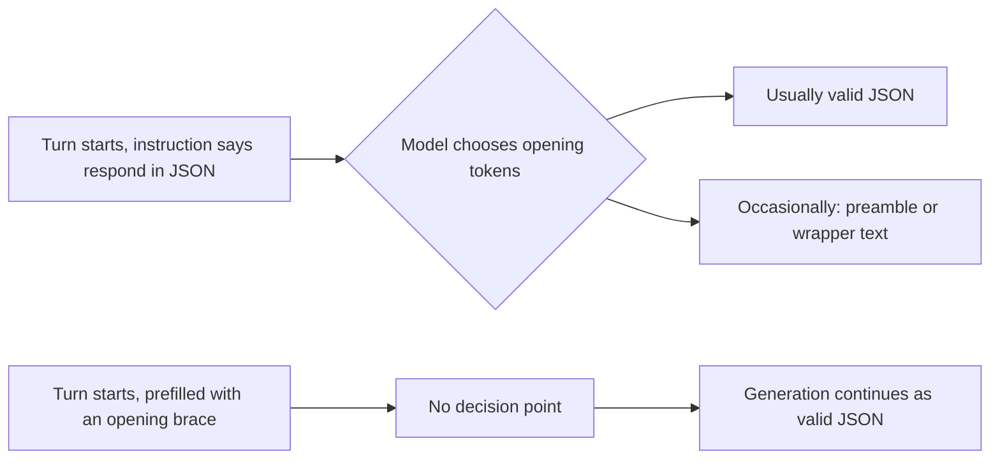

# Prefilling and Steering Model Output
{: .no_toc }

*Video duration: 11:00*

Every technique covered so far in this module works by shaping the *input* to the model — the system prompt, the examples, the framing of the task. **Prefilling** works differently: it shapes the *output* directly, by supplying the opening text of the assistant's own turn before the model generates anything at all. Instead of asking the model to produce a certain kind of response and hoping the instruction lands, prefilling simply starts the response for it, and the model's generation continues from wherever that prefilled text leaves off. It's a small mechanical trick with outsized architectural leverage, because it changes what the model is completing rather than merely what it's been told to do.

## What Prefilling Actually Is

In Claude's API, a conversation is built from a sequence of turns, and the assistant's turn is normally left for the model to generate in full. Prefilling means including a partial assistant turn in the request — some text you supply yourself — and letting the model's generation pick up from there rather than starting from a blank turn. The model doesn't re-derive or reconsider the prefilled text; it treats that text as already-committed output and generates the continuation as if it had written the prefilled portion itself.

This is a subtly different mechanism from an instruction. An instruction — "respond only in valid JSON" — asks the model to *choose* to produce JSON, and a sufficiently ambiguous, long, or adversarial context can still lead it to preface the JSON with an apology, a caveat, or explanatory prose before or after the structured content, because the instruction is a request the model is free to interpret loosely under pressure. Prefilling the assistant's turn with a literal `{` doesn't ask the model to produce JSON — it makes the model's very next tokens a continuation of an object that has already, unambiguously, begun. There is no longer a decision point at which the model might choose to preface the response with something else, because that decision point is exactly the part of the turn you've already supplied.

## Forcing Structured Output

The clearest and most common use of prefilling is forcing valid structured output. A prompt asking for JSON, even a carefully written one, can still occasionally produce a response wrapped in explanatory text ("Sure, here's the JSON you requested:") or markdown code fences the parser downstream wasn't expecting. Prefilling the assistant turn with an opening `{` (or `[` for an array) eliminates this failure mode structurally rather than relying on the instruction being followed precisely — the model's response necessarily begins with valid object syntax because that's literally where the turn starts, and the wrapping text that instructions alone sometimes fail to suppress has nowhere left to go.

The same idea generalizes past JSON. Prefilling with a fixed opening tag — `<answer>`, a specific header, the first line of a required template — pins the response's structure at the exact point where format drift is most likely to occur: the very beginning, where a model deciding how to open a response has the most latitude and where small variations compound into a downstream parsing failure. Anchoring that first token removes the ambiguity at its source, rather than trying to catch a malformed response after the fact with a schema validator or a repair step, which is more expensive and less reliable than preventing the drift from occurring in the first place.

## Forcing Persona and Register

Prefilling isn't limited to structural formatting — it's equally effective for locking in tone, persona, or register at the start of a response, which is exactly where a system prompt's persona instructions are weakest under pressure. A system prompt might establish "you are a terse, formal technical writer," but a sufficiently unusual or emotionally charged user message can still nudge a response toward a warmer or more casual register than intended, because the system prompt is competing with the pull of the specific conversational turn in front of the model. Prefilling the assistant's turn with a few words in the intended register — the start of a sentence written the way the persona would actually write it — gives the model a concrete anchor to continue from, rather than an abstract instruction to reinterpret fresh on every single turn.

This technique is particularly useful for maintaining consistency across a long deployed system where drift in tone across many independent calls is a real, observable failure mode — prefilling a consistent opening pattern is a cheap, mechanical way to keep dozens or hundreds of independent generations anchored to the same register, in a way that's far more reliable than restating the persona instruction more forcefully in the system prompt and hoping it holds under every input the system will ever see.

## Steering Output Shape Without Post-Hoc Filtering

Prefilling is one instance of a broader principle worth naming explicitly: it is almost always better, architecturally, to steer a model's output *during* generation than to generate freely and clean up afterward with a post-hoc filter or reformatter. A post-hoc approach — let the model write whatever it writes, then strip unwanted preamble, reformat loosely-structured text into the shape you need, or run a second pass to fix violations — adds an extra processing stage, adds a place where information can be silently lost or mangled, and treats the actual generation as an unreliable black box to be corrected rather than a process you can influence directly at its source.

Prefilling is the most direct version of steering during generation, but the same philosophy shows up throughout this module in other forms: explicit success criteria (from the prompting-best-practices lecture) steer output by defining what "correct" looks like before generation starts; few-shot examples steer by demonstration; and structured output enforcement steers by constraining the space of valid completions the model is sampling from. What prefilling adds to that toolkit is the ability to steer the single highest-leverage moment in any response — its opening tokens — with total certainty rather than high probability, because that opening is no longer generated at all; it's supplied.

The practical discipline this implies for an architect is to ask, whenever a prompt-only instruction is producing occasional format or tone drift, whether the actual point of failure is the *decision the model makes at the start of its turn* — and if so, to consider removing that decision point entirely with a prefill, rather than adding yet another instruction asking the model to make that same decision more carefully next time.

## A Worked Example

Suppose a classification system extracts a sentiment label and a short justification for each customer review, and downstream code expects a JSON object with exactly two fields, `sentiment` and `reason`. A prompt-only version of this task — "respond with a JSON object containing `sentiment` and `reason`" — will usually work, but under certain inputs (an unusually long review, a review containing text that looks like an instruction to the model, a review in a mixed or ambiguous language) it occasionally produces a response that opens with a clarifying sentence, wraps the object in a markdown code fence the parser doesn't strip, or adds a third field the schema didn't ask for. Each of these is a low-frequency but nonzero failure mode, and at meaningful production volume, low-frequency failures still add up to a steady trickle of parser errors that someone has to triage.

Prefilling the assistant turn with `{"sentiment": "` closes off nearly all of that failure surface at once. The model can no longer open with a caveat, because there is no more "opening" left to write — its first generated tokens are already partway through a string value inside an object that has already begun. It can still, in principle, produce a `sentiment` value that's wrong or a `reason` that misses the point, but the *shape* of the response — valid JSON, no wrapping prose, no unexpected preamble — is no longer something the model can drift away from, because that shape was fixed by the prefill rather than requested of the model's judgment. This is a good illustration of the distinction worth carrying forward into the rest of this module: prefilling doesn't make the model's reasoning better, but it does eliminate an entire category of formatting failure that reasoning quality alone was never going to fix.

**Why it matters for the exam:** Expect questions asking you to identify prefilling as the correct fix for a scenario where a model reliably produces the right content but wraps it in unwanted preamble, apologies, or inconsistent formatting at the start of its response — a failure mode instructions alone haven't fully eliminated. Also expect a conceptual question distinguishing prefilling (constraining what the model's turn starts with, before generation) from post-hoc filtering or reformatting (correcting output after the fact), and asking which approach is more reliable and why.

<!-- prevnext:start -->

---

| [&larr; Previous: Extended Thinking: When and How to Use It](16-extended-thinking-when-and-how-to-use-it) | [Next: Temperature, top_p, and top_k Explained &rarr;](18-temperature-top-p-and-top-k-explained) |
|:---|---:|

<!-- prevnext:end -->
