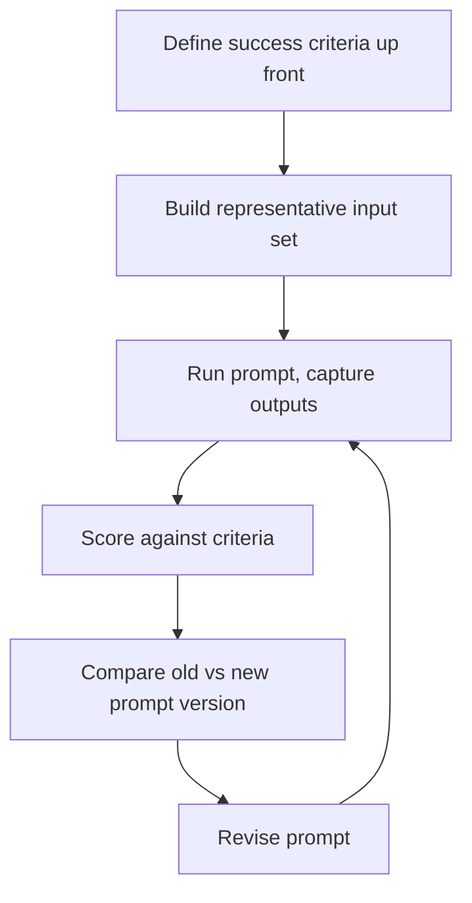

# Building a Prompt Evaluation Workflow
{: .no_toc }

*Video duration: 13:00*

A prompt that looks good on the handful of inputs you tried while writing it tells you almost nothing about how it will behave across the thousands of inputs it will actually see in production. This is the gap a **prompt evaluation workflow** exists to close: a systematic, repeatable process for measuring whether a prompt actually works, rather than relying on a spot check of a few examples and a gut feeling that the output "looks right." Where the independent-review lecture covered catching a bad output from a single production run before it does damage, evaluation is a distinct discipline that operates *before* a prompt ships and *across* many runs at once — it's how you know, with evidence rather than intuition, whether a prompt is ready to be trusted at all.

## Defining Success Criteria Up Front

Evaluation is impossible without first answering a question that has to come before any test is run: what does a *correct* or *good* output actually look like for this task? This is the same discipline the prompting-best-practices lecture described as explicit success criteria, but here it's being used for a different purpose — not to guide the model's own generation, but to give a human (or a grading process, covered in the next lecture) an objective standard to measure actual outputs against.

Good success criteria for evaluation purposes are specific enough to be checked consistently by someone other than the prompt's author. For a classification task, this might be as simple as "does the predicted label match the correct label for this input" — a clean binary check. For an open-ended generation task, like drafting a customer email, it's necessarily more nuanced: a rubric with several dimensions (did it address the customer's actual question, was the tone appropriate, did it stay within the required length, did it avoid any of the disallowed claims) scored individually rather than collapsed into a single vague "is this good" judgment. The important discipline is **writing these criteria down *before* looking at any actual outputs** — deciding after the fact what "good" means, once you've already seen some outputs and formed an impression of them, is far more prone to unconsciously moving the goalposts to match whatever the prompt happened to produce.

{: .important }
> Always define success criteria before looking at any actual outputs. Deciding what "good" means after you've already seen results is prone to unconsciously moving the goalposts to match whatever the prompt happened to produce, which quietly invalidates the evaluation.

## Building a Representative Set of Inputs

A prompt evaluated against three or four hand-picked inputs — usually the same ones the author used while drafting the prompt in the first place — tells you the prompt works on exactly those inputs, which is close to useless as a signal about production behavior, since those inputs were, by construction, the easiest cases to reason about while writing the prompt. A meaningful evaluation requires a set of inputs that actually represents the range of what the system will encounter: typical cases across the realistic spread of length, complexity, and phrasing; known edge cases that show up rarely but matter when they do; and cases drawn from, or closely modeled on, real production data rather than invented from imagination, since inputs an author imagines tend to cluster around what the author expects, while real inputs reliably include variations nobody anticipated.

This overlaps directly with the input-range discipline the few-shot-prompting lecture introduced for choosing examples, and the connection is not a coincidence — both disciplines are really the same underlying exercise, understanding your actual input distribution, applied to two different purposes. Few-shot example selection uses that understanding to teach the model a pattern; evaluation set construction uses the same understanding to test whether the model learned it. A team that has already done the work of mapping its input range for few-shot purposes has a considerable head start on building a representative evaluation set, and the reverse is equally true.

## Running and Comparing

With criteria and an input set both in hand, the mechanical part of the workflow is straightforward in concept, even if it takes real engineering effort to operationalize: run the candidate prompt against every input in the set, capture every output, and score each output against the success criteria defined earlier. The output of this process should be something quantifiable — a pass rate, a per-dimension score, a count of failures broken down by category — not a paragraph of prose impressions, precisely because a quantifiable result is what lets you compare one version of a prompt against another with any rigor, rather than relying on a subjective sense that "the new version feels better."

This comparison step is where evaluation earns its keep architecturally. Any nontrivial prompt goes through revisions — a clarified instruction, an added constraint, a reworded example — and without a standing evaluation set to run the revised prompt against, there's no reliable way to know whether a given revision actually improved things, left them unchanged, or quietly fixed one failure mode while introducing another. Running the same evaluation set against both the old and new versions of a prompt, and comparing the scored results side by side, turns "I think this version is better" into "this version scores higher on these specific dimensions, and lower on none of them" — a genuinely different, and genuinely more trustworthy, kind of claim.

## Iterating on the Prompt, Not Just the Evaluation

A useful evaluation run doesn't just produce a score — it produces a breakdown of *where* the prompt is failing, and that breakdown is what should drive the next revision. If a classification prompt scores 92% overall but its failures cluster heavily around one particular kind of input — say, tickets with mixed or ambiguous urgency signals — that's a specific, actionable signal: the fix is very likely a clarified instruction, an added few-shot example, or a explicit rule addressing exactly that ambiguous case, rather than a vague, undirected rewrite of the whole prompt. This is the same iterative loop that runs through the rest of this module: identify a specific failure pattern, apply a targeted fix, and re-run the evaluation to confirm the fix actually closed the gap without opening a new one elsewhere.

It's worth being explicit that this loop needs to terminate on evidence, not on a feeling that enough iterations have happened. A prompt is ready to ship not when it "seems good" after a few rounds of tweaking, but when it clears whatever score threshold the success criteria imply for the task's actual stakes — and that threshold itself is a judgment call: a task where an error is expensive and hard to reverse warrants a higher bar and probably a smaller tolerance for failure clustering in any one category than a low-stakes task where an occasional miss is cheap to absorb downstream.

## A Worked Example

Suppose a team is evaluating a prompt that triages support tickets into "billing," "technical," and "account access" categories, ahead of routing each ticket to the right team. Success criteria are defined first: the predicted category must exactly match a human-labeled ground-truth category, scored as a simple pass/fail per ticket, aggregated into an overall accuracy percentage and a separate confusion matrix showing which categories get mixed up with which. The evaluation set is then assembled deliberately, not opportunistically — several hundred real historical tickets, sampled to include a proportional mix of clear-cut cases and known-messy ones, including tickets that mention both a billing question and a technical problem in the same message, since those overlapping cases are exactly the kind of input a hand-picked "typical example" set would have missed entirely.

Running the current prompt against that set might reveal 94% overall accuracy, which sounds strong until the confusion matrix shows that nearly all of the misses are tickets genuinely spanning billing and technical concerns being routed to only one of the two relevant teams. That's a precise, actionable finding — a vague "let's make the prompt better" would not have surfaced it, but a broken-down failure analysis did. The fix might be an explicit instruction covering multi-category tickets, or a rule for when to route to both teams rather than choosing one, and the revised prompt gets run against the exact same evaluation set afterward to confirm the specific failure pattern actually closed, rather than simply trusting that the fix "should" have worked.

## Evaluation vs. Multi-Pass Review

It's worth being precise about how this discipline differs from the independent and multi-pass review covered earlier in this module, because the two are easy to conflate and the exam treats them as distinct concepts. Multi-pass review is a **runtime** architecture — it operates on individual production outputs, one at a time, as they're generated, and its purpose is to catch a specific bad output before it does damage downstream. Evaluation is a **pre-deployment and ongoing measurement** discipline — it operates on a whole set of inputs at once, offline or in a staging process, and its purpose is to answer a systemic question: is this prompt, as a whole, reliable enough to trust across the range of inputs it will see, and did a given revision actually make it better? A system can have excellent multi-pass review in production and still ship a prompt that was never properly evaluated beforehand — and the reverse is true too, a well-evaluated prompt can still benefit from a runtime review pass on individual high-stakes outputs, since evaluation demonstrates the prompt's reliability *in aggregate*, not on every single instance. The two disciplines are complementary rather than substitutes for one another, and a mature architecture generally has both: evaluation before a prompt ships and after any revision, and review at runtime for individual outputs where the stakes of a single miss are high.

**Why it matters for the exam:** Expect questions asking you to distinguish an evaluation workflow (pre-deployment, aggregate, offline, measuring a prompt's reliability across a representative input set) from multi-pass review (runtime, per-output, catching an individual bad result). Also expect scenario questions testing whether you recognize a flawed evaluation setup — success criteria defined after looking at outputs, an evaluation set that only covers the "easy" cases the author already had in mind, or a comparison between prompt versions with no consistent scoring to back up the claim that one version is actually better.

<!-- prevnext:start -->

---

| [&larr; Previous: Temperature, top_p, and top_k Explained](18-temperature-top-p-and-top-k-explained) | [Next: Test Dataset Generation and Model-Based Grading &rarr;](20-test-dataset-generation-and-model-based-grading) |
|:---|---:|

<!-- prevnext:end -->
