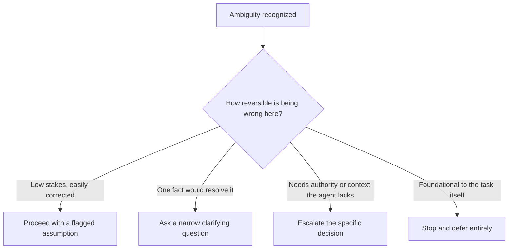

# Dealing with Escalation and Ambiguity
{: .no_toc }

*Read duration: 20:18*

Every context window, no matter how well managed, eventually runs into the same wall: a moment where what the agent needs to know isn't there. Maybe the information was never collected. Maybe it exists somewhere but wasn't retrieved. Maybe it's genuinely ambiguous — two readings are both plausible, and nothing in context settles which one applies. This lecture is about that moment, because it is one of the most heavily tested judgment calls on the CCA-F exam: what should an agent actually do when its context doesn't contain enough information to proceed safely?

## Recognizing ambiguity in the first place

The hardest part of handling ambiguity well isn't choosing what to do about it — it's noticing it's there at all. Language models are, by design and training, extremely good at producing a fluent, confident-sounding continuation of almost any input, including inputs that are underspecified. That fluency is a genuine strength in most contexts, and it's exactly the property that makes ambiguity dangerous: an agent can produce a perfectly coherent, well-formatted, plausible-sounding action on the basis of a guess, and nothing about the *surface quality* of that action reveals that it was built on a gap.

This is why "recognize ambiguity" has to be treated as a distinct, explicit design goal rather than assumed to fall out naturally from a capable model. A few patterns are worth calling out because they recur constantly in real systems and in exam scenarios:

**Underspecified instructions.** A user or upstream system asks for something that has more than one reasonable interpretation, and the context contains nothing that disambiguates between them. "Update the customer's address" is ambiguous if the customer has a billing address and a shipping address and nothing indicates which one is meant — the instruction is fluent and actionable-sounding, but actually underdetermined.

**Missing required information.** The task requires a fact that simply isn't present anywhere in context — not summarized away, not retrievable, genuinely absent. An agent asked to calculate a refund that depends on a purchase date it was never given can't calculate a correct answer no matter how it reasons; the information deficit is total, not partial.

**Conflicting information.** Two pieces of context that are individually clear disagree with each other — a retrieved policy document says one thing, a more recent email in the conversation says another. This is a close cousin of the ambiguity problem and gets its own full treatment in the provenance lecture later in this module, but it's worth flagging here because the *symptom* looks identical from the agent's point of view: proceeding confidently requires picking one, and nothing in context justifies picking either over the other.

**Stale or expired context.** Information that was accurate when it entered context is no longer reliable by the time it's acted on — a price quote, an inventory count, an account status that may have changed since it was retrieved. This is a subtler form of the missing-information problem: the data isn't literally absent, but its currency is unverified, which for high-stakes decisions can be functionally the same as not having it.

An architect's job is to design systems — through prompting, tool design, and workflow structure — that make these situations *visible* to the agent as decision points, rather than letting them slide past as just another turn to reason through. This is partly a prompting concern (explicitly instructing the model to flag uncertainty rather than resolve it silently) and partly a tool and workflow concern (building tools whose outputs make gaps and staleness legible — a "last verified" timestamp on a lookup result, for instance — rather than presenting retrieved data as if it were simply, timelessly true).

## Why "guess and continue" is almost always the wrong answer

Once ambiguity is recognized, the temptation is to resolve it the way a helpful, competent human assistant often would in a low-stakes setting: make a reasonable assumption, note it in passing, and keep moving so as not to be a bottleneck. In many human workflows this is a perfectly good norm. In agentic systems, it's a much riskier one, for three compounding reasons.

First, an agent's guess doesn't stay a guess. Once it's acted on and its output becomes part of context — the address gets updated, the refund gets calculated, the summary gets written — the guess is now indistinguishable, structurally, from a verified fact. Nothing about how it's represented in the window marks it as tentative unless the agent went out of its way to mark it, and under time or token pressure, that marking is exactly the kind of detail that gets summarized away. This is the seed of the error-propagation problem covered in the next lecture: guesses that don't announce themselves as guesses get trusted uncritically by every subsequent turn.

Second, the cost of being wrong is asymmetric in a way "make a reasonable assumption and move on" doesn't account for. A human assistant who guesses wrong on a low-stakes call is usually caught and corrected quickly, because they're operating inside a social context full of implicit checks — a colleague notices, a client pushes back, the assistant themselves senses something's off in a follow-up conversation. An autonomous agent has none of that ambient correction unless it's been deliberately engineered in. A wrong guess can execute cleanly, produce a clean-looking result, and sail through exactly because nothing about it looks wrong.

Third, "guess and continue" scales its damage with autonomy. The more independently an agent is operating — the fewer checkpoints between its decisions and real-world effects — the more a bad guess costs, because there's less standing between the guess and an irreversible outcome. This is precisely why the failure-affordance aside later in this module insists that how much guessing (if any) is tolerable depends entirely on the use case: a guess about which greeting to use in a drafted email is nearly free; a guess about which account to route a wire transfer to is not.

None of this means an agent should treat every shred of uncertainty as a hard stop — a system that escalates constantly is barely more useful than one that doesn't run at all, and excessive escalation has its own real cost, covered below. The point is narrower and more precise: the *default* under genuine ambiguity should not be silent resolution. Silence is the failure mode, not caution itself.

{: .important }
> **A guess that gets acted on becomes indistinguishable from a verified fact** in every later turn — nothing marks it as tentative unless the agent explicitly flags it. Treat "guess and continue" as almost never the right default: resolve the ambiguity, flag it visibly, or escalate it, but never resolve it silently.

## Choosing an appropriately granular response

Given that "guess and continue" is off the table as a default, what should an agent actually do? The exam expects you to know that this isn't a binary choice between "act" and "stop everything," but a spectrum of responses that should be matched to how severe and how resolvable the ambiguity actually is.

**Proceed with an explicitly flagged assumption.** For low-stakes, easily reversible situations, it can be entirely appropriate for an agent to make a call — but to do so *visibly*, stating the assumption plainly in its output rather than burying it inside an action that looks unconditionally confident. "I've drafted this assuming you meant the shipping address, since that's what was most recently referenced — let me know if you meant billing" preserves forward progress while giving a human an explicit, low-friction opportunity to catch a wrong guess before it does anything costly.

**Ask a narrow, specific clarifying question.** When the ambiguity is real but resolvable with one more piece of information, the right move is often not to escalate the whole task but to ask precisely the question that resolves it, then continue. This is the granular middle ground between guessing and fully stopping: "Which account should the refund be issued to — the original payment method or store credit?" is a fast, cheap resolution that doesn't require a human to re-derive the whole task from scratch.

**Escalate the specific decision, not the whole task.** When a clarifying question isn't enough — the decision requires authority or context the agent genuinely doesn't have — the agent should hand off *that decision point*, packaged with enough context for a human to resolve it quickly, while ideally still completing whatever surrounding work doesn't depend on the ambiguous piece. An agent processing fifty invoices where three have an ambiguous vendor match shouldn't stop all fifty; it should complete the forty-seven clear ones and escalate the three specific ambiguous cases with the relevant detail attached.

**Stop and defer entirely.** Reserved for situations where the ambiguity is foundational — where continuing at all, even on the unambiguous-seeming parts, risks compounding a misunderstanding about the task itself. This is the least common correct answer, but the exam will occasionally present a scenario where the *only* defensible choice is a full stop, and picking a narrower option because it "keeps things moving" is the wrong answer.

The granularity aside later in this module makes a point worth anchoring here explicitly: whichever level of response is appropriate, "do nothing and ask" **has to be a genuinely available option at the decision point**, not something the agent has to invent by refusing to follow its instructions. If an agent's designed option set is only ever "pick A or pick B," an ambiguous situation where neither A nor B is clearly right leaves the agent with no correct move at all — it will pick one of them, because that's all it's been given room to do. Designing for ambiguity means designing the option space to include restraint as a legitimate choice, not just the active alternatives.

## The cost of over-escalation

It's worth stating plainly that this isn't a call to make agents maximally cautious. An agent that escalates every minor uncertainty is a different kind of failure — one that defeats the purpose of automating the task at all, and that trains its human reviewers to stop reading escalations carefully because most of them turn out to be trivial. This is the agentic-system equivalent of alert fatigue, and it's a real, well-documented failure mode in human operational systems long before agents entered the picture.

The discipline this implies is that escalation thresholds have to be calibrated to genuine stakes and genuine uncertainty, not to the agent's raw confidence level in isolation. A well-designed system distinguishes between "I am uncertain and this decision is low-stakes and reversible" (proceed, flag the assumption) and "I am uncertain and this decision is high-stakes or hard to reverse" (ask or escalate) — treating all uncertainty identically, in either direction, is the underlying mistake whether it manifests as reckless guessing or as reflexive escalation.

## A worked example across the granularity spectrum

It helps to see the full spectrum applied to variations of the same scenario, because the exam tends to test your ability to distinguish "close but wrong" granularity from the actually-correct level, not just to recognize that ambiguity exists at all.

Picture an agent processing expense reports. A submitted report lists a $340 meal expense with no attached receipt image, in a company where the policy requires receipts above $100 but is genuinely silent on what happens when one is simply missing rather than disputed. Four versions of this same underlying situation call for four different responses.

If the missing receipt is for a $12 expense well under the policy's threshold, the ambiguity is real but the stakes are negligible — the right move is to proceed with a flagged assumption ("processed without a receipt; below the $100 documentation threshold") and move on, because a wrong call here costs almost nothing to notice and fix later.

If the missing receipt is for the $340 expense above the threshold, but the employee's history shows every other report this quarter was fully documented, the ambiguity is narrow and one fact would resolve it — the right move is a targeted clarifying question ("Can you attach the receipt for the $340 dinner on the 14th?") rather than a broader escalation, because the gap is specific and cheap to close.

If instead the same $340 expense is missing a receipt *and* falls just after a policy change the agent isn't fully certain has taken effect yet, the ambiguity is no longer just "one missing document" — it's compounded with genuine uncertainty about which rule even applies. That's the case for escalating the specific line item to a human with policy context attached, rather than either guessing which policy version governs or blocking the entire report over one line.

And if the agent discovers, while working the report, that its own understanding of the reimbursement policy itself may be out of date — the source document it's relying on doesn't carry a clear effective date — that's no longer a single-decision ambiguity at all. It's foundational: continuing to process *any* line item under a policy the agent can't confirm is current risks getting all of them wrong the same way. That's the rare case where a full stop, rather than a narrower response, is actually correct.

Notice that the underlying fact pattern — a missing receipt — barely changed across these four versions, but the correct response changed substantially each time, purely as a function of stakes and how foundational the uncertainty was. That sensitivity to context, not a fixed rule like "always ask when a receipt is missing," is what the exam is testing when it presents escalation scenarios.

**Why it matters for the exam:** Escalation and ambiguity scenarios are one of the most common question types on the CCA-F, usually framed as "an agent encounters situation X — what should it do?" The wrong answers are almost always recognizable by pattern: an option where the agent silently guesses and proceeds, and an option where the agent stops everything for a triviality. The right answer is nearly always the option matched in granularity to the actual stakes of the specific decision — narrow escalation for a narrow gap, a full stop only when the gap is foundational, and a flagged assumption only when the cost of being wrong is genuinely low and easily corrected.

<!-- prevnext:start -->

---

| [&larr; Previous: Let's Coin Context Data Governance (CDG)](03-let-s-coin-context-data-governance-cdg) | [Next: Granularity on Options... Includes The Option To Not Do Something &rarr;](05-granularity-on-options-includes-the-option-to-not-do-somethi) |
|:---|---:|

<!-- prevnext:end -->
