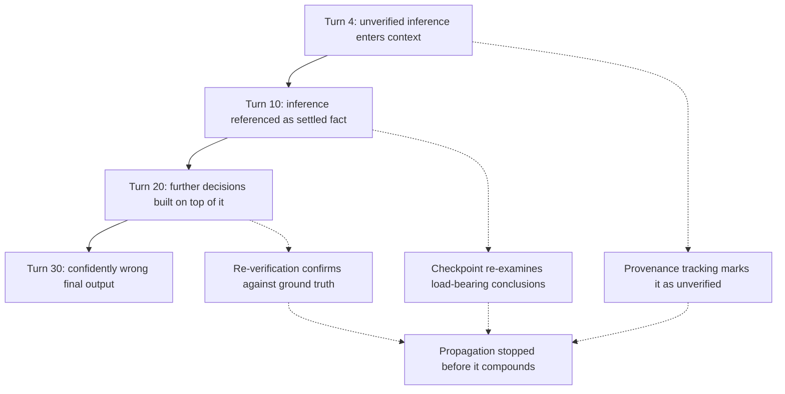

# Preventing Error Propagation
{: .no_toc }

*Video duration: 17:15*

A single wrong inference, made once, early in a session, and never revisited, is rarely what actually causes an agentic system to fail badly. What causes real damage is what happens *after* — the ten, twenty, or fifty subsequent turns that treat that early mistake as established fact, build on top of it without question, and produce a final result that looks thoroughly reasoned but is rotten at its foundation. This lecture is about that compounding process, why it's so easy for it to happen unnoticed inside a context window, and the concrete techniques that stop it.

## How a small mistake becomes a large one

The mechanism is worth spelling out precisely, because it's easy to underestimate how quickly it happens. In turn four of a long session, an agent misreads a field, misapplies a rule, or accepts an unverified guess as settled — maybe it was a low-stakes ambiguity that got silently resolved rather than flagged, the exact failure mode the previous lecture warned against. That mistaken conclusion becomes part of the context window going forward, phrased with the same syntactic confidence as everything else in it. Nothing in the text of the window distinguishes "this was carefully verified" from "this was inferred under uncertainty and never checked" — both simply read as declarative statements sitting in the model's context.

By turn ten, some other part of the task references that conclusion in passing, because it's now just an established fact as far as the window is concerned. By turn twenty, three more decisions have been built on top of *that* reference, each individually reasonable given what the context says is true. By the end of the session, the final output can be extensively, even impressively reasoned — every individual step following logically from the step before it — and still be wrong in a way that's completely invisible from reading the final output alone, because the flaw isn't in any single step's logic. It's in a premise several layers down that nobody re-examined.

This is what makes error propagation different from an agent simply being wrong once. A single wrong answer is usually easy to catch, because it's exposed and checkable on its own. A propagated error is camouflaged by everything reasonable that got built on top of it — the very quality of the surrounding reasoning is what makes the root mistake hard to spot, precisely because a plausible tree of good decisions is much harder to distrust than a single implausible one.

## Why context management makes this worse, not just possible

It would be easy to treat error propagation as purely a reasoning problem, but it's deeply entangled with context management specifically, for a reason this module has already covered from a different angle: summarization and compaction, done carelessly, actively erase the signal that would let a later turn catch an earlier mistake.

Recall the earlier point about summaries preserving conclusions but not always the reasoning or caveats behind them. If turn four's shaky inference gets folded into a summary a few turns later — "customer's preferred contact method: email" — the summary strips away exactly the detail that would have flagged it as uncertain ("inferred from a two-year-old support ticket, not confirmed with the customer directly"). Once that caveat is gone, every downstream turn is working from a context window that presents the inference with the same unearned confidence as a verified fact. Aggressive, poorly designed compaction doesn't just save space — it can actively launder uncertainty into apparent certainty, which is a much more dangerous failure than simply losing detail.

This is also why context isolation between agents, discussed earlier in this module, cuts both ways. Isolation protects a fresh subagent from inheriting an orchestrator's noise — but if the orchestrator's context already contains an unflagged bad inference, and that gets folded into the purpose-built brief handed to a new subagent, isolation doesn't prevent propagation, it just gives the error a clean, authoritative-looking new home. A subagent has no way to distinguish "this is in my brief because it was thoroughly verified" from "this is in my brief because it was assumed once and nobody checked since," unless that distinction was deliberately preserved when the brief was constructed.

## Checkpoints: creating deliberate points of re-examination

The first concrete defense against propagation is structural: build **checkpoints** into a long-running task — defined points where the agent (or a human reviewer) deliberately pauses to re-examine key conclusions before building further on top of them, rather than simply continuing to accumulate turns indefinitely.

A checkpoint is not the same thing as a milestone-based compaction boundary, though the two often coincide usefully. Compaction asks "what can I compress here to save space." A checkpoint asks a different question: "what am I currently treating as true, and does it still deserve that status." Effective checkpoints are typically placed at natural seams in the task — the end of a research phase before a synthesis phase begins, the completion of a data-gathering step before an irreversible action is taken on the basis of that data, the handoff point between one subagent and the next. At each checkpoint, the discipline is to explicitly restate the load-bearing conclusions the next phase will depend on, and to ask, for each one, "how confident am I in this, and on what basis."

This restating step matters more than it sounds like it should. The act of forcing a conclusion to be re-articulated, rather than letting it silently persist as an assumption buried several turns back, creates a natural opportunity to notice that it was never actually confirmed — the same way explaining a plan out loud to a colleague often surfaces a flaw that was invisible while it stayed in your own head. Checkpoints turn implicit, accumulated assumptions into explicit, examinable claims at regular intervals, rather than letting them ride silently until the final output.

## Re-verification: not trusting your own context

The second defense is **re-verification**: for conclusions that are both load-bearing (a lot depends on them) and cheap to check, actively re-confirm them against a ground-truth source before acting further, rather than relying on the fact that they're already sitting in context as if that made them settled.

This runs against a natural efficiency instinct — if the answer is already in context, why look it up again? — but the entire point of error propagation is that "already in context" and "actually correct" are not the same property, and nothing about a context window enforces that they stay linked. Re-verification is cheapest and most valuable exactly at the points where a conclusion is about to be used to justify something expensive or hard to reverse: before an agent issues a refund based on an eligibility determination it made several turns earlier, re-checking the account status at the moment of the refund (rather than trusting the status as it was read at some earlier point) catches the case where the underlying reality changed, or where the earlier read was simply wrong, before that error becomes a completed, irreversible transaction.

Re-verification doesn't need to be applied to everything — that would defeat the efficiency of having established a fact in context at all — but it should be applied deliberately to the specific conclusions a downstream, high-stakes action actually depends on. This is a targeting problem as much as a mechanical one: knowing *which* facts in a long context are load-bearing enough to deserve a second check is itself a skill, and it's closely related to the provenance tracking covered later in this module, because a fact whose provenance marks it as inferred or unverified is exactly the kind of fact re-verification should prioritize.

## Provenance tracking: knowing what to distrust

The third defense, and arguably the most foundational, is **provenance tracking** — attaching to every consequential piece of information in context some record of where it came from, how it was obtained, and how confidently it should be treated. This gets its own full lecture later in the module because it matters well beyond error propagation specifically, but its role here is central: propagation is fundamentally a problem of unmarked uncertainty, and provenance is the mechanism that keeps uncertainty marked.

A context window where every load-bearing claim carries a lightweight tag — verified against source X at time Y, versus inferred from indirect evidence, versus stated by the user without independent confirmation — gives every subsequent turn, and every subsequent checkpoint or re-verification step, the information it needs to decide how much weight that claim deserves. Without that tagging, an agent (or a human reviewing its output) has no way to distinguish a rock-solid fact from a plausible guess sitting three turns back, and the entire point of checkpoints and re-verification collapses, because you can't prioritize re-checking what you can't identify as uncertain in the first place.

## Designing for propagation resistance from the start

Taken together, these three techniques point at a broader design principle: a system resistant to error propagation isn't one that never makes mistakes — that's not achievable — it's one designed so that mistakes have a bounded blast radius. Checkpoints limit how far a bad conclusion can travel before it's re-examined. Re-verification catches load-bearing errors before they're acted on irreversibly. Provenance tracking ensures that when something does need to be double-checked, it's identifiable as needing that scrutiny in the first place, rather than blending in with everything else.

This is also where error propagation connects back to the granularity-of-options principle from the previous lecture. An agent that has "flag this as uncertain and continue" available as an explicit option, rather than only "state it as fact" or "stop entirely," is far less likely to generate the kind of unmarked, confidently-phrased mistake that propagation feeds on. Preventing propagation starts upstream of any checkpoint or re-verification step — it starts with never letting an unverified conclusion enter context looking more certain than it actually is.

## A worked example of compounding

Concreteness helps here, because the danger of propagation is easy to state abstractly and easy to underestimate in practice. Consider an agent handling contract renewals. In turn six, it reads a contract summary and concludes the renewal term is "auto-renewing annually" — but the summary it read was actually describing a *different*, superseded version of the contract that happened to be the first match returned by a search. Nothing flags this; the conclusion reads as a plain, confident fact from that point forward.

By turn fourteen, the agent uses that "fact" to calculate a renewal date eight months out and schedules a reminder task around it. By turn twenty-two, it uses the same assumed renewal date to tell a different part of the workflow that no action is needed on this contract for the next two quarters, deprioritizing it in a queue of contracts that actually do need review sooner. By the time a human looks at the output — a tidy, well-organized quarterly contract review queue — nothing about it looks wrong. Every step that built the queue followed sound logic given what it was told was true. The actual current contract, the one that wasn't auto-renewing and needed action in six weeks, simply never surfaces, not because any single step reasoned badly, but because turn six's misread was never re-examined by anything that followed it.

This is exactly the scenario a checkpoint at the end of the "gather contract facts" phase would have caught, if it had forced the agent to restate its source for the renewal term before building a schedule on top of it — restating "auto-renewing annually, per [document version and date]" instead of just "auto-renewing annually" would have made the mismatched document version visible at the moment it mattered, rather than three phases later when it had already shaped a queue nobody had reason to double-check.

**Why it matters for the exam:** Expect scenario questions structured as a multi-turn narrative where an early, easy-to-miss mistake is buried a few turns in, and the question asks either "what went wrong" or "what should have been in place to catch this." The correct diagnosis is almost always that an unverified conclusion was allowed to travel forward unflagged, and the correct fix is almost always one of the three techniques above — a checkpoint, a re-verification step, or provenance tracking — applied at the point where the mistake first entered context, not patched after the fact at the point where it finally caused visible damage.

<!-- prevnext:start -->

---

| [&larr; Previous: Granularity on Options... Includes The Option To Not Do Something](05-granularity-on-options-includes-the-option-to-not-do-somethi) | [Next: Should I Stay? Or Should I Propagate? &rarr;](07-should-i-stay-or-should-i-propagate) |
|:---|---:|

<!-- prevnext:end -->
