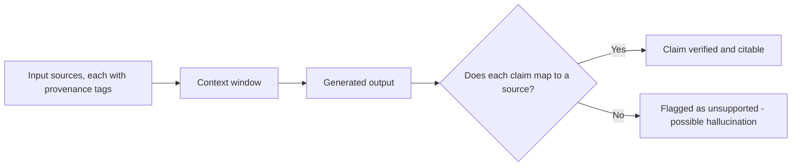

# Claim-to-Source Mappings: Why Every Sentence Needs a Source
{: .no_toc }

*Video duration: 11:00*

"Data Provenance and Conflicts" and "Putting the 'Provenance' in Data Provenance" built the case for tracking where a piece of *input* context came from — a fact in the window needs a source, a timestamp, and a trust level attached, the same way a painting up for auction needs its papers. This lecture extends that same discipline one level further, to the *output* side of the system: not just "where did this input fact come from," but "where did this specific sentence I just generated come from." That's the discipline of the **claim-to-source mapping** — tracing each factual claim in a generated output back to the specific source in the provided context that supports it.

## What a claim-to-source mapping actually is

A claim-to-source mapping is a explicit link between an individual assertion in generated output and the specific piece of context — a document, a retrieved chunk, a tool result, a particular record — that assertion is based on. It operates at a finer grain than provenance tracking on input data does. Input-side provenance, as covered earlier in this module, tags a fact *entering* the context window with metadata about where it came from. A claim-to-source mapping does the equivalent work on the *way out*: given a generated paragraph containing several distinct factual claims, which specific input source backs claim one, which backs claim two, and — critically — is there any claim in the output that doesn't trace back to anything in the provided context at all?

That last question is the one this discipline exists to answer, because it's the direct test for a specific and consequential failure mode: a generated sentence that reads exactly as confidently and fluently as every well-supported sentence around it, but that isn't actually grounded in anything the system was given. Nothing about a model's output signals, on the surface, which sentences are solidly backed by a specific source and which are unsupported extrapolation or outright fabrication — the prose reads uniformly confident either way, for the same reason discussed in "Data Provenance and Conflicts" that unmarked input facts all look equally trustworthy on the page. Claim-to-source mapping is the mechanism that makes that invisible distinction visible on the output side, the same way provenance tagging makes it visible on the input side.

## Why this matters: verifiability and catching hallucination

The value of tracing every claim to a source shows up in two related but distinct ways.

**Verifiability** is the more straightforward benefit: a claim with an attached source can be checked. A reader — human or another downstream system — encountering the sentence "the refund policy caps partial refunds at $200 for this product tier" gains something real if that sentence carries a pointer to the exact policy document and section it came from, because the claim is no longer something to simply take on faith; it's something that can be verified against its stated origin in seconds. Without that mapping, the same sentence is only as trustworthy as the reader's blind confidence in the system that produced it — which is precisely the "trust me, it's real" problem "Putting the 'Provenance' in Data Provenance" uses the auction-house analogy to warn against, now applied to the system's own generated claims rather than to the facts it was given.

**Catching hallucination** is the sharper and more architecturally important benefit. If every claim in a generated output is expected to map to a specific source, then a claim that *cannot* be mapped to anything in the provided context is immediately identifiable as a problem — either a fabrication, an over-generalization beyond what the source actually supports, or a claim smuggled in from the model's general training knowledge rather than from the material it was actually given to work with. This is a genuinely different and more rigorous check than simply asking whether an output "sounds right" or "seems consistent" with the source material, because a plausible-sounding elaboration that goes slightly beyond what any source actually says will pass a surface plausibility check while failing a strict claim-to-source mapping test. Building the requirement that every claim map to a source turns hallucination detection from a fuzzy judgment call into something closer to a structural audit: walk the output sentence by sentence, and for each factual assertion, either find the specific source it traces to or flag it as unsupported.

{: .important }
> **A claim that cannot be traced back to a specific source in context should be flagged as unsupported, not passed through because it sounds plausible.** Surface plausibility is not the same test as a strict claim-to-source mapping — a fluent elaboration that goes slightly beyond what any source says will pass the former and fail the latter.

## Extending provenance from input records to output sentences

It's worth being precise about how this discipline relates to, and extends, the input-side provenance work covered earlier in this module, because the two are easy to conflate but solve different halves of the same problem.

"Data Provenance and Conflicts" is concerned with facts *entering* the context window: a source, a timestamp, and a trust level attached to each piece of input data, so that the model — and any human reviewer — can weigh conflicting or uncertain input material correctly before reasoning over it. That discipline governs what goes *in*. Claim-to-source mapping governs what comes *out*: given that the model has now reasoned over a window full of provenance-tagged input, does its generated output actually and specifically trace back to that input, claim by claim, or has something crept in — an unsupported inference stated as fact, a detail from general world knowledge presented as if it came from the provided material, a subtly incorrect restatement of something a source actually said?

The two disciplines compound: input-side provenance without output-side claim mapping means you know your inputs were trustworthy, but you have no structural check on whether the output actually stuck to them. Output-side claim mapping without input-side provenance means you can trace a claim to *a* source, but you have no way to judge how much that source itself deserved to be trusted in the first place — the mapping just points you to an unverified or stale fact with more confidence than it warrants. A system that does both — tags input provenance rigorously *and* requires every output claim to map back to a specific, tagged source — gets the complete chain: a claim can be traced to its source, and that source's own trustworthiness, currency, and verification status is already known, exactly the kind of end-to-end chain-of-custody "Putting the 'Provenance' in Data Provenance" describes as the whole point of the provenance metaphor in the first place.

## Practical implementation: what to build

Concretely, systems that need strong claim-to-source guarantees — retrieval-augmented systems producing answers grounded in a document store being the clearest example — typically build this by requiring the model to emit explicit citations alongside its output (a specific document ID, chunk reference, or tool-result identifier attached to each claim, or grouped claims), and then treating any generated sentence that lacks a citation, or whose citation doesn't actually support what the sentence claims when checked, **as a flag for review rather than something to pass through silently**. This can be enforced at generation time (instructing the model explicitly to cite its source for every factual claim, and to say so plainly when a claim can't be sourced from the provided material) or as a post-hoc verification pass that checks generated claims against the context that was available. Either approach turns an implicit, unverifiable trust relationship between a generated answer and its inputs into an explicit, checkable one — which is exactly the throughline connecting this lecture back to everything the provenance lectures established about input data, now applied one level up, to the sentences a system actually hands to a user.

**Why it matters for the exam:** Expect scenario questions describing a generated output that sounds fluent and confident but contains a claim not actually supported by any provided source — the correct diagnosis is a missing claim-to-source mapping, and the correct fix is requiring explicit, checkable citations per claim rather than trusting surface plausibility. Recognize this as provenance discipline applied to output, extending rather than replacing the input-side provenance and conflict-resolution practices covered earlier in this module.

<!-- prevnext:start -->

---

| [&larr; Previous: Calibrating Confidence: Validation Sets and Stratified Sampling](20-calibrating-confidence-validation-sets-and-stratified-sampli) | [Next: Module Outro &rarr;](22-module-outro) |
|:---|---:|

<!-- prevnext:end -->
