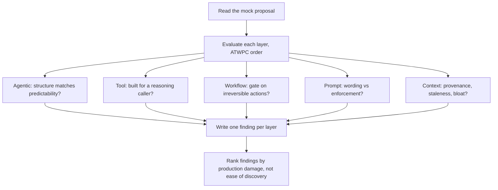

# Lab: Claude Architecture Review Board Simulator
{: .no_toc }

*Video duration: 1:43*

This lab puts you on the other side of the table. You're handed a mock architecture proposal — a two-page write-up for a Claude-powered system (a claims-intake assistant, a code-migration agent, whatever the exercise variant gives you) complete with a diagram, a tool list, a sample prompt, and a paragraph on "how context flows." Your job is to sit as a reviewer on an Architecture Review Board and produce a structured critique before the design ships.

Work the proposal one layer at a time, in ATWPC order, and force yourself to write down a finding for each: Does the Agentic layer choice (single agent, fixed workflow, multi-agent) actually match how predictable the task is? Are the Tool layer's definitions and error responses built for a reasoning caller, or copy-pasted from an internal API? Does the Workflow layer put a gate in front of anything irreversible, and does it put `CLAUDE.md`, Skills, and retrieval in the right places? Does the Prompt layer rely on wording where it needed enforcement? Does the Context layer risk provenance loss, staleness, or a bloated window?

Don't just flag problems — for each finding, name which layer it belongs to and what you'd change. That discipline, pinning a symptom to the layer that actually produced it, is the same discipline the exam's scenario questions are built to test.

The mock proposals in this lab are written to include at least one issue that looks like it belongs to a different layer than the one that actually caused it — a design smell borrowed straight from the Common Antipatterns lecture. A proposal might describe a "context window bloat" symptom that's really caused by a Workflow-layer decision to skip a review gate, which lets low-quality intermediate output accumulate in context unchecked instead of being caught and discarded early. Spotting that **the fix belongs one layer upstream of the symptom** is the entire point of the exercise, and it's a much better rehearsal for the exam than critiquing proposals where every problem sits exactly where it appears.

{: .important }
> Where a problem **shows up** and where it was actually **caused** are frequently two different layers. Always trace a finding back to the layer that produced it before proposing a fix — patching the symptom's layer instead of the cause's layer is a trap the exam builds in deliberately.

After you've written your findings, try one additional pass: rank them by how much downstream damage each one would actually cause in production, not by how obvious or easy each one was to spot. A well-hidden Context-layer provenance gap that lets one agent silently trust another agent's stale output is usually worse than an obviously verbose tool description, even though the tool description is the easier finding to write down. Review boards that only catch the easy findings and miss the dangerous quiet ones aren't doing their job, and neither is a reviewer who stops at the first pass.

<!-- prevnext:start -->

---

| [&larr; Previous: The 10 Takeaways Revisited](04-the-10-takeaways-revisited) | [Next: Module Outro &rarr;](06-module-outro) |
|:---|---:|

<!-- prevnext:end -->
