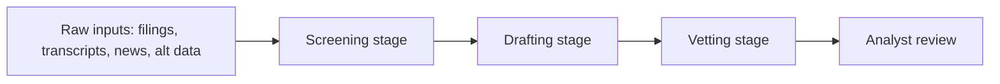

# Idea Generation/Vetting - Overview
{: .no_toc }

*Read duration: 7:16*

A hedge fund research desk lives or dies on a single narrow bottleneck: the rate at which a small team of analysts can turn raw information into trade theses that are both original and defensible. Every day the desk is flooded with inputs — earnings transcripts, regulatory filings, sell-side research, news, alternative data feeds, and the analysts' own accumulated knowledge of a sector — and only a tiny fraction of that flow ever becomes a thesis worth taking to a portfolio manager. The bottleneck isn't a shortage of ideas; it's a shortage of *vetted* ideas, because generating a plausible-sounding thesis is easy and generating one that survives scrutiny is hard. This is the business problem an idea generation and vetting system is built to address: compress the time between "here's a pattern in the data" and "here's a thesis with its risks, its supporting evidence, and its contradicting evidence laid out," without lowering the bar for what counts as a good idea.

It's worth being precise about what such a system is *not* meant to do, because the failure mode of over-promising is especially dangerous in finance. This is not a system that picks stocks. It does not have conviction, it does not have **capital allocation authority**, and it does not replace the analyst's judgment about what's actually investable given the fund's mandate, factor exposures, and risk appetite. What it does is compress the mechanical and semi-mechanical parts of the research process — surfacing candidate patterns, drafting a structured first-pass thesis, checking that thesis against known risk factors and the fund's own history, and pulling together the supporting and contradicting evidence a human would otherwise spend hours assembling by hand. Every output is a draft for a human to interrogate, not a recommendation to act on.

{: .important }
> This system never picks stocks, allocates capital, or replaces analyst judgment. Every output is a draft for a human to interrogate — not a recommendation to act on.

## Why This Is a Good (and Awkward) Fit for a Claude-Based System

Idea generation and vetting is a good fit for an agentic, retrieval-heavy system for a few concrete reasons. First, the raw material is overwhelmingly unstructured text — filings, transcripts, news, research notes — which is exactly the kind of input a language model is suited to read, synthesize, and reason over at a volume no analyst team can match. Second, the *task* itself has the shape agentic systems handle well: it isn't a single lookup, it's a multi-step investigation where the next step depends on what the previous step turned up. Reading a filing might surface a claim that needs to be checked against a competitor's most recent transcript, which might surface a risk factor that needs to be checked against the fund's existing exposure — a chain of judgment calls, not a fixed script. Third, "vetting" is naturally a two-sided task: generating supporting evidence and actively hunting for disconfirming evidence are different cognitive postures, and a system that does both explicitly (rather than one model quietly doing both in the same breath) produces a much more useful artifact than a single pass of enthusiastic thesis-writing.

At the same time, this domain has real constraints that make it more interesting — and more dangerous — than a typical retrieval-augmented drafting tool. Market data and news are extremely time-sensitive; a thesis built on a stale earnings estimate or a since-retracted news report isn't just unhelpful, it's actively harmful if it survives into a PM's inbox looking authoritative. The cost of a plausible-sounding but wrong thesis is **asymmetric**: a good idea that's caught and discarded costs a little analyst time, but a bad idea that isn't caught and gets sized into a position can cost real money and, in a regulated environment, real scrutiny. And there's a subtler risk unique to language models in this domain — a model that has absorbed enormous amounts of financial commentary during training can produce fluent, confident-sounding reasoning that pattern-matches "how research sounds" **without actually being grounded** in the specific, current facts of the situation. A generation-and-vetting system has to be architected specifically to fight that failure mode, not just to produce prose.

## The High-Level Shape of the Solution

The solution that fits these constraints is not a single do-everything chatbot but a small, purpose-built pipeline with distinct stages and a human checkpoint at the end. At the front, a **screening stage** scans incoming information — filings, transcripts, news, alternative data — for patterns worth turning into a candidate thesis: unusual language shifts in management commentary, diverging fundamentals versus consensus estimates, sector-wide moves that one name hasn't participated in yet. This stage is deliberately generous with what it surfaces, because the cost of a false positive here is small (an analyst skims and discards it) while the cost of a false negative is a missed idea.

Candidates that clear the screen move to a **drafting stage**, where a structured first-pass thesis gets built: the core claim, the catalysts, the time horizon, and an explicit statement of what would have to be true for the thesis to work. That draft then moves to a **vetting stage** that is architecturally distinct from drafting — it actively searches for evidence that contradicts the thesis, checks the idea against the fund's own known risk factors and past positions (has this thesis, or something like it, been tried before and failed?), and flags anything that looks like it's relying on stale or unverified data. Only after both stages complete does the output reach an analyst, packaged with its supporting evidence, its contradicting evidence, its risk-factor exposure, and explicit citations back to source documents so a human can verify rather than simply trust.

The remaining lectures in this module walk through each of these architectural layers in turn: how the agentic structure separates generation from vetting, what belongs in context at each stage, how retrieval is designed to keep the system grounded in current rather than stale information, and how such a system is monitored and kept affordable to run in production.

## Architecture Notes

This use case is a clean illustration of separating the **Agentic** layer's "who decides what happens next" question from the **Context** layer's "what does the model actually see" question: screening, drafting, and vetting are distinct agentic stages precisely because each needs a different slice of context and a different cognitive posture. The heavy reliance on filings, transcripts, and news also foreshadows why this module leans hard on the **Prompt** layer's grounding techniques and a dedicated **RAG & Retrieval** design — a thesis is only as trustworthy as the freshness and provenance of what it cites.

<!-- prevnext:start -->

---

| [&larr; Previous: Extra Module: Solution Architecture Patterns - Hedge Funds](./) | [Next: Idea Generation/Vetting - Agentic Architecture &rarr;](02-idea-generation-and-vetting-agentic-architecture) |
|:---|---:|

<!-- prevnext:end -->
