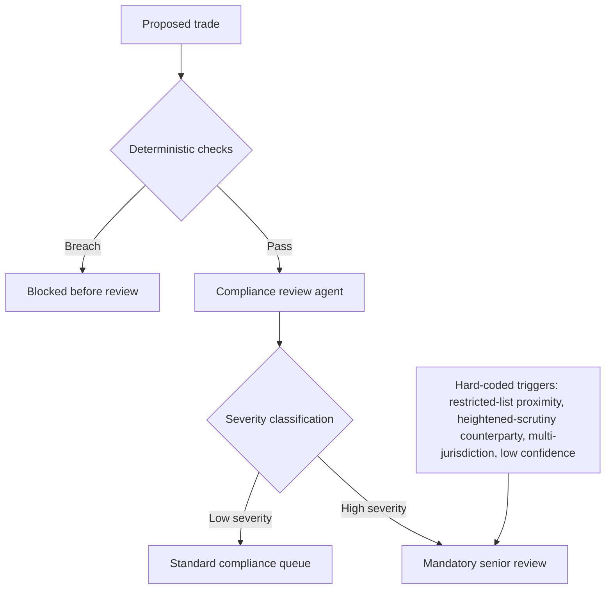

# Trade Risk Management/Compliance - Agentic Architecture
{: .no_toc }

*Video duration: 7:26*

The agentic architecture for a trade risk and compliance system starts from a constraint that's unusual in this course: the right amount of autonomy to grant is not primarily a function of what the model is capable of, it's a function of what the domain will tolerate, and the domain tolerates very little. That reframes the design question. Instead of asking "how much of this process can an agent handle end to end," the right question is "how much of this process is genuinely mechanical and should never touch a model at all, and for the remainder, how do we get useful agentic reasoning into a human reviewer's hands as fast as possible without ever letting that reasoning become the decision itself."

## Deterministic Rule-Checking vs. Agentic Judgment

The first and most important design move is separating the system into two architecturally distinct tiers, not just two conceptual categories described in a prompt. **Deterministic checks** — position limits, notional caps, concentration thresholds, hard restricted-list exact matches, and any other rule that reduces to evaluating trade data against a fixed numeric or boolean condition — are implemented as ordinary code: a rules engine or validation functions running against structured trade data with no language model in the loop. This isn't a cost-driven simplification; it's a correctness requirement. A deterministic check is auditable in a way a model call never fully is — the same input always produces the same output, verifiable by re-running the function, which matters when a regulator or internal auditor asks "why did this trade clear."

**Agentic judgment** is reserved for the genuinely ambiguous remainder: cases where applying a rule requires reading and interpreting text, connecting a trade to context that isn't already structured (a counterparty's recent regulatory history, a near-miss restricted-list match requiring a judgment call on whether it's actually the same entity, a trade structure that could plausibly trigger two different rules), or synthesizing several partially-relevant rules into an overall risk assessment. This is where an agent earns its place — not because it's more powerful than the deterministic tier, but because that tier structurally cannot handle unstructured judgment. The alternative to an agent doing this work isn't "no work happens," it's a compliance officer doing the same reading and cross-referencing by hand, slower and with less consistent documentation.

Keeping these tiers separate — rather than letting an agent "help out" with the deterministic checks too, since it technically could evaluate a numeric threshold if asked — matters because blending them erodes the auditability that makes the deterministic tier valuable in the first place. If a position-limit check sometimes runs as code and sometimes gets waved through by an agent's confident-sounding reasoning, the system's guarantees degrade to whatever the weakest path provides, and reviewers can no longer treat "it passed the deterministic check" as meaning what it's supposed to mean.

## A Single, Narrowly Scoped Reviewer Agent

Unlike the idea generation use case, this system doesn't benefit from an elaborate multi-agent pipeline. The agentic tier is best implemented as a single, narrowly scoped **compliance review agent** whose only job is to take a trade that's already cleared the deterministic tier and assess it against the ambiguous, judgment-requiring rules — not multiple competing agents, not a generator/critic split. The reason is structural: unlike thesis generation, there's no analogous "enthusiasm" failure mode to guard against here, because the agent isn't building a case for anything, it's evaluating a trade against fixed external rules. What this domain needs is consistency and traceability, not an adversarial internal check — the check that matters here is the human compliance officer reviewing the agent's output, not a second agent second-guessing the first.

This single agent's toolset is deliberately tiny and read-only: it can retrieve applicable rule text, look up counterparty records and trade details, and search prior review decisions for precedent. It has no tool that writes anything back to a trading system, a position record, or an order — the same "the tool simply doesn't exist" principle that governed autonomy boundaries in the idea generation use case applies here even more strictly, since a bypassed boundary here means not a wasted analyst-minute but a trade that shouldn't have executed.

## Autonomy Boundaries

The compliance review agent's autonomy is bounded to producing a structured assessment: which rules plausibly apply, the specific rule text and version it's citing, its confidence in the assessment, and — critically — an explicit **severity classification** that determines what happens next. A low-severity assessment (say, a borderline exposure percentage with clear supporting rationale) might route to standard compliance queue review. A high-severity assessment (a plausible restricted-list match, a clear regulatory conflict, anything touching a counterparty already under heightened scrutiny) triggers mandatory escalation to a senior compliance officer, and the trade is held pending that review regardless of how confident the agent's own assessment sounds. The agent never gets to clear a trade, downgrade its own severity classification after the fact, or resolve a flag it raised — those are exclusively human actions, logged as such.

{: .important }
> The agent's severity classification is a recommendation, not a decision. It cannot clear a trade, downgrade its own severity call after the fact, or resolve a flag it raised — those actions are exclusively human, and every one of them is logged as such.

This is the domain's central design principle stated plainly: the agent's job is to raise the right questions with the right evidence attached, as reliably and quickly as possible, and a human's job is to answer them. Confidence in the agent's own output is never treated as a substitute for review — even a high-confidence "this trade looks fine" assessment from the agent still routes through the standard human review queue, because the entire point of the system is to make that human review faster and better-informed, not to make it optional.

## Mandatory Escalation Paths

Escalation in this system is not a courtesy setting — it's a hard-coded routing rule sitting outside the agent's own control. Certain trigger conditions (restricted-list proximity matches, counterparties on a heightened-scrutiny list, trades that touch more than one jurisdiction's rules simultaneously, or any case where the agent itself reports low confidence) automatically route to senior review regardless of what the agent's severity classification says, precisely so that a single bad inference by the agent can't suppress an escalation that should have happened. This mirrors a theme from the core course material on ambiguity handling: when a system doesn't have enough information to proceed safely, the correct behavior is to **stop and defer, not to guess** — and here that principle is enforced by workflow routing rather than left to the agent's own discretion to apply consistently.

## Architecture Notes

This is the Agentic layer's autonomy-boundary discipline pushed to its strictest form: the domain fixes autonomy near zero for anything execution-adjacent, and the architecture reflects that by keeping deterministic and agentic reasoning in physically separate tiers rather than blending them under one flexible agent. Mandatory, workflow-enforced escalation paths are the Workflow layer's answer to a Context-layer problem — an agent's own confidence is not trustworthy evidence that no human review is needed, so the review gate is built into the routing logic itself rather than into the agent's judgment about when to ask for help.

<!-- prevnext:start -->

---

| [&larr; Previous: Trade Risk Management/Compliance - Overview](06-trade-risk-management-and-compliance-overview) | [Next: Trade Risk Management/Compliance - Context Architecture &rarr;](08-trade-risk-management-and-compliance-context-architecture) |
|:---|---:|

<!-- prevnext:end -->
