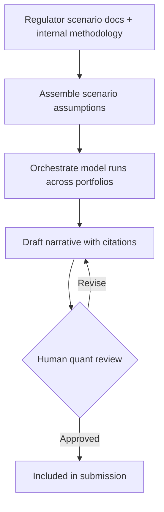

# Stress Testing - Overview
{: .no_toc }

*Read duration: 8:22*

Once a year — sometimes twice — a bank's risk organization has to answer a question regulators consider existential: if the economy took a sharp, specific, and unpleasant turn, would this institution still be solvent, still lending, and still capable of absorbing losses without a taxpayer-funded rescue? In the United States that question is formalized as CCAR (Comprehensive Capital Analysis and Review) and DFAST (Dodd-Frank Act Stress Testing); other jurisdictions run structurally similar exercises under the EBA, PRA, or Basel frameworks. Whatever the acronym, the mechanics are the same. A regulator publishes a small number of macroeconomic scenarios — a baseline, an adverse case, and a severely adverse case — specifying paths for unemployment, GDP growth, interest rates, housing prices, equity indices, and a dozen other variables over a nine-quarter horizon. The bank must then project how those macro paths flow through to its own balance sheet: loan losses, trading losses, revenue, capital ratios, and ultimately whether it stays above the regulatory minimums the entire way through the hypothetical downturn.

## The Business Problem

The work of translating a macro scenario into a bank-specific projection is enormous. A large bank's risk team has to assemble scenario assumptions from regulatory publications, map those assumptions onto dozens of internal models covering different portfolios (retail credit, commercial real estate, trading book, counterparty risk), run those models against the bank's actual current portfolio composition, reconcile the outputs into a single capital projection, and then — the part that is easy to underestimate — write a coherent narrative explaining *why* the numbers came out the way they did. Regulators do not accept a spreadsheet of results on its own; they expect a defensible story that connects scenario assumptions to portfolio characteristics to modeled outcomes, in language a supervisor with deep expertise but no institutional memory of your bank can follow and challenge.

That narrative work is where quantitative analysts currently spend an outsized share of their time relative to its intellectual difficulty. The modeling itself is technical and specialized, but writing up results — pulling together the scenario story, the portfolio drivers, the quarter-over-quarter trajectory, and the comparison against the prior cycle — is largely a drafting and synthesis task performed under a hard deadline, across dozens of sub-portfolios, every cycle. It's exactly the kind of high-volume, structured-but-verbose writing task where a Claude-based assistant can compress weeks of drafting effort, provided it's built with the constraints this domain demands.

## Why This Is High-Stakes and Audit-Heavy

Stress testing sits near the top of any bank's risk-and-compliance stack for a simple reason: getting it wrong has consequences that compound. An error in a submitted stress test can trigger a supervisory finding, a mandated remediation plan, or in the most severe cases a formal objection to the bank's capital plan — which can block dividends and share buybacks for a full year. Because the stakes are that high, every number and every sentence in a submission has to be traceable. Regulators can and do ask "where did this figure come from, and why does this year's narrative differ from last year's for the same portfolio segment?" A bank that can't answer that question crisply, with a reconstructable chain of assumptions and model runs behind it, has a supervisory problem independent of whether the underlying number was even correct.

This creates two requirements that shape the whole system design. First, everything the system produces has to be **reproducible** — the same scenario and portfolio inputs, run again months later during an examination, need to produce the same output, with a clear record of what changed if they don't. Second, nothing can leave the building as a bank position without a human with subject-matter authority signing off on it. A hallucinated loss driver or a subtly mischaracterized scenario assumption in a regulatory submission isn't a minor content bug; it's the kind of error that damages institutional credibility with a supervisor for years. Both of these requirements point toward an architecture where Claude is doing real cognitive work — assembling, calculating support, and drafting — while staying firmly inside a review structure the quant and compliance teams control.

{: .important }
> Nothing leaves the building as a bank position without a human with subject-matter authority signing off on it. A fluent, well-cited draft is still a draft — a hallucinated loss driver or mischaracterized scenario assumption in a submission damages institutional credibility with a supervisor for years, not just this cycle's numbers.

## The High-Level Solution Shape

The system this module describes is not a single autonomous agent that "runs the stress test." It's a structured assistant that supports each stage of a process the quant team still owns end to end. At the front, it helps assemble scenario assumptions from the regulator's published scenario documents and the bank's internal methodology, translating dense tables into the structured inputs the bank's models expect. In the middle, it helps orchestrate running those assumptions against current portfolio data — not by inventing model logic itself, but by calling the bank's existing modeling infrastructure as tools and organizing the outputs. At the back end, where the highest-value time savings live, it drafts the narrative explanations that connect scenario assumptions, portfolio characteristics, and modeled results into the prose regulators expect, citing the specific inputs behind every claim so a reviewer can verify rather than take the draft on faith.

Every stage in that shape is deliberately bounded: the system assembles and drafts, a human quant reviews and approves, and **nothing is submitted without that human step**. The remaining lectures in this use case walk through why that low-autonomy design is the right call, what has to live in context at each stage (and why version control on scenario data is non-negotiable), how retrieval is built to always surface the current cycle's rules rather than a stale prior cycle's, and how the whole system is logged, audited, and kept cost-effective given that it runs hard for a few weeks a year rather than continuously.

## Architecture Notes

Stress testing is a strong illustration of how the CCA-F's five layers interact under regulatory pressure: the **Agentic** layer stays deliberately shallow (assist, don't decide), the **Context** layer has to carry versioned scenario and portfolio state without contamination across cycles, and the **Workflow** layer supplies the mandatory human checkpoints that make the whole system auditable. Later lectures in this use case will show how **Tool** design (wrapping existing model infrastructure rather than reimplementing it) and **Prompt** design (grounding every narrative claim in a citable input) reinforce that same low-autonomy, high-traceability posture.

<!-- prevnext:start -->

---

| [&larr; Previous: Extra Module: Solution Architecture Patterns - Banking Compliance](./) | [Next: Stress Testing - Agentic Architecture &rarr;](02-stress-testing-agentic-architecture) |
|:---|---:|

<!-- prevnext:end -->
