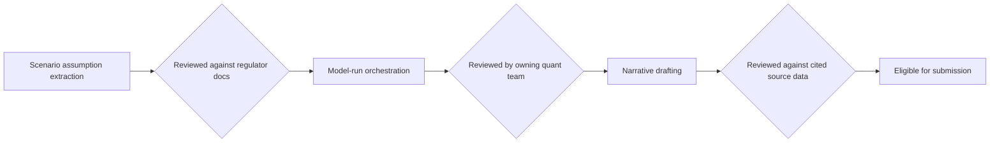

# Stress Testing - Agentic Architecture
{: .no_toc }

*Video duration: 8:15*

If the overview lecture established anything, it's that a stress-testing system's biggest architectural risk isn't that it's too weak — it's that it's too capable in the wrong direction. A system confident enough to draft regulatory narrative is also, unchecked, confident enough to draft a *wrong* regulatory narrative in exactly the same fluent tone as a correct one. That asymmetry is why the agentic design for this use case deliberately caps autonomy well below what the underlying model is capable of, and it's worth being explicit about how and why.

## Assistant, Not Decision-Maker

The core agentic principle here is a strict separation between *assembling and drafting* and *deciding and approving*. Claude's role at every stage — scenario assumption extraction, model-run orchestration, results synthesis, narrative drafting — is to produce a structured, well-cited artifact that a human quant can evaluate quickly. It is never the system's job to decide that a number is final, that a methodology choice is correct, or that a narrative is ready to submit. This isn't a conservative default chosen out of general caution; it follows directly from the nature of the task. Stress-test outputs feed directly into a regulatory submission with legal and reputational consequences, and the quantitative judgment involved — which model to trust when two disagree, how to explain a counterintuitive result, whether a scenario assumption was applied correctly to a specific portfolio segment — requires exactly the kind of domain expertise and institutional accountability that has to remain with a named, credentialed human.

{: .important }
> A system confident enough to draft a fluent, well-supported regulatory narrative is also, unchecked, confident enough to draft a *wrong* one in exactly the same tone. Fluency is not a signal of correctness here — it's why the assemble/draft-versus-decide/approve boundary can never collapse, no matter how good the drafts look.

Concretely, this means the system is architected around a small set of narrow, well-defined stages rather than a single open-ended agent loop deciding its own path through the whole exercise. A scenario-assembly stage takes regulator-published scenario documents and internal methodology as input and produces structured, machine-usable assumption sets — a task with a clear right answer that's easy to check against the source. An orchestration stage calls the bank's existing model infrastructure (as tools, not reimplementations — more on this in the tool-design implications below) and collects outputs into a consistent format. A synthesis-and-drafting stage takes those outputs, plus prior-cycle results and portfolio context, and produces narrative explanations with inline citations back to the specific figures and assumptions each sentence relies on. Each stage has a narrow mandate and a checkable output, which is precisely what keeps autonomy low without also making the system slow or brittle.

## Why Low Autonomy Is the Right Call

It's worth contrasting this explicitly with a higher-autonomy alternative, because the CCA-F exam rewards being able to articulate *why* a design choice was made, not just state what it is. A more autonomous design might let an agent decide for itself which portfolios need re-running when a scenario assumption changes, or let it choose how to resolve a discrepancy between two internal models rather than flagging it. Both would save time. Both would also be architecturally wrong for this domain, because the cost of an unsupervised bad call is not "redo some work" — it's a **materially misstated regulatory submission** that damages the bank's standing with its supervisor. Autonomy is valuable precisely where the right next step can't be enumerated in advance and the cost of exploring is low; stress testing is close to the opposite of that profile. The steps are well understood, the acceptable range of outputs is narrow, and the cost of an unpredictable path is severe. That combination is the textbook case for keeping agentic scope narrow and workflow structure explicit, even though the underlying task — reading dense documents, running numbers, writing narrative — is exactly the kind of work language models are good at.

## Mandatory Review Gates

The review structure isn't a single sign-off at the end; it's staged to match where errors are most likely and most costly to catch late. Scenario assumption extraction is reviewed against the regulator's published documents before anything downstream consumes it, because an error here propagates into every subsequent stage. Model-run orchestration output is reviewed by the quant team that owns each model, since they're the ones positioned to notice an output that's technically well-formed but substantively implausible. And every piece of narrative text is reviewed against its cited source data before it's eligible to move toward the compiled submission — not as a formality, but as the point where a subject-matter expert **actually reads the sentence** and confirms it says what the numbers support.

This staged-gate structure also does something subtler: it keeps each review scoped and fast. A reviewer checking scenario extraction doesn't need to also evaluate narrative quality, and a reviewer reading narrative doesn't need to re-derive the model run. Because each stage produces a narrow, checkable artifact, review stays proportional to what actually changed at that stage rather than requiring a full re-audit of the whole pipeline every time. That's what makes a low-autonomy design practical at the scale a real submission requires — dozens of portfolio segments, multiple scenarios, and a hard regulatory deadline — rather than merely safe in theory.

## Architecture Notes

This use case is a clean example of the **Agentic** layer's central trade-off: autonomy is valuable when the right next step can't be enumerated in advance, and a liability when it can be and the cost of error is high — stress testing is squarely the latter. The staged, narrow-mandate design also leans on the **Workflow** layer to place review gates exactly where errors are costliest to catch late, and on the **Tool** layer to keep Claude orchestrating the bank's existing model infrastructure rather than reimplementing modeling logic itself.

<!-- prevnext:start -->

---

| [&larr; Previous: Stress Testing - Overview](01-stress-testing-overview) | [Next: Stress Testing - Context Architecture &rarr;](03-stress-testing-context-architecture) |
|:---|---:|

<!-- prevnext:end -->
