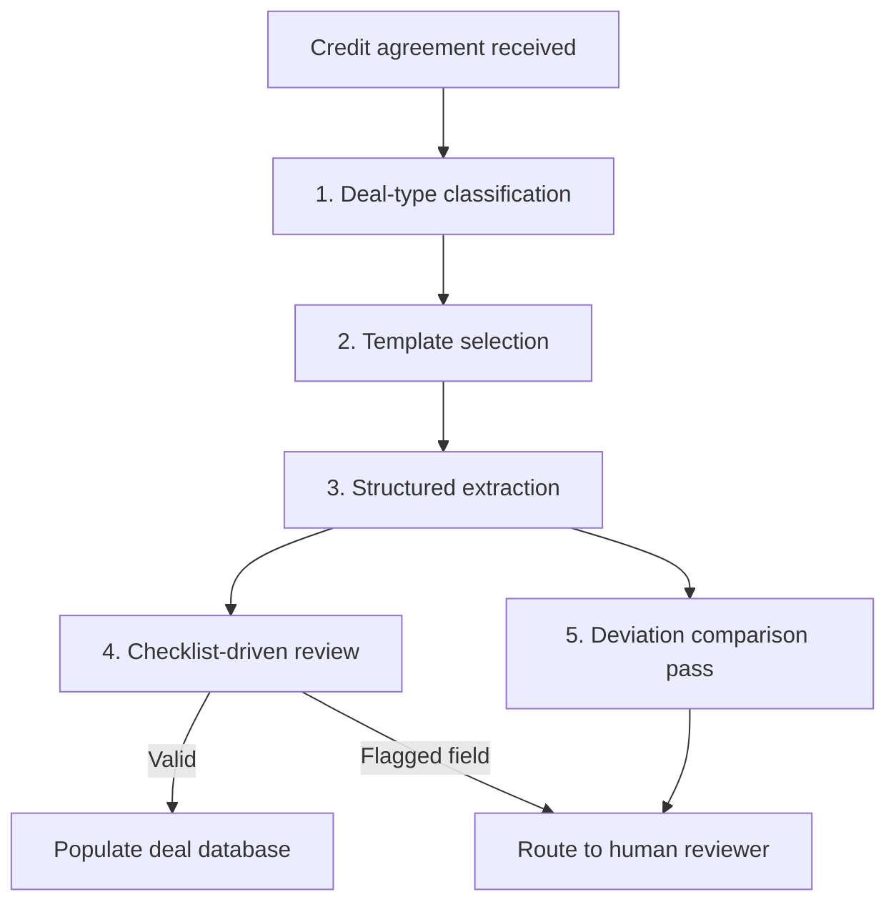

# Credit Agreements - Local Workflows
{: .no_toc }

*Read duration: 6:46*

The natural instinct when building "a Claude system that reads legal documents and answers questions" is to reach for an agent: give it a document, give it some tools, and let it figure out what to extract and how. For credit agreements, that instinct is usually wrong, and it's worth being explicit about why, because the reasoning generalizes to a lot of enterprise document work beyond this one asset class.

## Why fixed workflows beat open-ended judgment here

Recall the agentic-vs-workflow question from the core course: agentic autonomy earns its cost when a task's steps can't be fully enumerated in advance, because the right next action depends on what was just discovered. Credit agreement extraction fails that test on purpose. A lending team already knows, before it opens a single document, exactly what fields it needs out of a term loan agreement — facility amount, maturity date, applicable margin, leverage covenant threshold, and a fixed list of another twenty to forty data points that populate the firm's deal database. That list doesn't change document to document; it's set by what downstream systems and people consume, not by what's interesting about any particular agreement. When the destination schema is fixed and known in advance, letting a model improvise its own path to filling it in adds variance without adding value — it just makes the output harder to predict, harder to QA, and harder to explain when a number is wrong.

There's a second reason, specific to this domain, that goes beyond the general workflow-vs-agent trade-off: credit agreements bucket into a small number of well-known **deal types** — revolvers, term loan A, term loan B, asset-based lending facilities, unitranche — and each type has its own conventional document architecture and its own list of fields that matter. A leverage covenant matters enormously for a term loan B and may not exist at all in an ABL facility, where the operative concept is a borrowing base. That means the extraction task isn't even "read this document and figure out what's important" — it's "identify which of a small number of known deal types this is, then run *that* deal type's checklist."

{: .important }
> Don't apply one universal field checklist across deal types. A leverage covenant is central to a term loan B and often absent entirely from an ABL facility — extraction templates must be deal-type-specific, or the pipeline will either force-fit fields that don't apply or silently miss the ones that do. That's a classification-plus-lookup problem, not an open-ended reasoning problem, and it maps cleanly onto a deterministic pipeline rather than an autonomous agent deciding step by step what to do.

Cost and auditability reinforce the same conclusion. A fixed workflow runs the same prompt template against the same fields every time, which makes its behavior predictable, its failures reproducible, and its output easy to spot-check against a known schema. An agent given the same task with an open-ended "extract what's important" instruction will produce output that varies in coverage and framing from run to run, which is precisely the kind of variance a lending team — one whose entire job is precision about numbers and dates — cannot tolerate.

## What the workflow structure looks like concretely

The practical shape of this system is a short, fixed pipeline rather than a single freeform prompt:

1. **Deal-type classification.** A first, narrow step (which can itself be a small, cheap Claude call or even a simpler classifier) identifies which of the firm's known deal types the document matches, based on structural signals — presence of a borrowing base mechanic, presence of a term loan amortization schedule, the facility's own self-description in its opening recitals.
2. **Template selection.** That classification selects a **deal-type-specific extraction template**: a fixed, versioned prompt that lists exactly the fields to extract for a term loan B versus an ABL facility, along with the section of the document each field is conventionally found in (financial covenants live in the negative covenants article; pricing lives in the definitions and the pricing grid schedule).
3. **Structured extraction.** The model is run against the relevant sections of the document with that template, and it returns output constrained to a defined schema — structured fields, not free prose — so the result can be validated programmatically (is the maturity date a valid date, is the facility amount a number, is the covenant threshold within a plausible range) before it ever reaches a human.
4. **Checklist-driven review.** The extracted record is checked against a **per-deal-type checklist**: a fixed list of fields that must be present, plus sanity rules (a leverage covenant threshold below 0 or above some absurd ceiling is flagged, not silently accepted). Anything the checklist can't validate — a missing field, an out-of-range value, a term the model flagged as ambiguous — routes to a human reviewer rather than being auto-populated into the deal database.
5. **Deviation comparison as a separate, equally deterministic pass.** Comparing the agreement's clause language against house-standard paper runs as its own fixed step, clause type by clause type (financial covenants against the standard covenant package, MFN language against the standard MFN clause), rather than as an open-ended "review this whole document and tell me what's unusual" instruction — narrowing the comparison to like-for-like clause types is what keeps the comparison precise rather than impressionistic.

Where this pipeline *does* leave room for model judgment is inside each narrow step — deciding, for instance, whether a particular carve-out is "materially" different from the standard one requires real language understanding, not string matching. But that judgment is exercised inside a tightly bounded task with a defined input and a defined output shape, which is a world away from an agent freely deciding what to look at next. This is the general pattern worth internalizing: local workflows don't mean "no model reasoning" — they mean the *sequence and scope* of steps is fixed by the architect, while the model still supplies judgment within each step.

**Architecture Notes:** This is squarely a Workflow-layer decision: the deal-type checklist and extraction template are the kind of persistent, versioned configuration that belongs in a fixed pipeline rather than being re-derived by an agent every run. It borrows from the Tool layer in that each extraction step behaves like a well-scoped tool call with a validated schema, and it deliberately keeps the Agentic layer's autonomy out of the picture because the steps are fully enumerable in advance.

<!-- prevnext:start -->

---

| [&larr; Previous: Credit Agreements - Overview](01-credit-agreements-overview) | [Next: Credit Agreements - Context Architecture &rarr;](03-credit-agreements-context-architecture) |
|:---|---:|

<!-- prevnext:end -->
