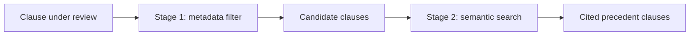

# Credit Agreements - RAG & Retrieval Architecture
{: .no_toc }

*Video duration: 8:22*

The previous lecture drew a line between the agreement itself (always in context for the task at hand), the defined-terms glossary (near-constant), and precedent clauses (retrieved). This lecture is about that third category: how a credit agreement system retrieves comparison material from a corpus of past deals, and — just as importantly — how it cites back to exact source language so nothing it says has to be taken on faith.

## Why this is a retrieval problem, not a context-stuffing problem

A lending institution that has done any meaningful volume of deals has a precedent library running into the hundreds or thousands of agreements. There is no version of "put all of it in context" that works, even with a large context window, because most of that library is irrelevant to any single comparison task — a deviation check on a term loan B's leverage covenant needs other term loan B leverage covenants, not the ABL borrowing-base language from an unrelated deal three years ago. This is precisely the situation retrieval-augmented generation is built for: a corpus too large to fit in context, where the value of any given document depends entirely on the query at hand, so the system needs to narrow the corpus down to what's relevant *before* the model ever reasons over it.

The retrieval unit matters more here than the retrieval mechanism. Retrieving whole agreements as the unit of comparison is close to useless — a deviation check on a leverage covenant doesn't care about the rest of a two-hundred-page precedent document. The corpus is instead indexed at the **clause level**: each precedent agreement is pre-segmented into its constituent clauses (individual covenants, individual representations, individual events of default), and each clause is tagged with metadata that makes filtering possible before semantic search even runs — deal type, clause category (financial covenant, negative covenant basket, MFN provision, change-of-control definition), vintage, and sometimes borrower industry. That clause-level indexing is what turns "find precedent for this leverage covenant" from a search over two hundred irrelevant pages per document into a search over a tightly-scoped set of comparable clauses.

## A two-stage retrieval pattern

In practice this works best as two stages rather than one. The first stage is **metadata filtering**: given the clause type currently under review (say, a leverage covenant in a term loan B) and known deal characteristics, the candidate set is narrowed to precedent clauses of that same type and deal type before any embedding similarity is computed. This step alone does most of the useful work, because clause type is the single strongest predictor of relevance — a leverage covenant from another term loan B is a vastly better comparison than a semantically similar-sounding sentence from an unrelated clause category. The second stage is **semantic retrieval within that filtered set**: embedding-based similarity search over the remaining candidates surfaces the precedent clauses whose actual language is closest to the clause being reviewed, which matters because covenant language varies in phrasing even when it's conceptually standard, and a purely keyword-based search would miss paraphrased equivalents.

This two-stage design avoids a common failure mode of RAG applied naively to legal text: pure semantic search over an undifferentiated corpus tends to surface clauses that are *topically* similar but *categorically* wrong — a passage that uses similar vocabulary but sits in a different part of the document's legal logic, like retrieving a representation instead of a covenant because both happen to discuss "material adverse effect." Filtering by structural metadata first, and only then applying semantic search, keeps the comparison set legally coherent rather than just lexically similar.

## Precise citation as a non-negotiable output property

Everything the system says about a credit agreement — an extracted term, a flagged deviation, an answer to a question — has to be traceable to a specific clause or section, not offered as an unattributed claim. This isn't a nice presentational feature; it's what makes the tool usable by people whose job is to be accountable for what they sign off on. A lending attorney is not going to rely on "the leverage covenant threshold is 4.0x" without being able to click through to Section 7.02(a) of the specific agreement and read it themselves in ten seconds.

Concretely, this means every retrieved passage and every extracted fact carries structured provenance — document identifier, article and section number, and ideally the exact character or page span — that survives all the way from retrieval through to the final answer the model produces. The model should be prompted (and validated) to attach that citation to every substantive claim, and a system that can't produce that citation for a given claim should treat the claim as unsupported rather than presenting it with the same confidence as a cited one. This is also where deviation flagging earns its trustworthiness: "this covenant is unusually loose" is a much stronger claim when it's accompanied by "compared against these three precedent clauses from comparable term loan B deals, cited here," than when it's an unsupported assertion about what's "typical."

## Handling comparisons across evolving market standards

One wrinkle specific to credit agreements is that "standard" isn't static — covenant packages loosen and tighten with credit market conditions, and a clause that was aggressive five years ago might be market-standard today. A retrieval architecture that doesn't account for this will produce misleading comparisons, flagging a perfectly current covenant as a deviation because it differs from a five-year-old precedent, or vice versa. The practical fix is to weight retrieval toward vintage — preferring recent precedent clauses over older ones for "is this market standard" comparisons, while still surfacing the full historical range when a user is explicitly asking about how a term has evolved over time. This is a case where the metadata filter isn't just a relevance improvement, it's necessary to avoid a specific, predictable error mode.

**Architecture Notes:** This is Context-layer retrieval design layered directly on top of the Workflow layer's fixed pipeline: the deviation-check step in the workflow calls out to a retrieval step whose scope (clause type, deal type, vintage) is itself predetermined by the deal-type template, not discovered by open-ended search. Precise, section-level citation is a data-provenance requirement — the model must be able to show, for every claim, which source clause it came from, which is what lets a human reviewer verify rather than merely trust the output.

<!-- prevnext:start -->

---

| [&larr; Previous: Credit Agreements - Context Architecture](03-credit-agreements-context-architecture) | [Next: Credit Agreements - Observability and Costs &rarr;](05-credit-agreements-observability-and-costs) |
|:---|---:|

<!-- prevnext:end -->
