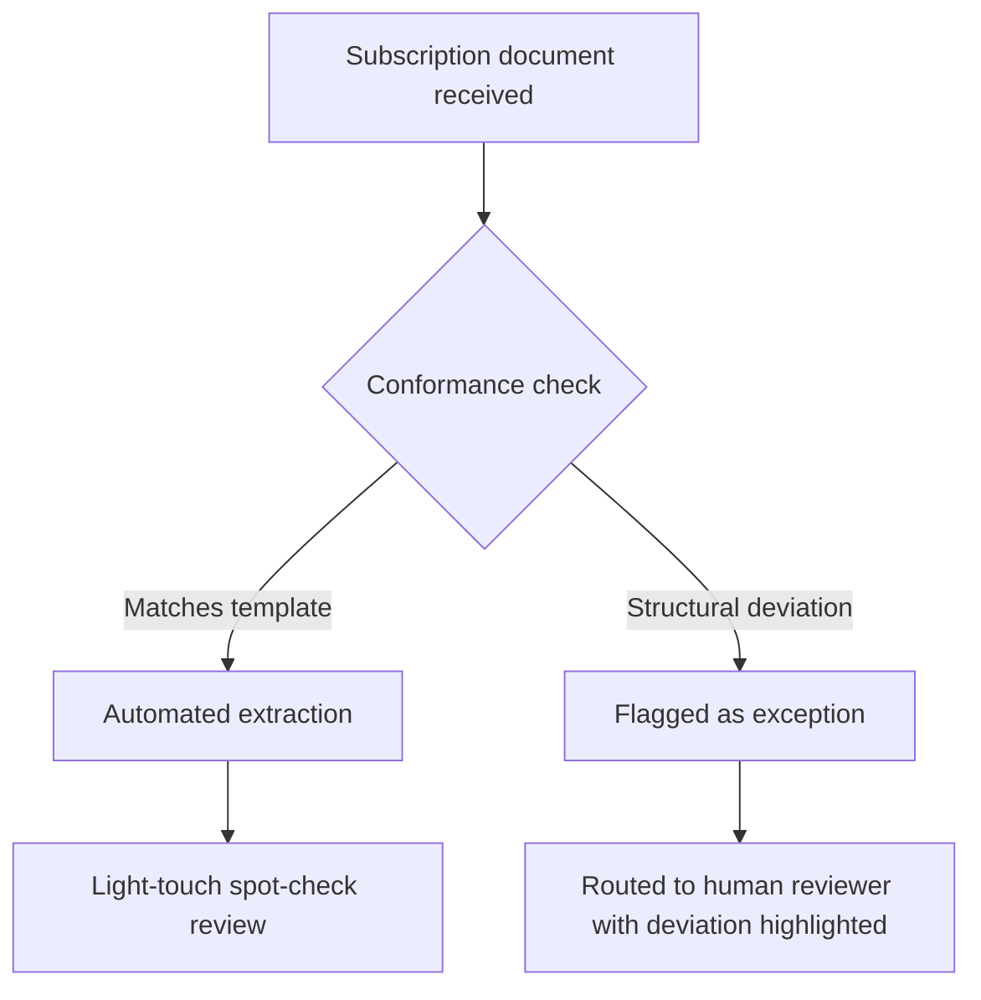

# LPA/Subscription Agreements - Local Workflows
{: .no_toc }

*Read duration: 6:48*

If credit agreements made the case for local workflows on the strength of a known, fixed field schema, subscription documents make an even stronger version of the same case, because the documents themselves are templated, not just the fields extracted from them. A fund closing might see two hundred subscription agreements come in, and the overwhelming majority of them are the same document with different names, amounts, and boxes checked. Building an agentic system that reasons freely about each one from scratch would be solving a harder problem than the one that actually exists — and solving it slower, less predictably, and more expensively than a workflow built around the template that's already there.

## Templated extraction across many similar documents

The workflow's default path is a batch pipeline, not a per-document conversation. Every subscription document in a closing is run through the same fixed extraction template — the standard field list (subscriber legal name, jurisdiction of formation, commitment amount, entity type, tax classification checkboxes, AML/KYC representations, signature and date) mapped to the same conventional locations in the standard subscription document form. Because fund counsel typically drafts and distributes the subscription document template itself, the system can be built with genuine knowledge of exactly where in that template each field lives, which makes extraction closer to structured form-parsing than open-ended document comprehension — the model's job is largely to correctly read values out of known positions and normalize them (parsing a commitment amount written as "Five Million Dollars ($5,000,000.00)" into a clean numeric field, for instance), rather than to discover what matters.

That batch orientation has a direct operational payoff: the same fixed template and validation rules run across every document in the closing, so results are directly comparable across the batch, extraction quality doesn't degrade as volume scales up (each document is an independent, identically-structured unit of work), and the whole run produces a consistent structured dataset — one row per LP — that flows straight into the fund's investor record system rather than needing to be reconciled from documents processed in inconsistent ways.

## Exception handling when a document deviates from the standard template

The templated approach only works if it's paired with a reliable mechanism for recognizing when a document *isn't* standard, because **the whole efficiency argument collapses if a redlined or non-conforming document gets silently forced through the standard pipeline and processed with default assumptions**.

{: .important }
> A conformance check is not optional polish on a templated pipeline — it's the control that keeps a redlined or non-conforming document from being silently processed with default assumptions. Skip it, and the batch's speed advantage becomes a liability the moment a document deviates. The practical design is a **conformance check** that runs before, or as the first stage of, extraction: comparing the incoming document's structure and language against the known template, section by section, and computing something closer to a diff than a fresh read. A document that matches the template closely — same section order, same clause language, only the investor-specific blanks filled in — is a high-confidence candidate for full automated extraction. A document with structural differences — a redlined clause, an inserted side letter reference, a missing representation, an unusual entity structure that doesn't fit the standard tax-classification checkboxes — gets flagged as an **exception** and routed differently.

That routing distinction matters operationally as much as technically. Standard documents flow through the automated extraction pipeline with light-touch spot-check review. Exceptions get pulled out of the batch and routed to a human reviewer — typically fund counsel or a senior operations person — with the specific deviation already identified and highlighted, so the reviewer's time is spent evaluating the substance of the deviation rather than rediscovering that one exists by rereading the whole document against the standard form themselves. This is the same principle as the checklist-driven review from the credit agreements module, applied at the front end of the pipeline instead of the back end: catch the exception early, and let automation handle everything that's genuinely routine while reserving human judgment for what actually needs it.

A well-designed exception workflow also tracks exception *types* over time, not just flags individual instances. If a particular kind of deviation — say, a specific tax-status carve-out — starts appearing across multiple LPs in the same closing, that's a signal worth surfacing to fund counsel directly: either the template needs updating to handle a legitimate recurring case, or several investors are independently pushing the same non-standard request that's worth addressing at the fund level rather than one document at a time. That kind of pattern detection across the exception queue is itself a fixed, low-cost check layered on top of the workflow — it doesn't require agentic judgment, just aggregation of what's already been flagged.

The overall shape, then, is a workflow tuned for a bimodal distribution: fast, cheap, highly automated processing for the large majority of documents that conform to template, and a clearly separated, human-reviewed path for the minority that don't — with the system's own conformance check doing the work of sorting one from the other rather than leaving that judgment to whoever happens to open the document first.

**Architecture Notes:** This is Workflow-layer design at its most literal: a fixed, versioned template drives extraction, and a deterministic conformance check — not agentic judgment — decides which path a document takes. The exception path still relies on the model's language understanding to identify *what* changed, but the routing decision itself (standard versus exception) is rule-based, keeping the Agentic layer's open-ended autonomy out of a process that doesn't need it for the vast majority of documents.

<!-- prevnext:start -->

---

| [&larr; Previous: LPA/Subscription Agreements - Overview](06-lpa-and-subscription-agreements-overview) | [Next: LPA/Subscription Agreements - Context Architecture &rarr;](08-lpa-and-subscription-agreements-context-architecture) |
|:---|---:|

<!-- prevnext:end -->
