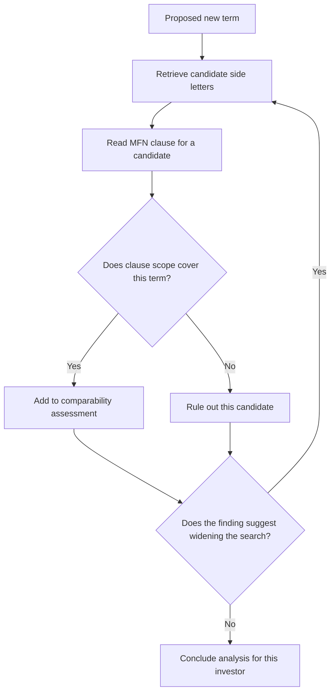

# MFN & Side Letter Negotiation - Agentic Architecture
{: .no_toc }

*Video duration: 6:50*

The credit agreements and LPA/subscription modules both made a deliberate case *against* agentic autonomy — fixed workflows won because the tasks had known schemas and enumerable steps. This lecture makes the opposite case, for the same underlying reason: architecture should follow the shape of the task, and MFN analysis is shaped differently.

## Revisiting the agentic-vs-workflow test

The core course's test for when agentic autonomy earns its cost is whether the right next action depends on what was just discovered, in a way that can't be fully specified in advance. Apply that test to MFN analysis directly. Given a newly proposed side letter term for Investor X, the analysis has to determine which of the fund's existing side letters even have an MFN clause (not all do), what each of those clauses actually covers and excludes (MFN clauses vary — some apply broadly, some are carved out by term category, some apply only to investors above a certain commitment size or within a certain time window of the fund's final close), and then, for each side letter whose MFN clause could plausibly apply, whether the newly proposed term is *substantively* comparable to what that investor already has, not just superficially similar in wording.

That last step is the crux of why this can't be a fixed workflow. Substantive comparability is a judgment call that depends on the specific pair of clauses being compared — a proposed 10-basis-point management fee reduction for a large anchor investor might not trigger an MFN right for a much smaller investor if that investor's MFN clause is scoped to "similarly situated" investors by commitment size, but the same fee reduction might trigger a different investor's broader, unqualified MFN right. There's no way to write a fixed checklist that correctly resolves every such comparison in advance, because the comparison logic itself depends on the specific carve-outs and qualifiers in each individual side letter, discovered only by reading it. That's exactly the condition — steps that can't be enumerated ahead of time because the right next move depends on what's found along the way — under which the core course says a single agent with narrow, well-scoped autonomy beats a fixed pipeline.

## What the agent actually does

The practical shape is a single agent, not a multi-agent system — this is worth being explicit about, because "complex task" doesn't automatically imply "needs multiple agents." The task doesn't require genuinely distinct specialized expertise at different stages the way, say, a research-then-write-then-fact-check pipeline might; it requires one consistent kind of reasoning (compare a proposed term against existing terms, assess comparability, determine MFN applicability) applied repeatedly across a growing set of comparisons. A single agent equipped with the right retrieval tool, working through the population of relevant side letters, is the right level of decomposition — introducing a coordinator and several subagents here would add coordination overhead without adding capability, since there's no natural specialization boundary to divide the work along.

That agent's loop looks like this: given a proposed new term, it retrieves candidate side letters that might be affected (the retrieval strategy for surfacing these, especially when MFN-relevant clauses are phrased very differently across letters, is the subject of the next-but-one lecture); for each candidate, it reads the relevant MFN clause and assesses, with reasoning it can show its work on, whether that clause's own scope and carve-outs would actually cover the newly proposed term; it decides, based on what it finds, whether to widen the search (a discovered carve-out referencing "co-investment rights" might prompt it to specifically check whether any other side letters have co-investment-related MFN triggers it hadn't initially considered relevant) or to conclude the analysis for a given investor. That widening-based-on-discovery behavior — the model deciding, mid-task, that something it just read changes what it should look at next — is the specific capability a fixed workflow can't replicate and an agent can.

## Bounding the autonomy that's granted

Genuine agentic judgment here doesn't mean unscoped autonomy. The agent's toolset should be narrow and specific to the analytical task: retrieve side letters, read a specific clause, compare two clauses' terms, produce a structured comparability assessment with citations. It should not include any tool that takes an action with external effect — sending correspondence to an investor, updating the fund's side letter registry, or communicating an MFN determination outside the review process. The agent's autonomy is scoped to *reasoning about and assembling* an analysis, and that analysis is a work product for a human reviewer, not a decision the system executes on. This mirrors the "draft, don't send" pattern from the core course's own worked example: the highest-stakes action — telling an investor they do or don't have an MFN right — stays outside what the agent can do unilaterally, no matter how good its analysis is, because the cost of a wrong autonomous action here is a real legal and financial consequence, not a recoverable inconvenience.

**Architecture Notes:** This is the Agentic layer's core trade-off worked in full: a single, narrowly-scoped agent is justified because the comparison steps genuinely can't be enumerated in advance, but a multi-agent system isn't, because there's no real specialization boundary to divide the work along. Bounding the agent's tools to analysis-only actions, with no external-effect capability, is where the Agentic layer's autonomy is deliberately kept in check by Tool-layer scoping — a direct application of the "draft, don't send" pattern to a domain where the equivalent of "send" is legally binding.

<!-- prevnext:start -->

---

| [&larr; Previous: MFN & Side Letter Negotiation - Overview](11-mfn-and-side-letter-negotiation-overview) | [Next: MFN & Side Letter Negotiation - Context Architecture &rarr;](13-mfn-and-side-letter-negotiation-context-architecture) |
|:---|---:|

<!-- prevnext:end -->
