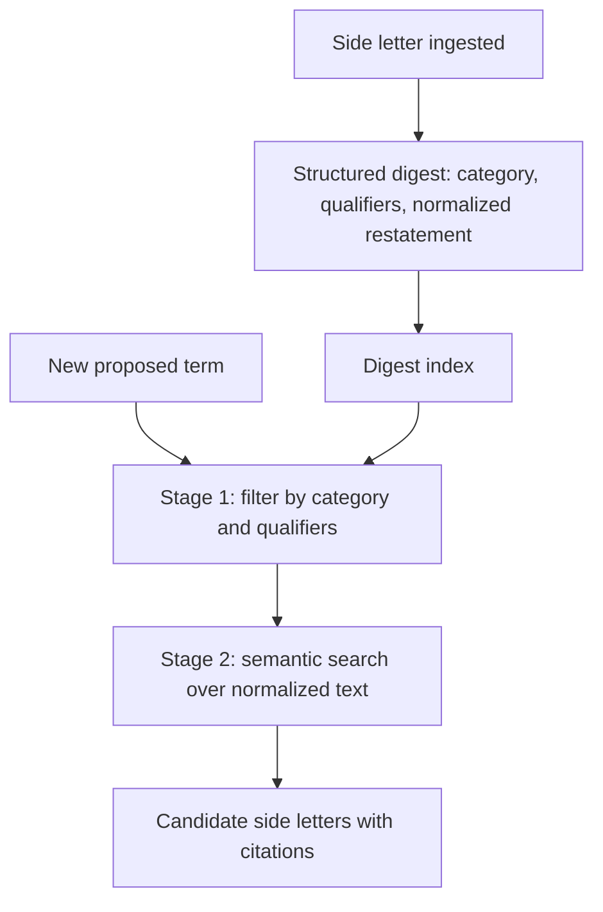

# MFN & Side Letter Negotiation - RAG & Retrieval Architecture
{: .no_toc }

*Read duration: 8:24*

The previous lecture established that MFN analysis needs visibility into the full shape of a fund's side letter population, with on-demand retrieval of full clause text for whichever letters turn out to be relevant. This lecture is about how that retrieval actually works — and about the specific challenge that makes it harder than the retrieval problems in the earlier two modules: MFN-relevant clauses have to be found even when they're phrased in ways that don't obviously match each other.

## Why this corpus is different from the earlier two

Credit agreement precedent retrieval had the benefit of a relatively standardized clause vocabulary within an asset class — leverage covenants across different term loan B deals tend to use recognizably similar structures and language, because they're drafted by overlapping sets of law firms working from overlapping market conventions. LPA consistency checking had an even stronger anchor: exactly one reference document per fund, with a stable internal structure. Side letters have neither advantage. Each one is individually negotiated, often by different outside counsel representing different investors, over the life of a fund that might span a decade or more of drafting conventions drifting over time. Two MFN clauses that mean essentially the same thing — "this investor may elect into more favorable terms granted to other investors of comparable size" — can be phrased in genuinely dissimilar ways: one might use the term "comparable," another "similarly situated," another might not use an adjective at all and instead specify a commitment-size band numerically. A retrieval system tuned for lexical or even naive semantic similarity will miss matches that a human reading both clauses would immediately recognize as functionally equivalent.

That's the central retrieval challenge of this module: **surfacing MFN-relevant clauses by what they functionally do, not by how closely their wording matches a query.** Getting this wrong doesn't produce an obviously bad-looking answer — it produces a silent under-inclusion, where a genuinely relevant side letter never enters the agent's consideration at all because the retrieval step never surfaced it. That failure mode is exactly the "missed MFN trigger" risk the overview lecture flagged as the module's central stakes concern, and it originates here, in retrieval, more often than in the reasoning that happens after retrieval.

{: .important }
> Retrieval tuned for lexical or naive semantic similarity will miss MFN clauses that are functionally equivalent but phrased differently — and that failure is silent, not an obviously bad answer. Normalize side letter language into a comparable digest at ingestion; don't rely on query-time search alone to bridge arbitrary phrasing differences.

## A retrieval strategy built around structured summarization, not raw search

The mitigation is to do the hard normalization work once, up front, rather than repeatedly at query time. As each side letter is ingested into the system, it's processed into a **structured digest**: does an MFN clause exist; what category of terms does it cover (fees, reporting, co-investment, excuse rights, governance); what qualifiers limit it (size thresholds, time windows, category carve-outs, notice-versus-election mechanics); and a normalized, plain-language restatement of what the clause actually does, independent of its specific drafting language. That normalized restatement is the key move — it translates each side letter's bespoke phrasing into a common representation that *can* be compared and searched consistently, rather than asking retrieval to somehow bridge arbitrary phrasing differences at query time, every time, from scratch.

With that digest layer in place, retrieval against a newly proposed term runs primarily against the **normalized category and qualifier fields**, not against raw clause text: which existing side letters have an MFN clause covering the same term category as what's being proposed, and what qualifiers on those clauses might apply. Semantic search over the normalized restatements serves as a second pass, catching functional matches that the categorical tagging might have been too coarse to capture on its own. This two-layer approach — structural/categorical filtering first, semantic search over normalized language second — mirrors the two-stage pattern from the credit agreements module, but the extra step of *normalizing bespoke language into a comparable representation before either stage runs* is what's specific to this use case, because unlike credit agreement covenants, side letter language doesn't arrive pre-standardized by market convention.

## Retrieval has to run in both directions

A subtlety worth naming explicitly: MFN retrieval isn't just "find side letters relevant to this new term." It's also, less obviously, "check whether granting this new term retroactively implicates an MFN right the fund already knew about but hasn't yet acted on" — because MFN elections aren't always exercised immediately, and a fund's obligation under an existing MFN clause can persist even after the term that triggered it was granted. That means the digest layer, and the retrieval built on it, needs to support a query not just from "new term" to "existing side letters" but also periodic batch queries of the form "given everything currently granted across the fund, are there any unresolved MFN obligations sitting latent in the population" — a sweep that doesn't wait for a new proposed term to trigger it. This is less a single retrieval call than a standing analytical job, and it's worth building as one rather than assuming every relevant MFN question will arrive framed as a query about a specific new proposal.

## Precision and citation, adapted to a functional-equivalence task

The citation discipline from the earlier modules carries over here with one adaptation. It's not enough to cite the specific side letter and clause a determination is based on — because the comparison hinges on functional equivalence between differently-worded clauses, the agent's output should show its normalization reasoning explicitly: here is the newly proposed term, here is the existing side letter's actual clause language, here is why they're being treated as comparable (or not) despite differing phrasing. A bare citation to a clause, without that explanatory bridge, leaves a human reviewer to redo the functional-equivalence judgment from scratch, which defeats much of the point of having the system do the comparison in the first place. The output format that works best in practice is a structured comparison table — proposed term, candidate side letter, its MFN clause's relevant language, the specific qualifier being evaluated, and the reasoning for why it does or doesn't apply — rather than a prose paragraph that buries the comparison logic.

**Architecture Notes:** Normalizing bespoke clause language into a structured, comparable digest before retrieval runs is a Context-layer technique for solving what looks like a pure retrieval problem — without it, semantic search alone would systematically under-surface functionally equivalent clauses phrased differently, which is a subtler and more dangerous failure than an obviously empty search result. The bidirectional retrieval requirement (new-term-to-letters, and population-wide sweeps for latent obligations) reflects the Agentic layer's judgment about when to search proactively rather than only reactively, which a fixed workflow triggered solely by new proposals would never surface on its own.

<!-- prevnext:start -->

---

| [&larr; Previous: MFN & Side Letter Negotiation - Context Architecture](13-mfn-and-side-letter-negotiation-context-architecture) | [Next: MFN & Side Letter Negotiation - Observability and Costs &rarr;](15-mfn-and-side-letter-negotiation-observability-and-costs) |
|:---|---:|

<!-- prevnext:end -->
