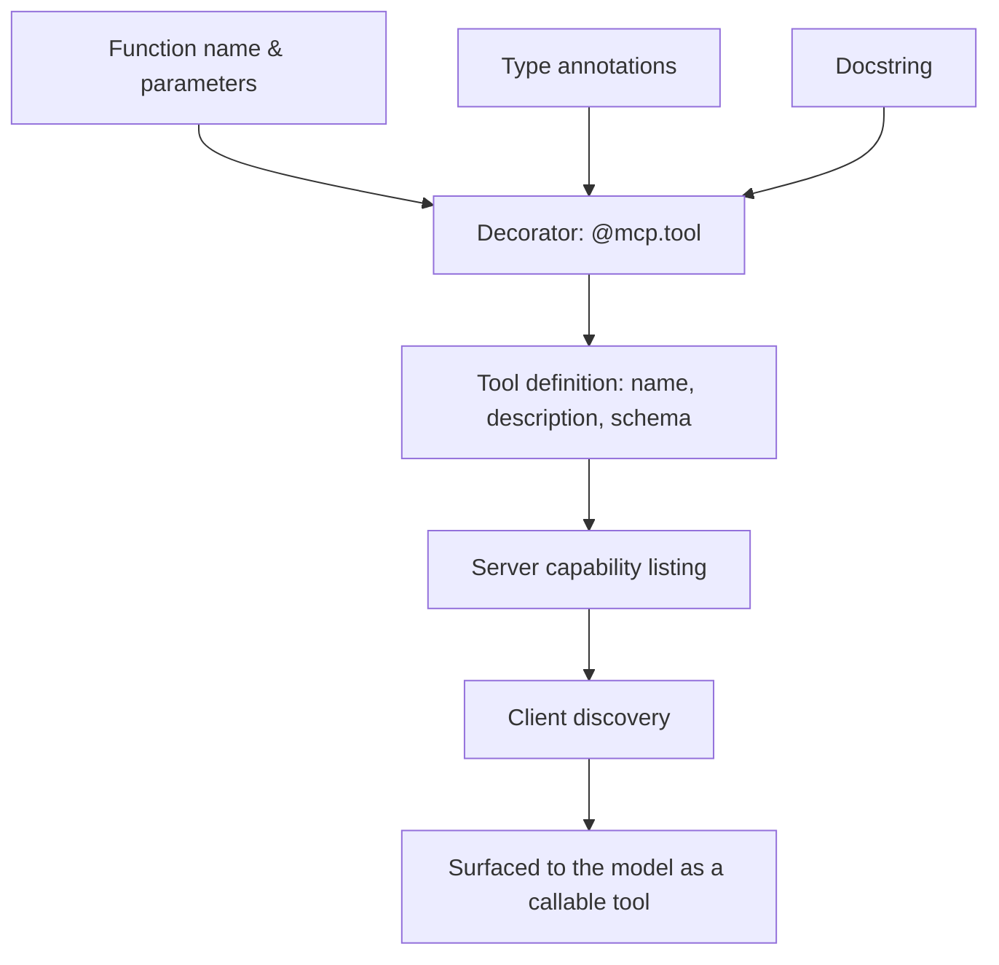

# Building an MCP Server in Python
{: .no_toc }

*Read duration: 20:00*

Everything so far has described MCP from the outside — servers expose primitives, clients connect, the model calls tools that happen to be MCP-backed. This lecture goes inside a server, at the level of actual code, because the exam expects you to reason about MCP not just as an architecture diagram but as something you could sit down and build. Python is the illustrative language here because the official MCP SDK's Python interface is the most widely used entry point into server authoring, and its high-level decorator-based API makes the underlying protocol concepts unusually visible.

## What a minimal server actually needs

Strip away everything optional and an MCP server needs exactly three things: an identity (a name the server presents to connecting clients), some registered capability (at minimum one tool, resource, or prompt), and a way to run — a process that sits listening for a client's requests and writing responses back, over whichever transport it's configured for. Everything else — authentication, multiple tools, resource listings, structured logging — is refinement layered on top of that minimal shape, not a prerequisite for it.

This minimalism matters pedagogically as much as practically: it means you can hold an entire working server in your head, and it means the exam can ask you to reason about a small, complete example without expecting you to have memorized an entire SDK's surface area. The mental model that matters is: a server declares what it can do, using the protocol's standard vocabulary of tools, resources, and prompts, and the SDK handles translating between your plain Python code and the wire-level protocol messages a client actually sends and receives.

## Server setup and initialization

Server authoring in Python's high-level SDK style starts by instantiating a server object with a name — a short, human-meaningful identifier that shows up to a connecting client as this server's identity in whatever UI or logs the client surfaces. That single line of setup is doing more work than it looks like: it's the object every subsequent tool, resource, and prompt registration will attach itself to, and it's the object whose `run()` method eventually starts the server listening on whatever transport gets configured.

## Registering a tool: the decorator pattern

The idiomatic way to register a tool in Python's high-level MCP SDK is a decorator placed directly above an ordinary function definition. This is a deliberate design choice worth understanding rather than just imitating: the decorator inspects the function it wraps — its name, its parameter names and type annotations, and its docstring — and derives the MCP tool definition (name, description, input schema) directly from ordinary Python code, rather than requiring you to hand-write a separate JSON Schema document alongside the function that implements it. Get the function's type hints and docstring right, in other words, and you've already written most of what the Tool Layer would call the tool's definition — the SDK's job is turning that into the protocol's wire format, not asking you to specify it twice.

This matters architecturally because it collapses a failure mode that plagues hand-maintained tool definitions elsewhere: a schema and an implementation drifting out of sync as one gets updated without the other. When the schema is derived from the function signature itself, drift becomes a type error or a docstring omission rather than a silent mismatch a model discovers at call time.



## The code: a minimal server end to end

The following is a plausible, minimal MCP server exposing a single tool, written in the idiomatic decorator style:

```python
from mcp.server.fastmcp import FastMCP

# Instantiate the server. This name is the identity a connecting
# client will see for this server -- pick something specific to
# the system it wraps, not something generic like "server".
mcp = FastMCP("weather-service")


@mcp.tool()
def get_forecast(city: str, days: int = 3) -> str:
    """Get a multi-day weather forecast for a city.

    Args:
        city: The city to forecast, e.g. "Austin, TX".
        days: Number of days to forecast, between 1 and 7.
    """
    if not 1 <= days <= 7:
        raise ValueError("days must be between 1 and 7")

    forecast = fetch_forecast_from_provider(city, days)
    return format_forecast_as_text(forecast)


if __name__ == "__main__":
    # Defaults to STDIO transport: reads client requests from
    # stdin, writes responses to stdout, and exits when the
    # parent process (the connecting client) closes the pipe.
    mcp.run()
```

Walk through what each piece is doing, because every line maps back to a concept from earlier in this module. The `FastMCP("weather-service")` call creates the server object and gives it the identity a client will see. The `@mcp.tool()` decorator is what turns an ordinary function into something a client can discover through the protocol's listing mechanism — without it, `get_forecast` is just a Python function no client knows exists. The function's parameter names and type annotations (`city: str`, `days: int = 3`) become the tool's input schema: a client and, ultimately, the model see a tool that accepts a required string and an optional integer with a default, exactly as if that schema had been hand-written as JSON Schema. The docstring becomes the tool's description — the **single most important piece of text** for whether a model calls this tool correctly, exactly as the Tool Layer emphasized, except here it's written once, in the same place as the implementation, instead of duplicated in a separate definition file.

The `raise ValueError(...)` line is worth pausing on, because it's a direct callback to the Tool Layer's error-response-design lecture: raising a clear, descriptive exception is how a well-behaved MCP tool communicates a validation failure back through the protocol as a structured error result, rather than letting an ambiguous or unhandled failure propagate as a generic crash. A server author who writes `get_forecast` with careless bounds checking has recreated, inside an MCP tool, exactly the kind of undiagnosable failure the earlier module spent a full lecture warning against — **MCP doesn't do that work for you**; it only gives you a clean protocol-level channel to communicate the result you choose to send back.

## Adding a resource alongside the tool

Because tools and resources are registered against the same server object, extending the example above to also expose a resource is a matter of adding one more decorated function, not restructuring anything:

```python
@mcp.resource("weather://stations/{station_id}")
def get_station_metadata(station_id: str) -> str:
    """Return metadata for a specific weather station."""
    station = look_up_station(station_id)
    return format_station_metadata(station)
```

Notice what changed and what didn't. The decorator is different (`@mcp.resource(...)` instead of `@mcp.tool()`), and it takes a URI template as its argument rather than deriving one implicitly — resources need an explicit address, where a tool only ever needed a name. But the underlying pattern is identical: a plain Python function, its signature and docstring doing the same descriptive work, registered against the same `mcp` object that already holds `get_forecast`. A client connecting to this server now discovers one tool and one resource template from the same running process, and the model sees the tool exactly as before, while a client can independently choose to read `weather://stations/KAUS` and attach the result to context without any tool call at all — the resource-versus-tool distinction from earlier in this module, made concrete in two adjacent function definitions inside the same file.

## Async tools and I/O-bound work

Real tool implementations frequently need to wait on something external — an HTTP call to a weather provider, a database query, a subprocess. The SDK's decorator pattern supports this directly: defining a tool function with `async def` instead of `def`, and using `await` inside it, lets the server handle that tool call without blocking its ability to process other requests while the I/O is in flight. This matters more as a server accumulates more tools and, especially, once it moves to a transport (covered in the next two lectures) that needs to serve multiple concurrent clients — a server built entirely from blocking, synchronous tool functions can become a bottleneck exactly where an async one wouldn't, since one slow external call no longer holds up everything else the server is doing. Nothing about the tool's *definition* changes between the sync and async versions — the name, description, and schema are derived identically either way — only how the function's body is written and executed.

## Running the server

The final block, `if __name__ == "__main__": mcp.run()`, is what actually starts the server listening. Calling `run()` with no arguments defaults to STDIO transport — the server reads incoming protocol messages from standard input and writes its responses to standard output, which is the natural fit for a server a client launches as a local subprocess (the next lecture goes deep on exactly this transport and why it's the common pattern for local developer tooling). The same `run()` method typically accepts a transport argument to instead serve over a network-based transport, which the module covers in the StreamableHTTP lecture, without requiring any change to the tool definition itself — the separation between "what this server can do" and "how a client reaches it" is clean by design, and it's the same separation that lets one server implementation serve both a solo developer's local CLI session and, with a different transport configuration, a whole organization's shared deployment.

## From one tool to a real server

A production MCP server rarely stops at one tool. Real servers register several related tools against the same server object, often several resources addressable by distinct URI schemes, sometimes a prompt template or two, structured logging so operators can trace what a connected model actually did, and configuration for authentication when the server runs somewhere other than a trusted developer's own machine. None of that changes the core shape demonstrated above — it's the same `@mcp.tool()` pattern repeated, the same server object accumulating more registered capability, the same `run()` call at the bottom starting the listening process. The minimal example here is not a toy simplified away from what a real server looks like; it's the actual skeleton every larger server is built from, which is exactly why the exam treats a small, complete example like this one as sufficient to test the full range of server-authoring concepts.

## Testing a server before connecting a real client

Because a server built this way is just an ordinary Python process underneath the decorators, it's worth being clear about how a developer actually verifies one works before pointing a production client at it. The SDK's tooling typically includes a local inspector or development harness that can connect to a running server the same way a real client would — listing its tools and resources, letting a developer invoke a tool directly with hand-supplied arguments, and inspecting the raw result or error that comes back — without needing Claude Code or any other full client running at all. This closes the loop on the module's earlier point about schema-implementation drift: because the schema is derived from the function signature, a developer testing locally is exercising the exact same code path a real model-driven call will exercise later, not a separately-maintained mock of it. Catching a malformed schema, a missing docstring, or an unhandled exception at this stage — before a model ever attempts a real call — is meaningfully cheaper than discovering it from a confusing failure deep inside a live agentic session.

## Packaging and dependencies

One last practical detail worth having in mind: a Python MCP server is an ordinary Python package with ordinary dependencies, which means whatever runs it — a client launching it over STDIO, or a deployment process starting it as a long-lived StreamableHTTP service — needs that package's dependencies actually installed and resolvable in whatever environment it executes in. A server that imports a database driver or an HTTP client library needs those installed wherever `mcp.run()` actually executes, exactly like any other Python program; MCP itself doesn't do anything to abstract dependency management away. This is a mundane point, but it's a common practical stumbling block: a server that runs perfectly from a developer's own virtual environment can fail immediately when a client launches it with a different interpreter or a clean environment that never installed those same dependencies, which is a packaging problem, not a protocol problem, and worth debugging as one.

{: .important }
> A server that works from your own virtual environment but fails the moment a client launches it is almost always a **packaging problem, not a protocol problem** — check for missing dependencies in whatever environment actually executes `mcp.run()` before suspecting the SDK or the protocol itself.

**Why it matters for the exam:** Expect questions that hand you a short code snippet like the one above and ask what a specific piece is doing — what becomes the tool's name, what becomes its description, what the decorator itself is responsible for, or what a validation error inside a tool function should do. The underlying test is whether you can connect the SDK's ergonomics (decorators, type hints, docstrings) back to the protocol-level concepts (tool listing, input schema, structured error results) they're standing in for, not whether you've memorized the SDK's full API surface.

<!-- prevnext:start -->

---

| [&larr; Previous: Tools, Resources & Prompts: The Three MCP Primitives](02-tools-resources-and-prompts-the-three-mcp-primitives) | [Next: Defining and Exposing Tools via MCP &rarr;](04-defining-and-exposing-tools-via-mcp) |
|:---|---:|

<!-- prevnext:end -->
