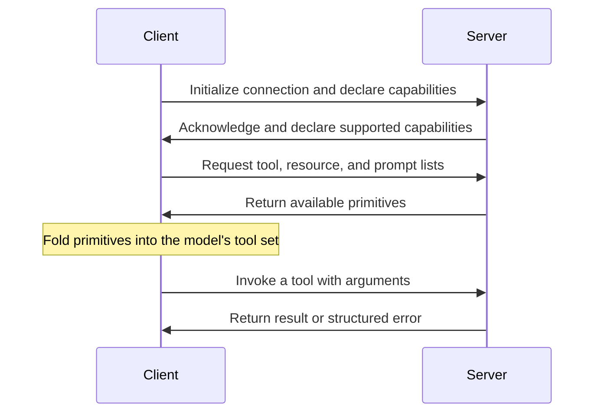

# Implementing MCP Clients
{: .no_toc }

*Video duration: 13:00*

Every lecture so far has been written from the server's side of the connection — what a server exposes, how its primitives are shaped, how its schemas should be written. This lecture turns to the other half: what a **client** actually has to do to make a connected server's tools, resources, and prompts available to a model at all. Claude Code has one of these built in; so does Claude Desktop; so does any application built on the Claude Agent SDK or directly against the Claude API that wants to speak MCP. Understanding this side matters even if you never author a server, because it's what determines whether a well-designed server actually reaches the model the way its author intended.

## Discovery: finding out what a server offers

A client's first job, once a connection to a server is established, is **discovery** — asking the server to list what it exposes. The protocol defines standard listing operations for each primitive: a client can request the full list of tools a server offers (each with its name, description, and input schema already attached), the list of resources it exposes (or the resource templates describing parameterized families of them), and the list of prompts available. This is not a one-time handshake the client performs once and discards — a well-behaved client re-lists when a server signals that its capabilities have changed (the next lecture covers exactly this kind of notification), so that a server can add or remove tools dynamically without the client operating on stale information.

Discovery is also where a client makes its first real judgment call: whether to surface everything a server offers, or to filter, rename, or annotate what gets exposed to the model. A client connecting to several servers simultaneously might find that two independently-authored servers both expose a tool named `search`, and part of a client's job is resolving exactly that kind of collision — commonly by qualifying names with the originating server's identity — before anything reaches the model's actual tool set.

## Connecting: sessions and capability negotiation

Establishing a connection is more than opening a transport channel. MCP includes an initialization handshake in which client and server exchange protocol version information and declare which optional capabilities each side supports — whether the client can receive certain kinds of notifications, whether the server supports resource subscriptions, whether sampling (covered later in this module) is available at all. This negotiation matters because MCP has evolved across versions, and a client built against an older understanding of the protocol shouldn't break outright against a server implementing a newer one, or vice versa — capability negotiation is what lets both sides agree on the common subset of behavior they can actually rely on for this particular connection.

## Surfacing primitives to the model

Once discovery and negotiation are done, a client's real work is translation: turning a server's tools, resources, and prompts into the shapes the model actually consumes as part of ordinary tool use. Tools translate the most directly — a client takes each tool's name, description, and input schema and folds it into the model's available tool set for that turn, exactly alongside any tools the client itself defines directly, with the model having **no way to tell (nor needing to)** which tools originated from an MCP server versus application code. Resources typically surface differently, often through a client's own UI (an "attach" affordance, a file picker, an automatically-included document) rather than through the model's tool-calling mechanism directly, though some clients also expose resource reading as a callable operation the model can invoke when that fits the interaction better. Prompts, consistent with the previous lecture, usually surface as a user-facing selection mechanism rather than anything the model chooses on its own.

A client is also responsible for actually executing a tool call once the model requests one: routing the call to the correct connected server, sending the arguments the model supplied, waiting for the result (or a structured error), and returning that result back into the model's context in the next turn — mechanically the same request-execute-result-repeat loop the Agentic Layer already established, just with "execute" now meaning "forward this call across a connection to an external server" rather than running local code directly.

## Error handling and the client's translation duty

A client's translation responsibility extends to failure, not just success. When a tool call to a connected server fails — a network error reaching a remote server, a malformed response, the server itself returning a structured MCP-level error — a well-behaved client needs to translate that failure into something the model can act on, consistent with everything the Tool Layer established about designed error responses. A raw connection timeout to a remote server and a clean, structured "not retryable" error returned deliberately by the server's own tool logic are different situations that call for different handling: the former might be something the client itself retries transparently before the model ever sees a failure at all (echoing the harness-level-recovery principle from the Tool Layer), while the latter should generally be surfaced faithfully, since the server author already did the work of producing a well-designed error response and a client that flattens or discards that signal on the way through is throwing away information the model needs.

{: .important }
> Don't let a client flatten every failure into the same generic message. A raw connection timeout is something the client may reasonably retry transparently, but a **structured, deliberate error a server's tool logic returns must be surfaced faithfully** — discarding that signal throws away information the model needs to decide what to do next.

## Session lifecycle and reconnection

A client is also responsible for the practical lifecycle of a connection: establishing it, keeping it alive for as long as the session needs it, and handling the case where a connection drops unexpectedly — a STDIO subprocess crashing, a remote server becoming briefly unreachable. Depending on the transport and the server's own statefulness, a client might reconnect and resume, reconnect and re-run discovery from scratch (treating the reconnection as equivalent to a fresh connection), or surface the failure upward if reconnection isn't meaningful for that particular server. This lifecycle management is invisible when everything works and consequential the moment it doesn't, which is exactly why production client implementations treat it as first-class engineering rather than an edge case to handle later.

## Managing multiple connected servers

A realistic client rarely connects to just one server. Claude Code, for instance, might have a filesystem server, a GitHub server, and an internal company server all connected within the same session, each contributing its own tools, resources, and prompts to one combined pool the model reasons over as a single tool set. This is where a client's discovery-time judgment calls compound: name collisions need resolving, and — echoing the governance lecture from the Tool Layer — a client is often the natural enforcement point for which servers are even allowed to connect in the first place, what credentials each connection carries, and what gets logged about calls made through it. The client, in other words, isn't just a protocol implementation; in a governed deployment, it's also the **practical chokepoint** where an organization's MCP policy actually gets enforced, since it's the one component positioned to see every connected server and every call made through any of them.

## Claude Code's client as a concrete instance

Claude Code's own built-in MCP client is worth grounding all of this in, since it's the client implementation most readers of this course will actually touch. Configuring an MCP server for Claude Code — specifying a command for a local STDIO server, or a URL for a remote StreamableHTTP one — triggers exactly the lifecycle this lecture describes: a connection attempt, an initialization handshake, discovery of that server's tools, resources, and prompts, and then ordinary tool use for the remainder of the session, indistinguishable at the model level from any tool defined natively. Multiple servers can be configured simultaneously, and Claude Code's client handles the resulting combined tool set exactly as this lecture describes — discovering each server independently, folding their capabilities into one pool, and resolving naming collisions where they arise. Seeing MCP configuration in a concrete tool you may already use is the fastest way to turn this lecture's abstractions into something you could reason about directly on the exam.

**Why it matters for the exam:** Expect questions distinguishing what happens client-side (discovery, capability negotiation, primitive surfacing, name-collision resolution, call routing) from what happens server-side (implementing the actual tool/resource/prompt logic). Also expect the client to reappear as the natural enforcement point for governance controls — trust, scope, audit — since it's the single component with visibility across every server a session has connected to.

<!-- prevnext:start -->

---

| [&larr; Previous: MCP Prompt Templates](06-mcp-prompt-templates) | [Next: STDIO Transport: Local Servers and Process Communication &rarr;](08-stdio-transport-local-servers-and-process-communication) |
|:---|---:|

<!-- prevnext:end -->
