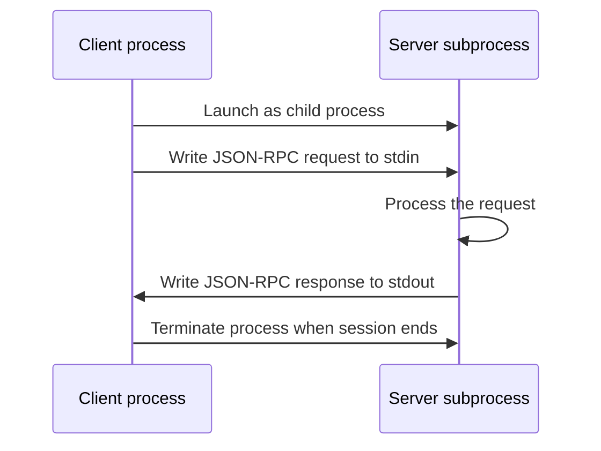

# STDIO Transport: Local Servers and Process Communication
{: .no_toc }

*Video duration: 11:00*

The minimal server built earlier in this module ended with a single, easy-to-skip line: `mcp.run()`, defaulting to STDIO transport. This lecture is about everything that default is quietly doing, because **transport** — the actual channel over which client and server exchange protocol messages — is a design decision with real consequences, and STDIO is the one you'll reach for by far the most often during local development.

## What STDIO transport actually is

**STDIO transport** means the client launches the server as a **subprocess** — a child process running on the same machine — and the two communicate over that subprocess's standard input and standard output streams. The client writes a protocol message (a JSON-RPC-formatted request, in MCP's actual wire format) to the subprocess's stdin; the server reads it, processes it, and writes its response to stdout; the client reads that response off the pipe connecting the two processes. There is no network involved at any point — no socket, no port, no listening address — just two processes on one machine exchanging text over the same kind of pipe a shell uses when you write `command_a | command_b`.

This is why the server code from the earlier lecture needed nothing beyond `mcp.run()` to function: STDIO requires no configuration of an address, a port, or a certificate, because the "connection" is entirely a function of the client having started the process and holding open handles to its stdin and stdout. The server doesn't need to know anything about networking at all — from its own code's perspective, it's just reading input and writing output the way any command-line program does.

## Why this is the dominant pattern for local developer tooling

STDIO's appeal for local tools comes directly from this simplicity. A client like Claude Code, configuring a connection to a local MCP server, typically just needs a command to run — the path to a Python interpreter and a script, for instance — and it handles everything else: starting the process, wiring up the pipes, and terminating the process when the session ends or the connection is no longer needed. There's no server to keep running independently in the background, no port to manage or conflict with another process using it, and no network exposure to reason about at all, since the server process only ever exists as a child of the specific client session that launched it. This lifecycle tightness is a genuine feature for local tools: a filesystem-access server, a local git-repository server, or a server wrapping some local developer utility all benefit from existing only exactly as long as the session that needs them, with automatic cleanup the moment that session ends.

Security also favors STDIO for this use case in a way worth making explicit: because there's no network listener at all, there's no remote attack surface to a locally-running STDIO server — reaching it requires already having process-level access to the machine it's running on, which is a meaningfully different (and generally much smaller) threat model than anything reachable over a network.

## The tradeoffs

STDIO's simplicity is also exactly its limitation. Because the server exists only as a subprocess of one client, it can't naturally serve multiple concurrent clients the way a persistent network service can — each client session that wants this server's capabilities needs its own subprocess, started fresh. That's a perfectly reasonable model for a solo developer's local tool, but it doesn't scale to the organizational pattern described in the Tool Layer's MCP governance lecture, where one centrally-hosted server serves many teams' applications at once — you can't point a hundred different Claude Code sessions across an organization at one shared STDIO server the way you can point them at one shared network endpoint, because STDIO has no notion of a shared, persistent, independently-running service at all.

STDIO also assumes client and server share a machine (or at least a container, a VM, or some environment where subprocess-launching and pipe access are actually available), which rules it out entirely for any server that needs to run somewhere the client can't directly execute a process — a server wrapping a cloud-hosted internal system, for instance, that many different clients across an organization need to reach without each of them being able to spawn that server's process locally.

## What the messages actually look like

Underneath the abstraction, STDIO transport carries MCP's underlying wire protocol — JSON-RPC-formatted messages, one per line, written to and read from the pipe connecting the two processes. A tool-call request from the client arrives on the server's stdin as a JSON object naming the tool and its arguments; the server's response, whether a successful result or a structured error, goes back out over stdout in the same format. This is worth knowing not because you need to hand-craft these messages yourself — the SDK handles that translation entirely — but because it demystifies what "communicating over stdin/stdout" concretely means: it's the same line-delimited JSON exchange a client and server would use over any other transport, just carried over a subprocess pipe instead of a network socket.

## A practical illustration: launching a local server

Concretely, a client configuring a local STDIO-based MCP server typically needs just a command and its arguments — something like `python server.py`, or an equivalent invocation of whatever interpreter and script implement the server. The client is then responsible for actually spawning that process, wiring its own output to the process's stdin and reading the process's stdout back, and tearing the process down when the session ends. From the perspective of whoever's configuring the connection, this is about as lightweight as connecting to an MCP server ever gets — no address to reach, no credentials to manage beyond whatever the underlying system the server wraps might itself require, and no separate deployment step, which is exactly why STDIO is the default on-ramp for trying out or developing a new MCP server before it's ever a candidate for the kind of shared, remote deployment the next lecture covers.

## A note on debugging a STDIO connection

Because a STDIO server's entire communication channel is stdin and stdout, one practical consequence follows directly: anything the server's own code accidentally prints to stdout outside the protocol's own messages — a stray `print()` statement left in during development, for instance — corrupts the channel, since the client is parsing everything arriving on stdout as protocol messages. This is a common, easy-to-make mistake when adapting existing code into an MCP server, and it's worth knowing as a debugging instinct: if a STDIO-connected server behaves strangely or fails to respond coherently, an errant print statement polluting stdout is one of the first places to look, well before assuming the protocol implementation itself is at fault.

**Why it matters for the exam:** Expect direct questions asking you to identify STDIO as the right transport for a described scenario (a single local developer's session, a tool needing filesystem or local-process access, a lightweight tool with no need for concurrent remote clients) versus scenarios that clearly call for the remote transport covered next — shared organizational infrastructure, multiple concurrent clients, or a server that needs to run somewhere the client itself cannot launch a process.

<!-- prevnext:start -->

---

| [&larr; Previous: Implementing MCP Clients](07-implementing-mcp-clients) | [Next: StreamableHTTP Transport: Remote Servers and Production Deployment &rarr;](09-streamablehttp-transport-remote-servers-and-production-deplo) |
|:---|---:|

<!-- prevnext:end -->
