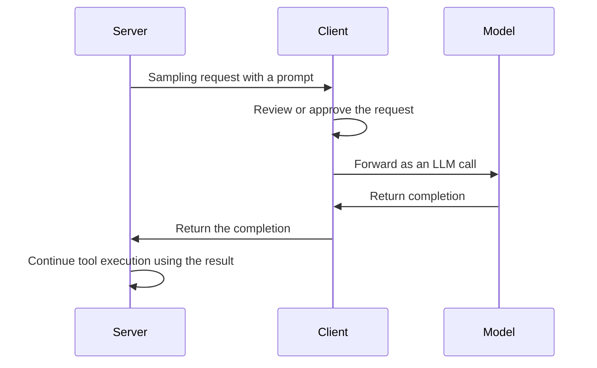

# Letting Servers Make LLM Calls Through the Client
{: .no_toc }

*Read duration: 12:00*

Every capability covered so far flows in one direction: the model (through the client) calls a tool, reads a resource, or invokes a prompt that a server provides. **Sampling** is the one MCP primitive that runs the relationship in reverse — a server, mid-execution, asks the *client* to make an LLM call on its behalf and hand back the result. It's a smaller, more specialized piece of the protocol than tools or resources, but it resolves a real architectural problem worth understanding precisely.

## The problem sampling solves

Consider an MCP server that summarizes long documents as part of a larger tool it exposes — say, a `summarize_and_file` tool that takes a long document, condenses it, and files the condensed version somewhere. Producing a good summary is itself a task that benefits from an LLM call. Without sampling, that server would need its own independent access to a model: its own API key, its own billing relationship, its own model-selection decisions, entirely separate from whatever model the connecting client and its user are actually using. That's redundant at best — the user is already mid-conversation with a capable model — and at worst it's a governance problem, since it means a connected MCP server needs its own credentialed access to an LLM provider, multiplying the number of places API keys and usage need to be managed and secured.

**Sampling** avoids all of this by letting the server ask the client to make the LLM call instead. The server sends a sampling request through the protocol — essentially, "here's a prompt, please have your model produce a completion for it and give me the result" — and the client, which already has a live connection to a model (Claude, in this course's context) on the user's behalf, executes that call and returns the result back to the server, which then continues its own tool execution using that result. The server **borrows the client's existing model connection for exactly the calls it needs, and nothing more**.

## What this actually enables

The practical benefit is that a server's author can build genuinely LLM-dependent functionality — summarization, classification, extraction, judgment calls the server's own deterministic code can't make — without that server ever needing its own model access, its own credentials, or its own opinion about which model to use. The server borrows the client's existing model connection for exactly the calls it needs, and nothing more. This keeps a server's dependency footprint smaller (no separate LLM provider relationship to manage or secure) and keeps a single point of control over model usage and cost sitting where it already naturally sits — with the client and the user or organization operating it — rather than scattered across every MCP server anyone happens to connect.

Sampling also means the LLM call a server triggers is subject to whatever governance the client already applies to its own model usage — the same account, the same usage policies, potentially the same human-in-the-loop review a client might apply to other consequential actions — rather than an entirely separate, unmonitored model relationship a server operates unilaterally. This is a meaningful governance win layered directly on top of the credential-scoping and audit concerns the Tool Layer already raised about connected MCP servers generally: sampling keeps one more category of access (model access itself) inside the same control boundary as everything else the client already governs.

## The client's role and the human-in-the-loop expectation

Because a sampling request means a connected server is effectively asking to spend the user's model usage on its own behalf, a well-behaved client doesn't blindly comply with every sampling request a server sends. The protocol's design expects a client to be able to review, approve, deny, or even modify a sampling request before it's actually executed — similar in spirit to the permission-gating a client might apply to a consequential tool call — precisely because an unchecked sampling capability would otherwise let any connected server silently consume model calls, at the user's expense, for purposes the user never explicitly approved. A production client implementation typically surfaces sampling requests with at least some visibility or approval step, rather than executing every one that arrives automatically and invisibly.

{: .important }
> A well-behaved client must **not blindly execute every sampling request a server sends** — sampling spends the user's own model access on the server's behalf, so the protocol expects the client to review, approve, deny, or modify the request, similar to permission-gating a consequential tool call.

## A worked example

Return to the `summarize_and_file` tool from earlier: a document-management MCP server that condenses a long document and files the result. Without sampling, this server's author would need to choose and credential their own model provider, handle their own API errors and rate limits independently of anything the connecting client does, and absorb the cost of every summarization call directly — costs and failures the connecting client and its user have no visibility into and no ability to govern. With sampling, the tool's implementation instead issues a sampling request through the protocol: "summarize the following document," handed to whichever client is connected. The client — which might be Claude Code, running on behalf of a specific user with a specific Claude subscription — makes that LLM call using its own existing model access, applies whatever review or approval step it has configured, and returns the completion back to the server's tool implementation, which then proceeds to file the result exactly as it would have with a summary produced any other way. The tool's external behavior — take a document, return a filed summary — is unchanged; what's different is that the model call inside it borrowed access instead of owning it.

## Not every server needs sampling

It's worth being clear that sampling is **the exception, not the default** expectation for every MCP server. A server wrapping a purely deterministic system — a database, a ticketing API, a filesystem — has no need for it at all, since none of its operations require an LLM call internally. Sampling matters specifically for the narrower case of a server whose own tool implementation would otherwise need genuine language-model judgment to do its job — summarization, classification, freeform extraction — and even then, only where the server author has deliberately chosen not to hold independent model credentials. Recognizing when a described server's functionality would plausibly need sampling, versus when it's simply a tool with no LLM-dependent step inside it at all, is the practical judgment call the exam expects.

## Why this design exists rather than the alternative

It's worth being explicit about the alternative sampling avoids: every MCP server that wants any LLM-backed functionality maintaining its own independent model access. That alternative fails the same reusability and governance logic that motivates MCP generally — instead of one clean protocol for borrowing model access through an already-trusted connection, every server author would need to solve credential management, provider selection, and cost control independently, and every organization connecting to third-party servers would need to trust each one's separate, unauditable relationship with whatever model provider it chose. Sampling keeps "who has model access, under what governance" answered once, at the client, rather than answered separately and inconsistently by every server an organization happens to connect to.

**Why it matters for the exam:** Expect sampling to be tested as "the primitive that lets a server request an LLM call through the client rather than needing its own model access" — a direct, memorizable definition — paired with scenario questions asking *why* this design is preferable to a server maintaining independent model credentials (answer: avoids redundant credentials, centralizes governance and cost control, and keeps model usage subject to the client's existing oversight, including human approval of the request itself).

<!-- prevnext:start -->

---

| [&larr; Previous: StreamableHTTP Transport: Remote Servers and Production Deployment](09-streamablehttp-transport-remote-servers-and-production-deplo) | [Next: Notifications, Roots, and Progress Reporting &rarr;](11-notifications-roots-and-progress-reporting) |
|:---|---:|

<!-- prevnext:end -->
