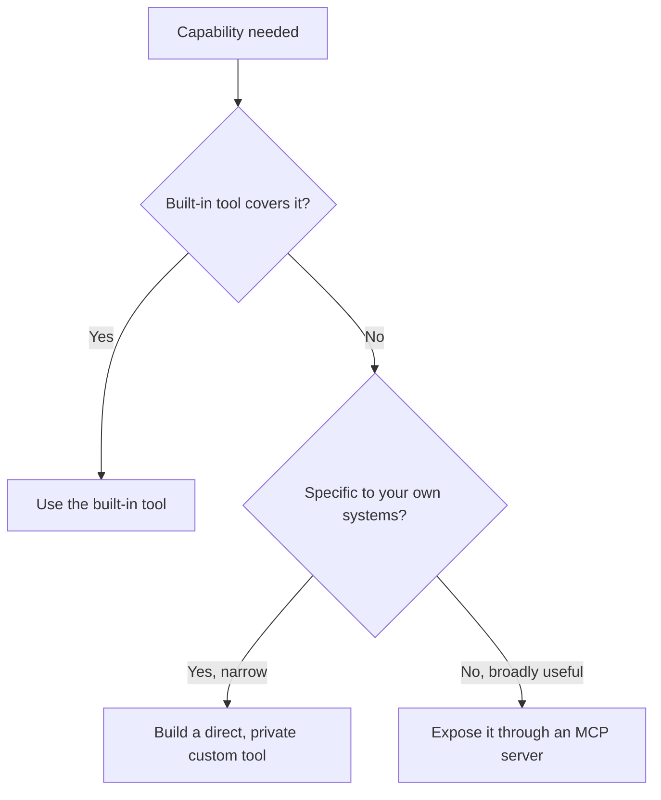

# Choosing Built-in vs Custom Tools
{: .no_toc }

*Read duration: 10:00*

The previous lecture drew the architectural line between a built-in tool and one exposed through MCP or defined directly in application code. This lecture turns that distinction into a decision: given a capability you need, when do you reach for what already ships with Claude, and when is building or connecting something custom actually the right call?

## Start with the default, not the exception

The practical default, and the one worth internalizing first: if a built-in tool already does what you need, **use it, and don't build a custom equivalent without a specific reason**.

{: .important }
> Default to the built-in tool. Build or connect a custom one only for a **specific, articulable reason** — the capability doesn't exist as a built-in, you need control a built-in doesn't expose, or the built-in's risk scope doesn't match your deployment — never reflexively, and never as a blanket "always build custom" policy. A team that writes its own web-fetching-and-parsing tool when Claude's built-in web search already covers the need has taken on real, ongoing maintenance burden — keeping a scraper working against sites that change their markup, handling rate limits and blocking, maintaining error handling — for a capability that already exists, is already maintained by the people best positioned to maintain it, and improves over time without that team lifting a finger. The same logic applies to code execution: a custom sandboxed execution tool duplicates real infrastructure work (isolation, resource limits, security hardening) that a built-in equivalent already solves.

## When custom is the right call

Custom tools — whether defined directly in application code or exposed through an MCP server — earn their place precisely where a built-in tool's generality stops matching what's actually needed. Three situations come up repeatedly.

**The capability doesn't exist as a built-in at all.** No built-in tool reaches into your company's internal ticketing system, your specific production database, or a proprietary internal API — those are inherently custom, because "built-in" by definition means something general enough for Anthropic to ship natively, and a bespoke internal system will never meet that bar. This is the least ambiguous case: if the underlying capability is specific to your organization's own systems, it was never going to be built-in, and the real decision is just whether to build a private, direct tool or an MCP server (a decision that turns on reusability — one application's private need versus a capability multiple teams or applications should share).

**You need control a built-in tool doesn't expose.** A built-in web search might not let you restrict results to an approved allowlist of domains, or apply an organization's specific content-filtering policy, or log queries in the exact format your compliance requirements demand. Where a built-in tool's behavior is close but not sufficiently configurable for a genuine requirement, a custom tool — potentially even one that wraps the same underlying capability with an added policy layer — becomes the right call, because the maintenance cost of the custom layer is being paid specifically for control that matters, not duplicated for its own sake.

**The built-in tool's scope doesn't match your actual risk tolerance.** Recall the Tool Layer's point about `Bash`: a broad tool's safety comes from the infrastructure around it, not its schema. A built-in tool that's appropriately scoped for one deployment context might be too broad — or too narrow — for another. An organization with strict data-residency or access requirements might reasonably decide a built-in code-execution environment doesn't meet its isolation guarantees and build a custom, more tightly controlled execution tool instead, accepting the maintenance cost specifically because the control gap is a genuine requirement rather than a preference.

## The maintenance-burden tradeoff, stated plainly

Every custom tool you build or connect is a piece of infrastructure your organization now owns: it needs to keep working as the underlying system it wraps changes, needs its own security review and credential scoping (with real force if it's MCP-exposed, per the governance lecture), and needs someone accountable for it when it breaks. A built-in tool carries none of that burden — its maintenance is Anthropic's responsibility, not yours, and it improves as Claude itself improves without any action on your part. This is the same build-versus-buy calculus that applies to infrastructure decisions generally, just applied to the specific case of tools a model calls: the question is never "can we build this" but "**should we carry the ongoing cost of owning this**, given what we'd actually gain by not using what already exists."

## A worked contrast

Consider two scenarios side by side. An application needs to let Claude fetch and summarize public web pages relevant to a user's question — a generic, broadly-useful capability with no organization-specific data or logic involved. This is squarely a built-in-tool case: web search already does this, is already maintained, and adding a custom equivalent would mean owning scraping logic, rate-limit handling, and result parsing for zero net capability gained. Now consider an application that needs to let Claude look up a customer's account status in an internal billing system. No built-in tool reaches into that system, the data is proprietary, and the lookup logic depends entirely on internal schemas and authentication no external provider could ever implement generically. This is squarely a custom-tool case, and the only remaining question is whether it's worth exposing through an MCP server (if multiple internal teams or applications will need the same billing lookup) or wiring in directly (if this one application is the only consumer that will ever exist). The two scenarios aren't close calls, and most real decisions resemble one of them far more than they resemble a genuinely ambiguous middle case.

## A decision framework

Putting it together, a reasonable sequence of questions for any capability you're considering exposing to Claude: Does a built-in tool already do this? If yes, use it, absent a specific, articulable reason not to. If no built-in equivalent exists, is this capability specific to your own systems, or general enough that others would benefit from it too? Internal-only and narrow points toward a direct, private custom tool; broadly useful and reusable across teams or applications points toward an MCP server, so the implementation effort is paid once and reused, per the Tool Layer's reusability argument for MCP generally. And regardless of which path you take, does the resulting tool meet the same design bar the rest of this course has built — clear naming, well-designed schema, honest error responses — since a custom tool built to a lower bar than a built-in one is strictly worse off on every axis that matters.

**Why it matters for the exam:** Expect scenario questions describing an organization considering building a custom tool for something a built-in tool already covers well, testing whether you correctly identify unnecessary duplicated maintenance burden as the issue — and, conversely, scenarios where a genuine internal system or a real control gap makes custom the right call, testing whether you can articulate the specific, legitimate reason rather than defaulting reflexively to either "always build custom" or "always use built-in."

<!-- prevnext:start -->

---

| [&larr; Previous: The Built-in Toolset: What Ships with Claude](12-the-built-in-toolset-what-ships-with-claude) | [Next: Module Outro &rarr;](14-module-outro) |
|:---|---:|

<!-- prevnext:end -->
