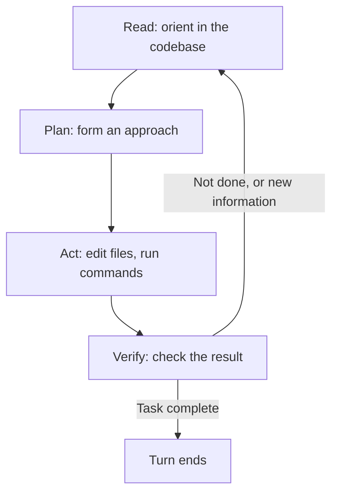

# What Claude Code Is and How It Works
{: .no_toc }

*Video duration: 14:00*

**Claude Code** is an agentic coding tool: a command-line application (with editor extensions and a web/desktop surface built on the same engine) that gives Claude a real working environment — a file system it can read and edit, a shell it can run commands in, and a live view of a codebase — and lets it operate in that environment across many steps toward a goal, rather than producing a single block of text and stopping. Where a plain chat interface to a model produces one answer per turn, Claude Code wraps the model in a **harness**: the surrounding software that defines what tools exist, what context loads automatically, what gets confirmed with a human before it runs, and how a multi-step task actually gets driven to completion.

That harness is not a new invention sitting outside everything else this course has covered — it is a direct, opinionated application of the agentic loop from the Agentic Layer. Recall that loop's shape: the model receives context, decides on an action (usually a tool call), the harness executes that action in the real world, the result comes back as an observation, and the model decides what to do next — repeating until the task is finished or some limit is reached. Claude Code *is* that loop, instantiated with a specific, curated tool set aimed at software engineering, a system prompt tuned for coding workflows, and a permission layer wrapped around every action that could touch your file system, your shell, or the network. Understanding Claude Code well means recognizing, concretely, which part of the general agentic loop each piece of the product corresponds to — this is a favorite exam framing, precisely because it's easy to describe Claude Code in product terms ("it edits your files") without connecting that back to the architecture underneath.

## The Read-Plan-Act-Verify Cycle

At a high level, a single Claude Code turn on a nontrivial task moves through a recognizable cycle, even though the boundaries blur in practice and the model moves back and forth between phases as needed rather than marching through them in strict lockstep.

**Read.** Before Claude edits anything, it orients: reading relevant files, searching the codebase for related code, checking configuration, and pulling in whatever standing context is available (most importantly `CLAUDE.md`, covered in depth later in this module). This phase is doing real epistemic work — an edit made against a wrong mental model of the code is often worse than no edit at all, because it looks plausible while being subtly incompatible with how the codebase actually works.

**Plan.** For anything beyond a trivial one-line fix, Claude forms an approach before touching files: which files need to change, in what order, and what the intended end state looks like. Sometimes this planning is implicit, folded into the model's reasoning before its first tool call. Sometimes it's explicit and visible, surfaced to you for approval before any edit happens at all — that visible, gated version of planning is **Plan Mode**, which gets its own lecture later in this module because of how directly it connects to the workflow-safeguarding material from the Agentic Layer.

**Act.** Claude executes: editing files, running shell commands, creating new files, installing dependencies, running the test suite. This is where the harness's tool set (the subject of the next lecture) actually gets exercised, and where the permission system intervenes to confirm or block actions that carry real-world risk.

**Verify.** A competent agentic coding session doesn't stop the instant an edit is made — it checks the edit worked: running the relevant tests, re-reading the changed file, checking a linter, or reasoning about whether the change actually addresses the original request. This verification step is what separates "Claude produced a plausible-looking diff" from "Claude confirmed the diff does what was asked," and it's a recurring theme across everything from tool error recovery (Tool Layer) to workflow safeguarding (Agentic Layer) to this module's treatment of permission modes and hooks.

This cycle repeats, often many times within a single user turn — reading a test failure leads back to reading more code, which leads to another edit, which leads to running the tests again — until Claude judges the task complete or hits a limit (a turn budget, a context limit, or an explicit stop from the user).

### A Worked Turn

Concretely, ask Claude Code to "fix the intermittent failure in the checkout integration test," and the cycle above stops being an abstraction and becomes a sequence of specific tool calls. **Read**: it locates the test, reads it, and reads the code path it exercises, forming a hypothesis about what "intermittent" implies — probably a race condition or a dependency on ordering, rather than a straightforward logic bug, since a deterministic bug would fail every run rather than some runs. **Plan**: it decides which file most plausibly needs to change and what the fix looks like — perhaps awaiting a promise the code was previously firing and forgetting. **Act**: it makes the edit and, likely, runs the test suite repeatedly to try to reproduce the original flakiness under the fix. **Verify**: seeing the test pass consistently across several runs (not just once, which wouldn't distinguish a real fix from having gotten lucky against an intermittent failure) is what actually justifies calling the task done — and if it isn't consistent, the cycle loops back to **Read** with a revised hypothesis rather than stopping on a single lucky pass.

## What the Harness Actually Provides

Concretely, "the harness" breaks down into a handful of distinct responsibilities, each of which recurs as its own topic later in this module:

- **A curated tool set.** Claude Code doesn't expose every conceivable capability — it exposes a specific, well-differentiated set of file, search, execution, and network tools, designed the way the Tool Layer teaches tool design should work: granularity matched to each capability, structured arguments over free-text where possible, and clear error responses. The next lecture covers this tool set directly.
- **Context assembly.** At the start of a session, the harness assembles what the model sees before your first message even arrives: a system prompt describing Claude Code's role and conventions, any `CLAUDE.md` files discovered in the directory hierarchy, and a live picture of the working directory. This is why Claude Code can behave as if it already "knows" your project's conventions on the very first turn — that knowledge was loaded, not inferred from scratch.
- **A permission layer.** Every action that edits a file, runs a shell command, or reaches the network passes through a permission check before it executes. Depending on the configured mode, that check might auto-approve, prompt you, or block the action outright — this is the subject of the permission-modes lecture later in this module.
- **Session and context management.** A Claude Code session is a continuous, stateful conversation: it can span many turns, it can be resumed later, and when the accumulated context grows too large the harness compacts it — summarizing older history to make room for new work rather than simply truncating it and losing everything. This is the same session-lifecycle concept the Agentic Layer introduced, applied concretely: a Claude Code session has a beginning (context assembly), a middle (repeated loop iterations across many user turns), and an end (either you close it or it's explicitly resumed later with its history intact).

## One Engine, Several Surfaces

Claude Code's terminal application is the surface most closely associated with the name, but it is not the only one, and understanding why the others don't represent a different architecture is worth being explicit about. Editor extensions (bringing the same session into an IDE, alongside your open files and diffs), a desktop application, and a browser-based surface all exist as different *front ends* onto the same underlying engine — the same agentic loop, the same tool set, the same permission layer and context-management behavior. None of these surfaces changes what the harness fundamentally is; each changes only how you interact with it and where its output is displayed (a terminal transcript versus an inline diff view in an editor, for instance). This matters for the exam mainly as a way to avoid a trap: a question describing Claude Code "in your IDE" or "on the web" is still describing the same architecture this lecture covers, not a different product with different rules.

## Session Persistence and Compaction, a Little Deeper

The session-management bullet above is worth one more layer of precision, because it's frequently tested. A session isn't just "long-running" in some vague sense — it has concrete persistence properties. It can be explicitly resumed later, picking back up with its accumulated history intact, which means a session's lifetime isn't bound to how long a terminal window happens to stay open. And when that accumulated history grows large enough to threaten the available context budget, the harness performs **compaction**: summarizing older turns into a condensed form that preserves what's still relevant while freeing up room for continued work, rather than an abrupt truncation that would silently drop earlier context with no record of what was lost. This is a direct, product-level instance of the context-management tradeoffs the Context Layer treats more generally — the same tension between "keep everything" and "stay within a finite budget," resolved here through summarization rather than either extreme.

## Why This Is Still "Just" an Agent

It's worth being precise about what Claude Code adds on top of the base model and what it doesn't. Claude Code does not give the underlying model new capabilities it didn't otherwise have — the model's reasoning, its coding knowledge, its judgment about what a good fix looks like, are the same Claude you'd get through the API directly. What Claude Code adds is entirely on the harness side: a real environment to act in, tools scoped to that environment, context that's assembled automatically instead of pasted in by hand, and safety scaffolding around what gets executed without confirmation. This distinction matters because it's exactly the same distinction the Agentic Layer draws between "an agent" as a general architectural pattern and any specific product built on that pattern — Claude Code is one particular, very well-engineered instance of the pattern, not a different kind of thing.

**Why it matters for the exam:** Expect questions that describe some piece of Claude Code's behavior — auto-loading project context, pausing before a risky shell command, summarizing a long session — and ask you to identify which general agentic-loop or workflow-layer concept it's a concrete instance of. The reliable way to answer these is to first strip away the product-specific name and ask "what is this, architecturally?" before matching it back to Claude Code's terminology.

<!-- prevnext:start -->

---

| [&larr; Previous: Module Intro](01-module-intro) | [Next: The Tool System: Reads, Bash, Edits, and Web Search &rarr;](03-the-tool-system-reads-bash-edits-and-web-search) |
|:---|---:|

<!-- prevnext:end -->
