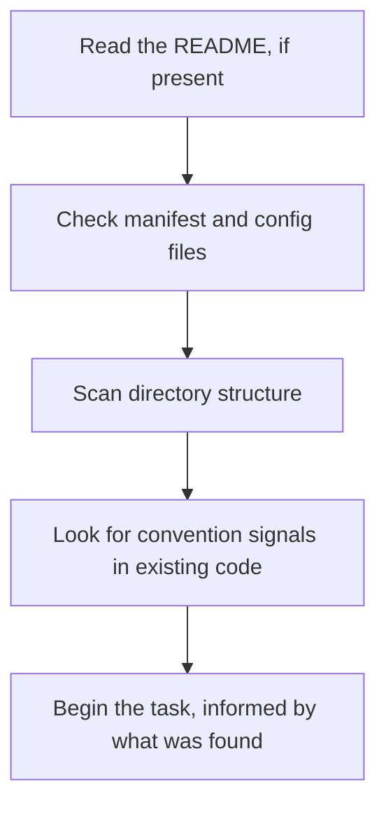

# Starting a Project: Onboarding Claude to a Codebase
{: .no_toc }

*Video duration: 12:00*

Every Claude Code session against a new codebase starts from the same disadvantage a new human hire starts from: zero accumulated context about how this particular project actually works, as opposed to how projects in general tend to work. The difference is that a new engineer accumulates that context gradually, over weeks, through code review, Slack threads, and trial and error. Claude Code has to reconstruct a usable working model of it far faster — often within the first few tool calls of a session — and understanding how it does that, and how to make that process better, is the practical skill this lecture covers.

## How Claude Code Orients Itself

Dropped into an unfamiliar repository with a task to perform, Claude Code's default behavior is exploratory before it's active: reading a `README` if one exists, checking manifest and configuration files (`package.json`, `pyproject.toml`, `Cargo.toml`, a `Makefile`) to infer the language, dependencies, and available build/test commands, and scanning directory structure to build a rough map of where things live before making any assumption about where new code should go. This mirrors, at the level of a single session, the same "read before act" discipline the tool system enforces at the level of a single file — orientation before commitment, applied to the whole project rather than one file.

Beyond structure, Claude Code also looks for **convention signals**: existing code in a similar area of the codebase is usually the strongest available evidence for how *this* project does things, often stronger than a generic best practice would suggest on its own. If every existing API route in a project follows one particular error-handling pattern, a well-oriented session imitates that pattern for a new route rather than introducing a different (even objectively "better") one — consistency with what's already there is usually more valuable than a locally superior alternative, because a codebase with three different patterns for the same thing is worse than one with a single mediocre pattern applied everywhere. This is exactly the instinct a good human contributor develops after their first few code reviews, compressed into how the harness explores by default.

Where this self-directed exploration falls short is anything that isn't discoverable from the code itself: *why* a workaround exists, which parts of the codebase are deprecated but still technically functioning, which tests are flaky and safe to ignore, or which directories are shared infrastructure that shouldn't be touched without a wider conversation. That gap is precisely what standing project context — `CLAUDE.md`, covered in depth for the rest of this module — exists to close.

## Generating a Starting Point

Rather than relying purely on ad hoc exploration every session, Claude Code offers a way to convert that exploration into a persistent artifact: running an initialization command against a codebase has Claude explore the project the way it normally would, then write down what it found — build commands, test commands, directory conventions, apparent architectural patterns — as a first-draft `CLAUDE.md`. This is a genuinely useful starting point for onboarding a new project, but it should be treated as exactly that: a draft written by an agent that has seen the code but not the history, the incidents, or the tribal knowledge behind why things are the way they are. A team's first real task after generating this file is reading it critically, correcting anything it inferred wrong, and adding the category of knowledge no amount of code-reading recovers: known gotchas, deliberate constraints, and vocabulary specific to the team.

## Choosing the Right First Tasks

"Start narrow" is easy to agree with in principle and easy to get wrong in practice, because **narrow scope and low risk aren't quite the same thing**, and a good first task needs both. A single-line configuration change is narrow but often uninformative — it's too small to reveal much about how Claude Code actually handles this codebase's real conventions. A sprawling refactor is informative but not narrow, and a bad first choice for exactly the reason "start small" exists: if it goes wrong, the blast radius is large before anyone's calibrated enough trust to have caught it earlier.

The better first tasks sit in between: a genuine, independently-testable bug fix in a non-critical path, a new unit test for existing but under-tested behavior, or a small, self-contained feature addition to a low-stakes internal tool. Each of these is substantial enough to expose whether Claude Code has actually picked up on the codebase's real conventions — does the fix match the existing error-handling style, does the new test follow the project's existing test structure — while staying small enough that a wrong turn is cheap to catch and cheap to revert. Treat the first several tasks less as "getting useful work done" and more as a calibration exercise that happens to also produce useful work as a side effect; the calibration is the actual point in this early phase.

## Best Practices for Introducing Claude Code to an Existing Project

**Start narrow, not broad.** The first tasks given to Claude Code in a new codebase should be small and independently verifiable — a well-scoped bug fix, a single new test, a narrow refactor — rather than "understand this entire system and make it better." This isn't just caution for its own sake; it's how a team calibrates its own trust in Claude Code's output on *this specific codebase*, the same way you'd calibrate trust in a new human contributor before handing them the keys to a critical service.

**Review the generated `CLAUDE.md` as a team artifact, not a Claude artifact.** Because it starts as machine-generated content, there's a temptation to treat it as automatically correct or to skip reviewing it the way you would a human-written onboarding doc. Treat it the opposite way: **a wrong statement in `CLAUDE.md` has more leverage than a wrong statement anywhere else**, since it's loaded into every future session automatically and shapes every future task, whether or not anyone double-checks it that day.

{: .important }
> A generated `CLAUDE.md` is a first draft written by an agent that saw the code but not the history, the incidents, or the tribal knowledge behind it. Never treat it as automatically correct — a wrong statement there compounds across every future session that loads it.

**Set permission boundaries deliberately before broad use.** A brand-new integration is exactly the wrong moment to reach for the most permissive permission mode "just to get things moving faster" — this is precisely backwards from the actual risk profile, which is highest when trust in the specific project's setup is lowest. The permission-modes lecture that follows this one covers the concrete mechanics, but the sequencing principle belongs here: earn the ability to run with less oversight by first observing Claude Code behave well under more of it.

**Expect (and budget time for) an early correction phase.** The first week or two of real use on an existing codebase surfaces the gaps in both the generated `CLAUDE.md` and the team's own assumptions about what Claude Code will discover on its own. Treating this as expected calibration, rather than as a sign the tool doesn't work, produces a much better long-run outcome than either blind trust or premature abandonment.

**Introduce extension mechanisms incrementally, not all at once.** Slash commands, Skills, subagents, and hooks (all covered later in this module) each solve a real problem, but a team that tries to configure all of them on day one, before anyone has a feel for how the base tool behaves on their codebase, tends to produce an over-engineered setup nobody fully understands. The more durable pattern is starting with `CLAUDE.md` alone, letting real friction reveal which extension mechanism actually solves a recurring problem, and adding capability in response to observed need.

**Why it matters for the exam:** Onboarding questions on this exam typically present a described rollout scenario — a team enabling broad autonomous permissions on day one, or skipping review of a generated `CLAUDE.md`, or trying to configure five extension mechanisms before running a single real task — and ask you to identify what's wrong with the sequencing. The underlying test is almost always the same: does the described approach earn trust incrementally and verify as it goes, or does it assume more than the available evidence supports?

<!-- prevnext:start -->

---

| [&larr; Previous: The Tool System: Reads, Bash, Edits, and Web Search](03-the-tool-system-reads-bash-edits-and-web-search) | [Next: Claude Code Permission Modes &rarr;](05-claude-code-permission-modes) |
|:---|---:|

<!-- prevnext:end -->
