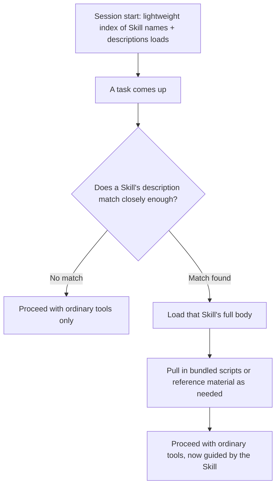

# Authoring Agent Skills
{: .no_toc }

*Read duration: 13:00*

Having covered what a Skill is and when a team should build one, this lecture gets into the mechanics of actually writing one: the file structure, what goes in each part, and how Claude Code decides a given Skill is relevant to the task in front of it.

## The Basic Structure

A Skill lives in its own directory, with a required entry-point file at its root containing instructions and metadata, alongside — optionally — any supporting files the procedure needs. A minimal Skill for drafting a customer-facing changelog entry might look like this on disk:

```text
changelog-entry/
├── SKILL.md
└── examples/
    └── sample-entry.md
```

The entry-point file is where everything starts, and it has two distinct parts doing two distinct jobs: YAML frontmatter that describes the Skill *to the harness* (so it can be discovered without loading the whole thing), and a body that instructs the model once the Skill has actually been invoked.

## Frontmatter: The Discovery Signal

The frontmatter's most important field is a short **description**, and it's worth treating this with the same care the Tool Layer demands of a tool's name and description — because mechanically, it's playing an almost identical role. Before a Skill's full instructions ever load, Claude Code has access to a lightweight index of every available Skill's name and description, and it's *that* short signal — not the full instructions — that determines whether a given task triggers this Skill at all. A vague description ("helps with writing") is nearly useless as a discovery signal, the same way a vaguely-described tool is nearly useless in a tool set with several similar options. A precise one — "use when drafting a customer-facing changelog entry from a list of merged pull request titles" — gives the harness something concrete enough to match reliably, and, just as importantly, to *not* match when a task merely sounds superficially similar (an internal engineering changelog with a completely different audience and format, say).

Frontmatter can also specify metadata like a name distinct from the directory name, and — depending on how a specific deployment is configured — constraints on how the Skill can be invoked (whether it can be triggered automatically by the model recognizing a match, invoked only by explicit user request, or both). This invocation-control detail matters in practice: a Skill that performs something consequential or slow is often better scoped to explicit invocation only, so it never fires as a side effect of the model merely judging a task "close enough" to match.

## The Body: Writing Instructions for a Competent Stranger

Once a Skill is triggered, its body is what actually lands in context, and the right mental model for writing it is a runbook for a smart, capable colleague who has never done this specific task before — not a colleague who needs the basics of the domain explained, but one who genuinely doesn't know *this team's* specific way of doing *this specific thing*. Concretely, that means:

- **State the goal and the shape of the output up front.** What is this procedure actually producing, and in what format? A changelog Skill should say plainly that the output is a short, customer-facing Markdown block grouped by feature area, not leave the model to infer format from examples alone.
- **Spell out the steps in the order they actually need to happen**, including any judgment calls along the way and how to make them — "group related pull requests under one entry rather than listing each separately" is exactly the kind of nuance that separates a Skill worth writing from one that just restates the obvious.
- **Name the failure modes worth avoiding.** If past attempts at this procedure have gone wrong in a specific, recurring way — including internal implementation details in a customer-facing entry, say — stating that explicitly is often the single highest-value sentence in the whole file, since it's exactly the kind of hard-won specificity that ad hoc prompting tends to lose over time.

## Bundling Scripts and Reference Material

Not every Skill is pure prose. A Skill can bundle small, purpose-built scripts alongside its instructions — a formatter, a validator, a template-filling utility — that only make sense in service of this one procedure. Packaging them with the Skill rather than scattering them into the project's general tool surface keeps the whole unit self-contained: anyone who reads the Skill's directory sees everything relevant to this one procedure in one place, and the project's broader tool set isn't cluttered with narrow-purpose scripts that only ever get used from inside this one workflow.

A Skill can also bundle **reference material meant to load only when actually needed** — a second layer of progressive disclosure nested inside the Skill itself. The top-level instructions stay lean and get loaded whenever the Skill triggers, while deeper documentation — a full field-by-field template specification, a longer style guide, an exhaustive edge-case list — sits in a separate file the top-level instructions can point to, loaded only if the specific situation actually calls for that depth. This mirrors, at a smaller scale, the exact same discipline that motivates keeping `CLAUDE.md` lean and pushing detail into subdirectory files or Skills in the first place: load the minimum that's actually needed for the task in front of you, and make everything else reachable on demand rather than paid for upfront.

## Discovery in Practice



Putting the pieces together, a Skill's lifecycle across a session looks like this: at session start, the harness has a lightweight index of every available Skill's name and description — cheap enough that having dozens of Skills available costs almost nothing until one of them is actually used. When a task comes up, the model compares it against that index and decides whether any Skill's description matches closely enough to warrant loading it. If one does, its full body (and, from there, any bundled scripts or on-demand reference material it points to) enters context, and the model proceeds using its ordinary tools — file reads, edits, shell execution — now guided by the Skill's specific instructions about how to apply those tools to this particular procedure. Nothing about invocation spins up a separate agent or a new context window; it's the same session, the same model, now holding one more runbook it didn't have a moment ago.

## A Common Authoring Mistake: Writing for the Reader, Not the Trigger

A subtle but common failure when authoring a first Skill is spending most of the effort on the body and treating the description as an afterthought, dashed off once the real content is done. This gets the priorities backwards. **The body only ever matters if the description successfully triggers the Skill in the first place** — a beautifully written procedure that never loads because its description didn't match the way the task was actually phrased delivers exactly zero value, indistinguishable in outcome from a Skill that was never written at all. Authoring a Skill well means treating the description as a first-class piece of writing in its own right, worth iterating on independently of the body, not a label applied to already-finished work.

{: .important }
> A Skill's description, not its body, determines whether it ever gets used. A perfectly written procedure that never loads because the description didn't match how the task was phrased delivers zero value — indistinguishable from never having written it at all.

## A Short Worked Example

Putting this all together, a well-authored Skill for the compliance-report scenario from the Workflow Layer's worked comparison might have this shape: frontmatter with a precise description ("use when generating the quarterly compliance audit report from the incident and access-review data"), a body that states the required section structure, names the validation rules each section must satisfy, and explicitly calls out a past failure mode ("don't include raw customer identifiers in the summary section — reference the anonymized incident ID instead"), and a bundled validation script the instructions tell the model to run against the drafted report before considering it complete. Every piece of that structure is doing a distinct job: the frontmatter gets the Skill discovered at the right moment; the body encodes the procedure and its hard-won nuances; the bundled script gives the model something concrete to check its own work against, rather than relying on judgment alone for a check that's actually mechanical.

**Why it matters for the exam:** Expect questions asking you to identify what belongs in a Skill's frontmatter versus its body, why a Skill's description quality matters as much as a tool's description does, and what progressive disclosure means concretely at both the "which Skill loads" level and the "which reference file within a loaded Skill loads" level. A well-authored Skill and a poorly-authored one often contain the same underlying knowledge — the exam tests whether you can tell the difference in how that knowledge is structured and signaled.

<!-- prevnext:start -->

---

| [&larr; Previous: What Skills Are and When to Build Them](12-what-skills-are-and-when-to-build-them) | [Next: Creating and Configuring Custom Subagents &rarr;](14-creating-and-configuring-custom-subagents) |
|:---|---:|

<!-- prevnext:end -->
