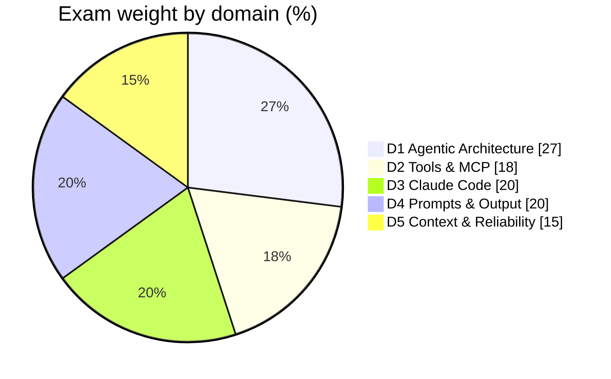

# Chapter 0 — Exam Blueprint & Study Plan
{: .no_toc }

Contents

{: .text-delta }
1. TOC
{:toc}

---

## 🎯 What the Exam Is

| Item | Detail |
|:--|:--|
| Name | **Claude Certified Architect – Foundations (CCA-F)** |
| Audience | People who design and ship solutions built on Claude (developers, architects, technical leads) |
| Style | **Scenario-based multiple choice**: pick the *best* design decision or fix |
| Format details | Question count, time limit, passing score and delivery: **check the official exam guide**, as they can change |

{: .note }
Every question sits inside a **production scenario** (Ch 24). You are judged on **architecture judgment**, not on remembering syntax.

---

## 📊 Domains & Weights

| Domain | Weight* | Book part |
|:--|:--|:--|
| D1 Agentic Architecture & Orchestration | ~27% | [Part B](../part-b/) |
| D2 Tool Design & MCP Integration | ~18% | [Part C](../part-c/) |
| D3 Claude Code Configuration & Workflows | ~20% | [Part D](../part-d/) |
| D4 Prompt Engineering & Structured Output | ~20% | [Part E](../part-e/) |
| D5 Context Management & Reliability | ~15% | [Part F](../part-f/) |

*Check the weights against the current exam guide.

## 📊 The 6 Production Scenarios

| # | Scenario | Running example in this book |
|:--|:--|:--|
| 1 | Customer Support Resolution Agent | ShopAssist (`get_customer`, `lookup_order`, `process_refund`, `escalate_to_human`) |
| 2 | Code Generation with Claude Code | The httpx migration, team CLAUDE.md |
| 3 | Multi-Agent Research System | "AI in creative industries" |
| 4 | Developer Productivity with Claude | Shared MCP servers, skills |
| 5 | Claude Code for Continuous Integration | The PR review gate |
| 6 | Structured Data Extraction | Invoice extraction |

---

## 🧠 How Questions Are Framed

1. **"What is the MOST effective fix?"** Look for the one that fixes the **root cause**, not the symptom.
2. **Several answers "would help".** Pick the one that is **deterministic** when the requirement is *always* or *never*.
3. **Plausible over-engineering** (an extra classifier, multi-agent, a bigger model) is a common tempting wrong answer.
4. **Louder wording** ("be careful", "IMPORTANT", "be conservative") is almost never the answer.
5. **The core split**: the model proposes, the app decides. **Judgment → prompt. Guarantee → code.**

---

## 🗓️ Study Plan (about 3 weeks)

| Week | Read | Practise |
|:--|:--|:--|
| 1 | Part A + Part B (D1, the largest domain) | Course labs: the agentic loop, gates, hooks |
| 2 | Parts C, D, E | Build the MCP server, CLAUDE.md, the extraction pipeline |
| 3 | Part F + Part G | Ch 27 questions, the course exam simulators, the cheat sheet |

{: .tip }
After each chapter, cover the **Exam Traps** table's right-hand column and say the correct choice out loud.

---

## 🔗 References

1. [Anthropic Academy / certification pages](https://www.anthropic.com/learn): official exam guide and registration
2. [Claude Docs](https://docs.claude.com) · [Claude Code Docs](https://code.claude.com/docs)
