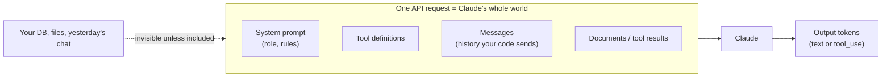
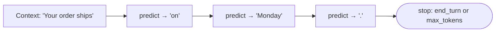

# Chapter 1 — How LLMs & Claude Work
{: .no_toc }

<details open markdown="block">
<summary>Contents</summary>
{: .text-delta }
1. TOC
{:toc}
</details>

---

## 🎯 Exam Snapshot

| Item | Detail |
|:--|:--|
| Domain | Foundations, which underpins D1, D4 and D5 |
| The exam expects you to know… | 1. Claude knows **only what is in the request** |
| | 2. The API is **stateless** and the context is **finite** |
| | 3. Why the **same question can get different answers**, and what to do about it |

---

## 🧠 Core Concepts

1. **An LLM predicts the next token**, one at a time, based on everything in its context.
2. **A token** is a chunk of text, roughly ¾ of an English word. Cost, limits and speed are all counted in tokens.
3. **The context window** is the maximum number of tokens per request (input + output). Everything Claude uses must fit inside it.
4. **What Claude sees** = the system prompt + the messages + the tool definitions + any documents you include. **Nothing else**: no database, no memory of yesterday, no access to your app unless you give it tools.
5. **Stateless**: each API call starts from zero. "Memory" in a chat means **your code resending the history**.
6. **The training cutoff**: knowledge after it must come from the context (tools, retrieval, documents).
7. **Sampling** makes outputs vary. The same prompt can produce different wording or decisions.
8. **Hallucination**: when information is missing, a model may produce plausible but wrong content. Give it sources, allow "unknown", and validate.
9. **More context ≠ better.** Irrelevant tokens dilute attention and cost money (Ch 22).

---

## 🔀 Diagrams

### What Claude actually receives



### Token-by-token generation



---

## 📊 Same Question, Different Answers

| Cause | Fix | Ch |
|:--|:--|:--|
| Vague criteria, so the model's judgment varies | **Explicit criteria** + few-shot examples | 18 |
| Free-form output | **Schema / forced tool** | 20 |
| A must-never rule held only in the prompt | A **gate or hook in code** | 8 |
| Missing facts, so it guesses | Give it the data (tools, documents), allow `null` | 20, 22 |
| Sampling randomness | A lower temperature *reduces* it but **doesn't guarantee** consistency | 3 |

{: .key }
Consistency comes from **clear criteria, examples, schemas and code checks**, not from hoping the model will behave.

---

## 💻 Implementation — Statelessness in Practice

```python
import anthropic
client = anthropic.Anthropic()
MODEL = "claude-sonnet-5-5"

# Call 1
r1 = client.messages.create(model=MODEL, max_tokens=200,
        messages=[{"role": "user", "content": "My name is Priya."}])

# Call 2 WITHOUT history: Claude cannot know the name
r2 = client.messages.create(model=MODEL, max_tokens=200,
        messages=[{"role": "user", "content": "What is my name?"}])

# Call 2 WITH history: your code supplies the "memory"
r3 = client.messages.create(model=MODEL, max_tokens=200, messages=[
        {"role": "user", "content": "My name is Priya."},
        {"role": "assistant", "content": r1.content[0].text},
        {"role": "user", "content": "What is my name?"}])

print(r3.usage.input_tokens)   # grows every turn: history costs tokens
```

---

## ⚠️ Exam Traps

| Distractor | Why it's wrong | Correct choice |
|:--|:--|:--|
| "Claude remembers the earlier session" | The API is stateless | Your code sends the history or facts |
| "Claude can check our database" | Only if it is given a tool | Provide a tool or the data in context |
| Set temperature to 0 to *guarantee* consistent decisions | It reduces variation but guarantees nothing | Criteria, schemas, code checks |
| Put everything in context "just in case" | Dilutes attention, costs more | Relevant context only |

---

## 🔁 Quick Recall

| Q | A |
|:--|:--|
| What does Claude see? | Only the request: system, messages, tools, documents |
| Who keeps the conversation? | Your code |
| A token is roughly? | ¾ of an English word |
| How do you get consistent judgment? | Explicit criteria + examples, with code for guarantees |

---

## 🔗 References

1. [Intro to Claude](https://docs.claude.com/en/docs/intro)
2. [Context windows](https://docs.claude.com/en/docs/build-with-claude/context-windows)
3. [Token counting](https://docs.claude.com/en/docs/build-with-claude/token-counting)
