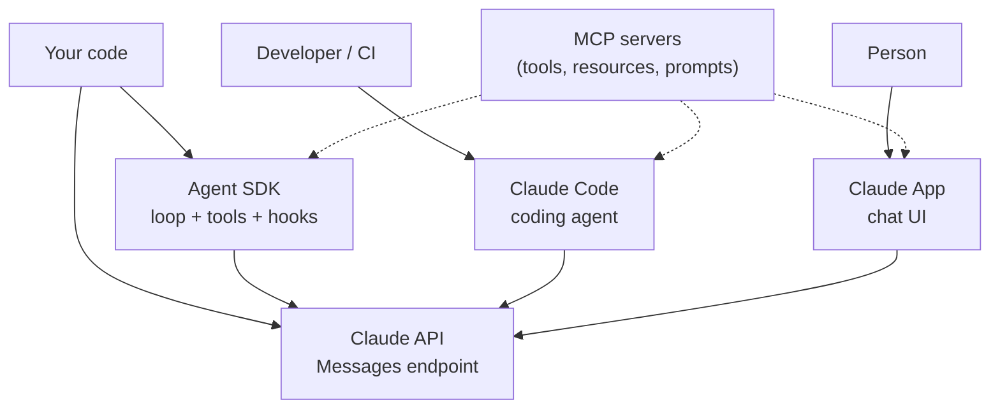

# Chapter 2 — The Claude Ecosystem Map
{: .no_toc }

<details open markdown="block">
<summary>Contents</summary>
{: .text-delta }
1. TOC
{:toc}
</details>

---

## 🎯 Exam Snapshot

| Item | Detail |
|:--|:--|
| Domain | Foundations, used in every scenario |
| The exam expects you to know… | 1. What the **App, API, Agent SDK, Claude Code and MCP** each are |
| | 2. Which one a scenario is using, by asking **"who does the work?"** |

---

## 🧠 Core Concepts

1. **Claude App** (web, desktop, mobile): a **person chats** with Claude. Anthropic runs everything.
2. **Claude API** (Messages API): **your code** sends requests. You own the conversation, the tools and the loop.
3. **Claude Agent SDK** (Python / TypeScript): **the agent loop as a library**. It runs tools, hooks, subagents, MCP and permissions for you.
4. **Claude Code**: an **agentic coding tool** (CLI, IDE, desktop, web, CI), built on the same agent harness, configured with CLAUDE.md, skills and hooks.
5. **MCP**: a **protocol**, not a product. It connects tools and data to any host (Claude Code, the App, your SDK agent).
6. **"Who does the work?"**: who runs the **loop** and **executes the tools**? A person (App)? Your code (API)? The SDK? Claude Code?

---

## 🔀 Diagram



---

## 📊 Who Does the Work?

| Product | Who runs the loop | Who executes the tools | Typical exam signal |
|:--|:--|:--|:--|
| **Claude App** | Anthropic | Anthropic (built-ins, connectors) | "Employees chat with Claude…" |
| **Claude API** | **Your code** | **Your code** | "The application sends requests…", `stop_reason` |
| **Agent SDK** | **The SDK** (`query()`) | The SDK (built-ins, your tools, MCP) | `allowed_tools`, `AgentDefinition`, hooks in code |
| **Claude Code** | Claude Code | Claude Code (Read, Edit, Bash…) | CLAUDE.md, skills, `-p` in CI |
| **MCP** | – (protocol) | **The MCP server** | "Expose the internal system to Claude…" |

## 📊 Pick the Product

| Need | Use |
|:--|:--|
| A one-off chat or analysis by a person | App |
| A custom product with full control (a support bot, an extraction pipeline) | API |
| A custom agent without writing the loop yourself | Agent SDK |
| Coding, repo work, PR review | Claude Code |
| Make a system usable from any of the above | MCP server |

---

## 💻 Implementation — The Same Task, Three Ways

```python
# 1) API: YOU run the loop (full code in Ch 5)
resp = client.messages.create(model="claude-sonnet-5-5", max_tokens=1024,
                              tools=TOOLS, messages=messages)

# 2) Agent SDK: the SDK runs the loop for you
from claude_agent_sdk import query, ClaudeAgentOptions
async for msg in query(prompt="Summarize open issues",
                       options=ClaudeAgentOptions(allowed_tools=["Read", "Grep"])):
    print(msg)

# 3) Claude Code in CI (shell): Claude Code runs the loop
#    claude -p "Summarize open issues" --output-format json
```

---

## ⚠️ Exam Traps

| Distractor | Why it's wrong | Correct choice |
|:--|:--|:--|
| "MCP is a Claude model / product" | It is a protocol | A connector standard for tools and data |
| "The API executes your tools" | The API only returns `tool_use` | Your code (or the SDK) executes them |
| Use the App for an automated nightly pipeline | Needs a person | API or Batch API |
| Write a custom loop when the SDK covers it | Reinvents the harness | Agent SDK |

---

## 🔁 Quick Recall

| Q | A |
|:--|:--|
| The key question for any scenario? | Who does the work? |
| Who executes tools when you use the API directly? | Your code |
| The agent loop as a library? | Agent SDK |
| A protocol, not a product? | MCP |

---

## 🔗 References

1. [Claude API overview](https://docs.claude.com/en/api/overview)
2. [Agent SDK overview](https://docs.claude.com/en/docs/agent-sdk/overview)
3. [Claude Code overview](https://code.claude.com/docs/en/overview)
4. [Model Context Protocol](https://modelcontextprotocol.io)
