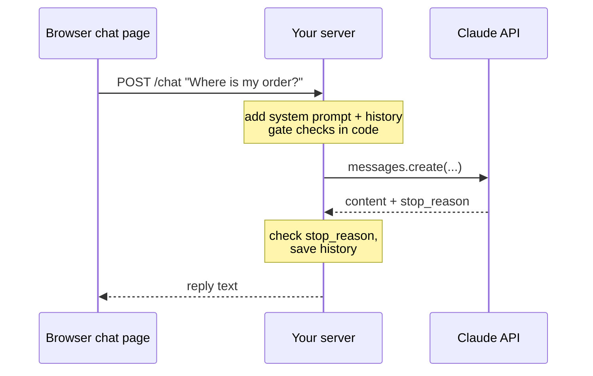
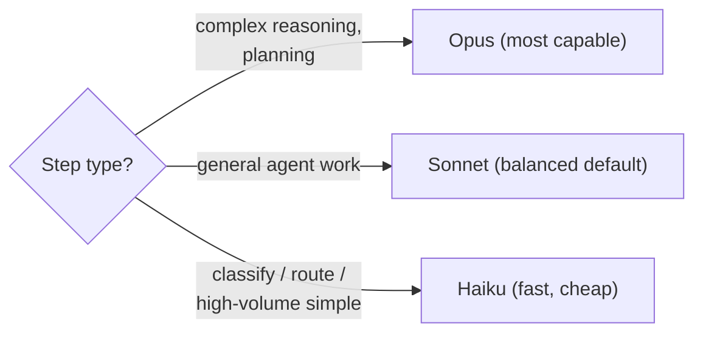

# Chapter 3 — Claude API Essentials
{: .no_toc }

<details open markdown="block">
<summary>Contents</summary>
{: .text-delta }
1. TOC
{:toc}
</details>

---

## 🎯 Exam Snapshot

| Item | Detail |
|:--|:--|
| Domain | Foundations, the basis for Ch 5, 9 and 20 |
| The exam expects you to know… | 1. The request and response shape, and **`stop_reason`** |
| | 2. That the **conversation lives in your code** |
| | 3. **Model, effort and `max_tokens`** choices |
| | 4. **System prompt rules vs code rules** |

---

## 🧠 Core Concepts

1. **Request**: `model`, `max_tokens`, `messages` (alternating `user`/`assistant`), plus optional `system`, `tools`, `tool_choice`, `temperature` and `stop_sequences`.
2. **Response**: a list of `content` **blocks** (`text`, `tool_use`, …), a **`stop_reason`**, and **`usage`** (input and output tokens).
3. **`max_tokens` is a ceiling.** If it is hit, `stop_reason = "max_tokens"` and the reply is **cut off**. Check before sending it to a user.
4. **The conversation lives in your code**: keep a list, append each turn, and resend it. Input tokens **grow** every turn.
5. **Chat UI architecture**: browser → **your server** (adds the system prompt and history, holds the API key) → Claude. **Never** call the API from the browser with your key.
6. **System prompt** = role, scope, tone and **judgment rules**. **Code** = rules that must **always** hold (a gate runs *before* the request or tool call).
7. **Model choice per step**: the most capable model for hard reasoning, a balanced one as the default, and the fastest or cheapest for simple high-volume steps.
8. **Effort / thinking**: more reasoning effort means better results on hard problems, at a higher cost and latency. Use it only where it pays off.
9. **Errors**: `429` rate limit and `529` overloaded are **transient**, so retry with backoff. `400` means fix the request.

---

## 🔀 Diagrams

### Chat UI talks to your script



### Model choice per step



---

## 📊 Model Families

| Family | Strength | Typical use | Example ID |
|:--|:--|:--|:--|
| **Opus** | Most capable | Hard reasoning, coordinators, complex code | `claude-opus-5-5` |
| **Sonnet** | Balance of quality, speed and cost | Default agents, extraction, review | `claude-sonnet-5-5` |
| **Haiku** | Fastest, cheapest | Routing, classification, simple subagents | `claude-haiku-5-5` |

## 📊 `stop_reason` Quick Map

| Value | Meaning | Action |
|:--|:--|:--|
| `end_turn` | Finished | Use the reply |
| `max_tokens` | Truncated | Don't ship it: raise the limit or continue |
| `tool_use` | Wants a tool | Run it, return `tool_result` (Ch 5) |
| `stop_sequence` | Hit your stop string | Handle it according to your design |
| `refusal` | Declined | Handle it, don't blindly retry |

## 📊 Prompt Rule vs Code Rule

| Rule | Where |
|:--|:--|
| "Be friendly and concise" | System prompt |
| "Only discuss our products" (scope) | System prompt |
| "Never send a reply that was cut off" | **Code** (`stop_reason` check) |
| "Never show internal account notes" | **Code** (filter the data before it reaches Claude) |

---

## 💻 Implementation — A Minimal Chat Backend

```python
import anthropic
client = anthropic.Anthropic()          # key read from ANTHROPIC_API_KEY (server side)

SYSTEM = "You are ShopAssist. Help with orders and returns only. Be concise."
history: list[dict] = []                # the conversation lives HERE

def chat(user_text: str) -> str:
    if len(user_text) > 4000:                                   # code rule
        return "Message too long, please shorten it."
    history.append({"role": "user", "content": user_text})
    r = client.messages.create(model="claude-sonnet-5-5", max_tokens=800,
                               system=SYSTEM, messages=history)
    if r.stop_reason == "max_tokens":                           # ceiling hit
        history.pop()
        return "Sorry, something went wrong. Please try again."
    reply = r.content[0].text
    history.append({"role": "assistant", "content": reply})
    print("tokens in/out:", r.usage.input_tokens, r.usage.output_tokens)
    return reply
```

1. The **system prompt** sets the role and scope (judgment).
2. **Code** enforces the input limit and the `stop_reason` check (guarantees).
3. `history` grows each turn, so watch `input_tokens` (cost and context, Ch 22).

---

## ⚠️ Exam Traps

| Distractor | Why it's wrong | Correct choice |
|:--|:--|:--|
| Treat `max_tokens` as a target length | It's a ceiling, and hitting it means truncation | Check `stop_reason` |
| Call Claude straight from the browser | Exposes the API key, no server-side rules | Go through your server |
| Use the most capable model for every step | Cost and latency | Match the model to the step |
| Retry a `400` error | The request itself is wrong | Fix the request. Retry only 429 or 529 |
| Put "never leak internal notes" only in the prompt | Probabilistic | Filter the data in code |

---

## 🔁 Quick Recall

| Q | A |
|:--|:--|
| Where does the conversation live? | In your code |
| `max_tokens` hit means? | A truncated reply |
| The cheapest, fastest family? | Haiku |
| Which errors are worth retrying? | 429 and 529 (with backoff) |

---

## 🔗 References

1. [Messages API](https://docs.claude.com/en/api/messages)
2. [Models overview](https://docs.claude.com/en/docs/about-claude/models/overview)
3. [Handling stop reasons](https://docs.claude.com/en/api/handling-stop-reasons)
4. [API errors](https://docs.claude.com/en/api/errors)
