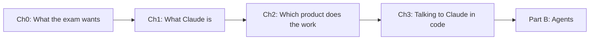

# Part A — Foundations
{: .no_toc }

**Not a scored domain on its own, but every domain builds on it.**
{: .fs-5 }

| Ch | Title | Pages | You must be able to… |
|:--|:--|:--|:--|
| 0 | [Exam Blueprint & Study Plan](00-exam-blueprint.html) | 2 | Know the domains, the scenarios and how questions are framed |
| 1 | [How LLMs & Claude Work](01-how-llms-work.html) | 3 | Explain tokens, context, statelessness and why answers vary |
| 2 | [The Claude Ecosystem Map](02-ecosystem-map.html) | 2 | Tell the App, API, Agent SDK, Claude Code and MCP apart |
| 3 | [Claude API Essentials](03-api-essentials.html) | 3 | Make a request, hold the conversation in code, and check `stop_reason` |

