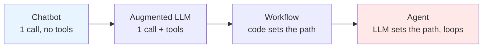
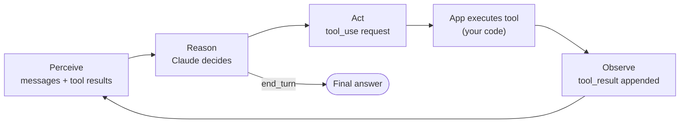
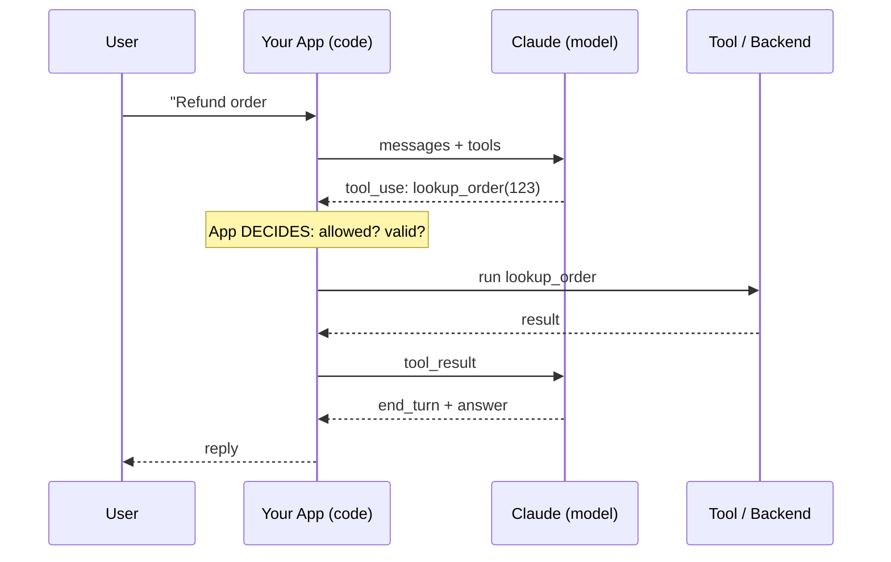

# Chapter 4 — Agents vs Workflows vs Chatbots
{: .no_toc }

<details open markdown="block">
<summary>Contents</summary>
{: .text-delta }
1. TOC
{:toc}
</details>

---

## 🎯 Exam Snapshot

| Item | Detail |
|:--|:--|
| Domain | D1 Agentic Architecture & Orchestration (~27%) |
| The exam tests whether you can… | 1. Tell a chatbot, a workflow and an agent apart |
| | 2. Pick the **simplest** architecture that solves the problem |
| | 3. Split responsibility: **model proposes → application decides and executes** |

---

## 🧠 Core Concepts

1. **Chatbot**: one request → one reply. No tools and no loop. The app sends the history and Claude answers.
2. **Augmented LLM**: an LLM plus tools, retrieval and memory. This is the building block for everything below.
3. **Workflow**: LLM calls and tools arranged along **paths fixed in code**. *Your code* decides the next step.
4. **Agent**: the LLM **decides its own next step** (which tool, when to stop) by using **tools in a loop**.
5. **Agency = tools + loop.** Without a loop it is a single tool call. Without tools it is a chatbot.
6. **Claude never runs anything itself.** It returns a `tool_use` *request*. Your code runs it and sends back a `tool_result`.
7. **Start simple.** Use a single call, then a workflow, and use an agent only when the steps **can't be known in advance**.
8. Agents trade **cost, latency and predictability** for **flexibility**.

{: .key }
**Model proposes, application decides.** What the agent *should* do is left to Claude's judgment (the prompt). What it must **never** do is a check in code.

---

## 🔀 Diagrams

### The autonomy ladder


*Further right = more flexibility, but also more cost, latency and risk.*

### The agent cycle: Perceive → Reason → Act → Observe



### Who does what



---

## 📊 Workflow Patterns
These come from Anthropic's *Building Effective Agents*.

| Pattern | How it works | Use when | Example |
|:--|:--|:--|:--|
| **Prompt chaining** | Step 1 output → step 2 input, with code checks ("gates") between steps | The task splits into fixed, known steps | Draft → check → translate |
| **Routing** | Classify the input, then send it to a specialised prompt or model | Inputs fall into distinct categories | Billing vs technical vs returns |
| **Parallelization** | Sectioning (split the work) or voting (run the same task N times) | Subtasks are independent, or you need more confidence | Review N files at once |
| **Orchestrator–workers** | An LLM splits the task dynamically and workers run the parts | Subtasks are **not known in advance** | Multi-source research |
| **Evaluator–optimizer** | One LLM generates and another critiques, in a loop | There are clear quality criteria and iteration helps | Polishing a translation |
| **Agent** | An open-ended loop where the LLM picks tools and decides when to stop | Steps are unpredictable and many turns are needed | Support case resolution |

---

## 📊 Choosing an Architecture

| Question | If YES → | If NO → |
|:--|:--|:--|
| Can one call with good context solve it? | **Single call** | ↓ |
| Are the steps known and fixed? | **Workflow** (chain / route / parallel) | ↓ |
| Are the subtasks independent and broad? | **Orchestrator–workers / multi-agent** (Ch 7) | ↓ |
| Is the path unpredictable, needing tools in many turns? | **Single agent** | Re-check the requirements |

| | Workflow | Agent |
|:--|:--|:--|
| Control flow | Code | Model |
| Predictability | High | Lower |
| Cost / latency | Lower, bounded | Higher, variable |
| Debugging | Easy (fixed path) | Harder (traces needed) |
| Best for | Repeatable processes, compliance | Open-ended problems |

{: .tip }
Words in the question like *"predictable"*, *"auditable"*, *"same steps every time"* or *"compliance"* point to a **workflow**. Words like *"open-ended"*, *"unknown number of steps"* or *"must adapt"* point to an **agent**.

---

## 💻 Implementation — Workflow vs Agent in Python

```python
import anthropic
client = anthropic.Anthropic()
MODEL = "claude-sonnet-5-5"

def ask(prompt: str) -> str:
    r = client.messages.create(model=MODEL, max_tokens=1024,
                               messages=[{"role": "user", "content": prompt}])
    return r.content[0].text

# WORKFLOW: code fixes the path (prompt chaining with a gate)
def summarize_then_translate(doc: str) -> str:
    summary = ask(f"Summarize in 5 bullets:\n{doc}")
    if summary.count("\n") > 8:                 # gate: a code check between steps
        raise ValueError("Summary too long")
    return ask(f"Translate to French:\n{summary}")

# AGENT: the model picks the path -> see the loop in Chapter 5
# run_agent("Customer says order #123 never arrived", tools=TOOLS)
```

1. In the workflow, **your code** calls step 1, checks it, then calls step 2.
2. In the agent, Claude decides which tool to call next and when it is finished.
3. Same model, different **owner of the control flow**.

---

## ⚠️ Exam Traps

| Distractor | Why it's wrong | Correct choice |
|:--|:--|:--|
| "Use a multi-agent system for a fixed 3-step process" | Over-engineered: more cost, latency and failure points | Prompt chaining workflow |
| "Claude executes the refund" | Claude only *requests* tools | The app executes and decides |
| "Put the rule 'never refund over $500' in the system prompt" | Prompts are probabilistic | A code check (gate or hook, Ch 8) |
| "Agents are always better because they're smarter" | Agents cost predictability | Use the simplest architecture that works |
| "A chatbot with function calling is an agent" | Without a **loop** it is one step | Agent = tools **in a loop** |

---

## 🧩 Scenario Mini-Case

**ShopAssist.** A company wants to (a) classify each incoming email into 1 of 4 queues and (b) resolve return requests, which can need order lookups, policy checks and refunds in a varying order.

| Need | Architecture | Why |
|:--|:--|:--|
| (a) Classify emails | **Routing workflow** (one call) | Fixed categories, no tools needed |
| (b) Resolve returns | **Single agent** with 4 tools | The steps vary per case |
| Refund limit | **Code check** | It must *never* be broken |

---

## 🔁 Quick Recall

| Q | A |
|:--|:--|
| What turns a chatbot into an agent? | Tools used in a **loop** |
| Who executes a tool? | Your application, never Claude |
| Workflow vs agent, in one line? | Code controls the path vs the model controls the path |
| Which pattern has subtasks that are not known in advance? | Orchestrator–workers |
| Default advice when unsure? | Start with the simplest option and add complexity only when it is needed |

---

## 🔗 References

1. [Building Effective Agents — Anthropic Engineering](https://www.anthropic.com/engineering/building-effective-agents): pattern diagrams
2. [Tool use overview — Claude Docs](https://docs.claude.com/en/docs/agents-and-tools/tool-use/overview)
3. [Agent SDK overview](https://docs.claude.com/en/docs/agent-sdk/overview)
