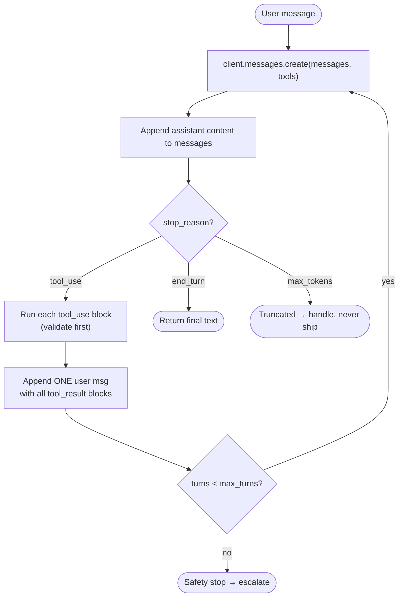
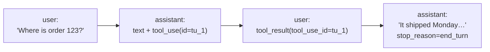

# Chapter 5 — The Agentic Loop & Loop Control
{: .no_toc }

<details open markdown="block">
<summary>Contents</summary>
{: .text-delta }
1. TOC
{:toc}
</details>

---

## 🎯 Exam Snapshot

| Item | Detail |
|:--|:--|
| Domain | D1 (~27%) |
| The exam tests whether you can… | 1. Drive the loop with **`stop_reason`** |
| | 2. Append `tool_use` and `tool_result` messages correctly |
| | 3. Spot **wrong stop conditions** (text parsing, iteration caps used as the main control) |

---

## 🧠 Core Concepts

1. The API is **stateless**. *Your code* keeps the `messages` list and resends all of it on every call.
2. Each response has a **`stop_reason`** that tells your loop what to do next.
3. On `tool_use`: append Claude's **whole assistant content**, run each tool, then append **one user message** holding all the `tool_result` blocks.
4. Each `tool_result` must carry the matching **`tool_use_id`**.
5. Claude can ask for **several tools in one turn** (parallel tool use). Return **all** their results in the **same** user message.
6. The loop ends when `stop_reason == "end_turn"`, meaning Claude has decided it is finished.
7. **`max_tokens` is a ceiling, not a target.** If you hit it, the reply was **truncated**. Never send a cut-off reply to a customer.
8. An **iteration cap** (`max_turns`) is a **safety net** against runaway loops. It is *not* the normal way the loop stops.
9. Tool errors are returned **as `tool_result`** (with `is_error: true`) so that Claude can adapt. Don't crash the loop.

---

## 📊 `stop_reason` Values

| `stop_reason` | Meaning | Your loop should… |
|:--|:--|:--|
| `tool_use` | Claude wants one or more tools run | Execute them → append `tool_result` → **call again** |
| `end_turn` | Claude finished naturally | **Exit** and return the final text |
| `max_tokens` | Output hit your `max_tokens` limit | Treat it as **incomplete**: raise the limit, continue, or fail safely |
| `stop_sequence` | One of your custom stop strings appeared | Handle it according to your design |
| `pause_turn` | A long server-tool turn was paused | Send the response back to let Claude continue |
| `refusal` | Claude declined, for safety reasons | Don't retry blindly. Handle it or escalate |

---

## 🔀 Diagrams

### Loop control flow



### Shape of the `messages` list after one tool round



---

## 💻 Implementation — The Agentic Loop

```python
import json
import anthropic

client = anthropic.Anthropic()
MODEL = "claude-sonnet-5-5"

TOOLS = [{
    "name": "lookup_order",
    "description": "Get an order's status, items and total by order ID (e.g. 'A123').",
    "input_schema": {"type": "object",
                     "properties": {"order_id": {"type": "string"}},
                     "required": ["order_id"]},
}]

def run_tool(name: str, args: dict) -> dict:
    if name == "lookup_order":
        return {"order_id": args["order_id"], "status": "shipped"}
    raise ValueError(f"Unknown tool: {name}")

def run_agent(user_text: str, max_turns: int = 10) -> str:
    messages = [{"role": "user", "content": user_text}]
    for _ in range(max_turns):                         # safety net only
        resp = client.messages.create(model=MODEL, max_tokens=1024,
                                      tools=TOOLS, messages=messages)
        messages.append({"role": "assistant", "content": resp.content})

        if resp.stop_reason == "end_turn":             # the real exit
            return "".join(b.text for b in resp.content if b.type == "text")
        if resp.stop_reason == "max_tokens":
            raise RuntimeError("Reply truncated - do not send to the customer")

        if resp.stop_reason == "tool_use":
            results = []
            for block in resp.content:                 # may be several (parallel)
                if block.type != "tool_use":
                    continue
                try:
                    out = run_tool(block.name, block.input)
                    results.append({"type": "tool_result", "tool_use_id": block.id,
                                    "content": json.dumps(out)})
                except Exception as e:                 # errors go back to Claude
                    results.append({"type": "tool_result", "tool_use_id": block.id,
                                    "content": str(e), "is_error": True})
            messages.append({"role": "user", "content": results})
    raise RuntimeError("max_turns reached - escalate to a human")
```

1. `stop_reason` drives **every** branch of the loop.
2. All tool results go into **one** user message, each matched by its `tool_use_id`.
3. The `for … range(max_turns)` is a guard. `end_turn` is the normal exit.

{: .note }
The **Claude Agent SDK** runs this same loop for you (`query()`), along with tool execution, hooks and subagents. The concepts are the same, so the exam expects you to know what the SDK is doing under the hood.

---

## ⚠️ Exam Traps

| Distractor | Why it's wrong | Correct choice |
|:--|:--|:--|
| Stop when the reply text contains "done" or "complete" | Parsing natural language is unreliable | Check `stop_reason == "end_turn"` |
| Stop as soon as the response has *any* text | Claude often writes text **and** a `tool_use` in the same turn | Check `stop_reason`, not the content type |
| Use `max_turns=3` as the main stop rule | It cuts off valid work part-way | Use a cap as a safety net only. `end_turn` is the exit |
| Send only the latest message on the next call | The API is stateless and Claude loses context | Resend the **full** history |
| One user message per tool result when there are parallel calls | It breaks the expected format | **One** user message with all the results |
| Raise an exception when a tool fails | The loop dies and Claude can't recover | Return `tool_result` with `is_error: true` |
| Return a reply that stopped on `max_tokens` | The customer gets a truncated answer | Check `stop_reason` before delivering |

---

## 🧩 Scenario Mini-Case

**ShopAssist bug report:** "Sometimes the agent replies *'Let me check that order…'* and then nothing happens."

| Step | Finding |
|:--|:--|
| Root cause | The loop exited when it saw text content, but `stop_reason` was `tool_use` |
| Fix | Branch on `stop_reason`. Keep looping while it is `tool_use` |
| Extra guard | Check for `max_tokens` before sending anything to the customer |

---

## 🔁 Quick Recall

| Q | A |
|:--|:--|
| Which field controls the loop? | `stop_reason` |
| The normal exit signal? | `end_turn` |
| What links a result to its request? | `tool_use_id` |
| `max_tokens` hit means? | The output was truncated, so it is incomplete |
| The role of an iteration cap? | A safety net against runaway loops |

---

## 🔗 References

1. [Handling stop reasons — Claude Docs](https://docs.claude.com/en/api/handling-stop-reasons)
2. [How to implement tool use — Claude Docs](https://docs.claude.com/en/docs/agents-and-tools/tool-use/implement-tool-use)
3. [Agent SDK — the agent loop](https://docs.claude.com/en/docs/agent-sdk/overview)
