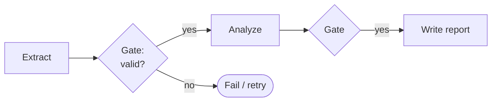
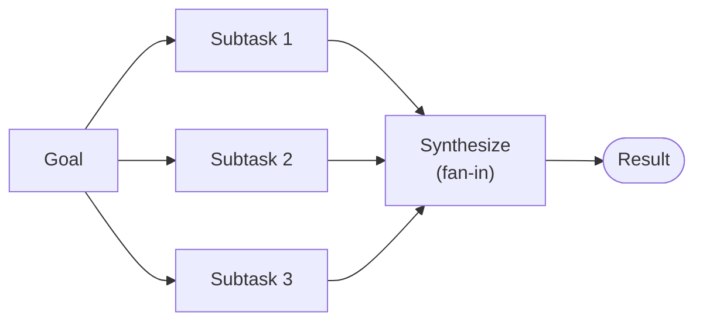
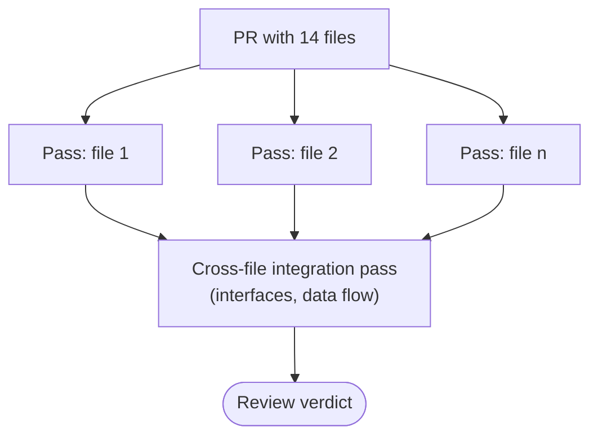
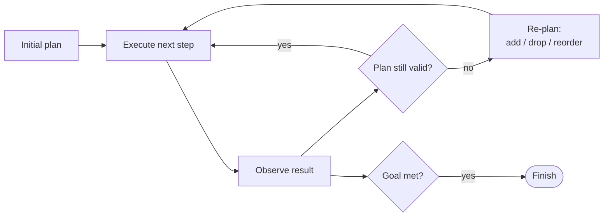

# Chapter 6 — Task Decomposition & Planning
{: .no_toc }

<details open markdown="block">
<summary>Contents</summary>
{: .text-delta }
1. TOC
{:toc}
</details>

---

## 🎯 Exam Snapshot

| Item | Detail |
|:--|:--|
| Domain | D1 (~27%) |
| The exam tests whether you can… | 1. Choose **sequential, parallel or hierarchical** decomposition |
| | 2. Choose **fixed (prompt chaining)** or **adaptive (dynamic)** planning |
| | 3. Find **coverage gaps** caused by decomposition that is too narrow |

---

## 🧠 Core Concepts

1. **Decomposition** means splitting a goal into subtasks that are each **small, testable and assignable**.
2. **Sequential**: each step needs the previous step's output. You can put **gates** (code checks) between steps.
3. **Parallel (fan-out / fan-in)**: independent subtasks run at the same time, then a **synthesis** step merges them.
4. **Hierarchical**: goal → sub-goals → tasks. A coordinator delegates and each part may split again.
5. **Fixed plan (prompt chaining)**: use it when the steps are **predictable**, as in a multi-aspect review that is the same every time.
6. **Adaptive plan**: use it for **open-ended investigation**. The plan changes as results arrive.
7. **Attention dilution**: one huge pass over many files or topics misses things. Split it into **per-item passes plus an integration pass**.
8. **Coverage**: what the system *misses* is decided at the point where work is decomposed, so check that the subtasks span the **whole** goal.
9. **Ambiguity**: when it is cheap to ask, ask a clarifying question. Otherwise make **explicit, recorded assumptions**. Never guess silently.

---

## 🔀 Diagrams

### Sequential (prompt chain with gates)



### Parallel: fan-out / fan-in



### Large code review: per-file passes + cross-file pass



### Adaptive planning



---

## 📊 Choosing a Decomposition Pattern

| Pattern | Use when | Trade-off | Exam signal |
|:--|:--|:--|:--|
| **Sequential** | Step B needs A's output | Slowest, and an early error spreads unless gated | "each stage depends on…" |
| **Parallel** | Subtasks are independent | Fast, but needs a merge step and costs more tokens at once | "independent sources / files" |
| **Hierarchical** | The goal is large with sub-goals | Coordination overhead | "coordinator delegates…" |
| **Fixed chain** | The steps are the same every time | Predictable, but can't adapt | "consistent, repeatable review" |
| **Adaptive** | The next step depends on findings | Flexible, but less predictable | "open-ended investigation" |

### Fan-out / fan-in checklist

| # | Check |
|:--|:--|
| 1 | Are the subtasks truly **independent**, with no shared mutable state? |
| 2 | Does each subtask get **all the context it needs** in its own prompt? |
| 3 | Do the outputs use the **same structured format**, so they can be merged? |
| 4 | Is there a rule for **missing or failed** branches (wait, time out, or go ahead partial)? |
| 5 | Does synthesis **keep the sources** and flag conflicts? |

### Handling ambiguity

| Situation | Action |
|:--|:--|
| A human is available and the choice matters | **Ask** a focused clarifying question |
| Batch or autonomous work, and the choice can be undone | Pick a sensible default and **record the assumption** in the output |
| High-stakes and still unclear | **Stop and escalate**. Don't guess |

---

## 💻 Implementation — Fan-out / Fan-in in Python

```python
import asyncio, json
from anthropic import AsyncAnthropic

client = AsyncAnthropic()
MODEL = "claude-sonnet-5-5"

async def review_file(path: str, code: str) -> dict:
    r = await client.messages.create(
        model=MODEL, max_tokens=1024,
        system="Review ONE file. Return JSON: "
               '{"file": str, "issues": [{"line": int, "issue": str}]}',
        messages=[{"role": "user", "content": f"{path}\n{code}"}])
    return json.loads(r.content[0].text)

async def review_pr(files: dict[str, str]) -> str:
    # Fan-out: one focused pass per file, run in parallel
    per_file = await asyncio.gather(*(review_file(p, c) for p, c in files.items()))
    # Fan-in: a separate cross-file pass sees every finding together
    r = await client.messages.create(
        model=MODEL, max_tokens=1024,
        messages=[{"role": "user", "content":
                   "Find cross-file problems (interfaces, data flow) using these "
                   f"per-file findings:\n{json.dumps(per_file)}"}])
    return r.content[0].text
```

1. Each file gets **full attention**, so there is no dilution.
2. `asyncio.gather` gives a real **parallel** fan-out.
3. The **integration pass** catches problems that no single-file pass can see.

---

## ⚠️ Exam Traps

| Distractor | Why it's wrong | Correct choice |
|:--|:--|:--|
| The report misses whole subtopics, so "improve the subagent prompts" | The subagents did what they were given. The **decomposition** was too narrow | Fix the **coordinator's decomposition** so it covers the full scope |
| Review 14 files in one prompt with a bigger context window | Attention dilution: inconsistent, missed issues | Per-file passes **plus** a cross-file pass |
| Run dependent steps in parallel to save time | The later steps get no inputs | Sequential, with gates |
| Use an adaptive agent for an identical monthly report | Unpredictable and costly | A fixed prompt chain |
| Guess silently when the spec is unclear | Hidden errors | Ask, or record the assumption, or escalate |

---

## 🧩 Scenario Mini-Case

**Multi-agent research:** *"Impact of AI on creative industries."* The final report covers only **visual art** and leaves out music, writing and film.

| Check | Finding |
|:--|:--|
| Subagent outputs | Each is accurate for what it was given |
| Coordinator log | It produced only 3 visual-art subtasks |
| **Root cause** | A decomposition that was **too narrow** |
| **Fix** | The coordinator maps the full scope first and checks that the subtasks cover it |

---

## 🔁 Quick Recall

| Q | A |
|:--|:--|
| Independent subtasks → which pattern? | Parallel fan-out / fan-in |
| A predictable, repeated multi-step review → ? | Fixed prompt chaining |
| Open-ended investigation → ? | Adaptive decomposition |
| A large PR review strategy? | Per-file passes + a cross-file integration pass |
| Missing coverage in a report usually comes from? | Coordinator decomposition that is too narrow |

---

## 🔗 References

1. [Building Effective Agents — chaining, parallelization, orchestrator-workers](https://www.anthropic.com/engineering/building-effective-agents)
2. [How we built our multi-agent research system](https://www.anthropic.com/engineering/multi-agent-research-system)
3. [Prompt chaining — Claude Docs](https://docs.claude.com/en/docs/build-with-claude/prompt-engineering/chain-prompts)
