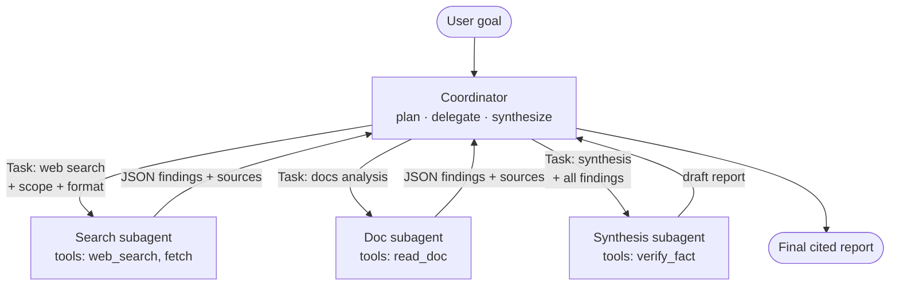
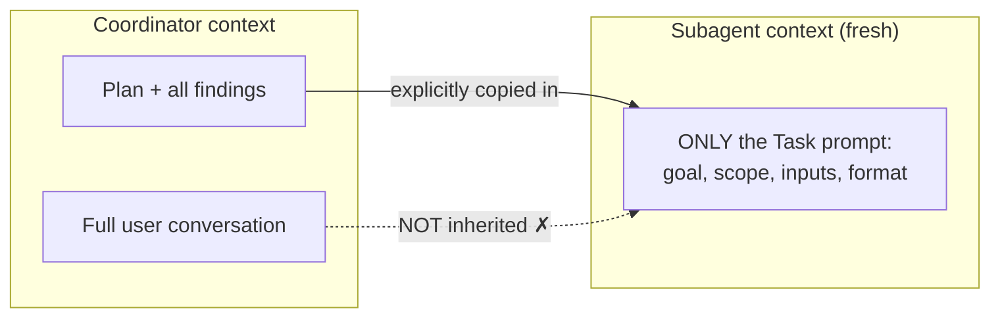
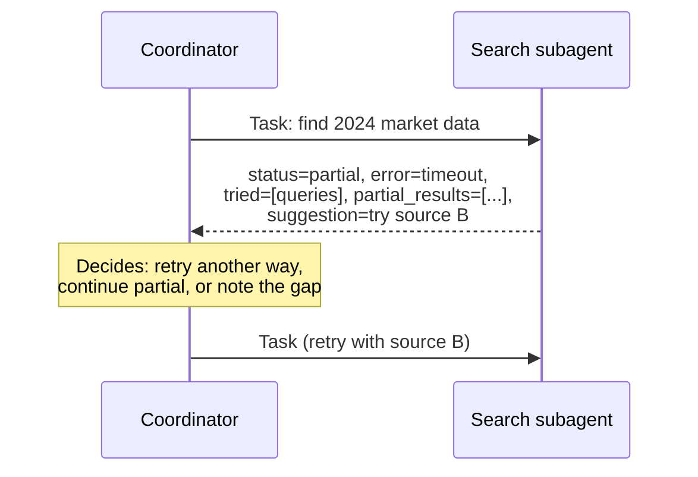

# Chapter 7 — Multi-Agent Orchestration
{: .no_toc }

<details open markdown="block">
<summary>Contents</summary>
{: .text-delta }
1. TOC
{:toc}
</details>

---

## 🎯 Exam Snapshot

| Item | Detail |
|:--|:--|
| Domain | D1 (~27%). One of the 6 scenarios is the **multi-agent research system** |
| The exam tests whether you can… | 1. Design the **coordinator ↔ subagent** split |
| | 2. **Pass context explicitly** (subagents inherit nothing) |
| | 3. **Scope tools** per agent and handle **subagent failures** |
| | 4. Judge **cost and fit**: when multi-agent is *not* worth it |

---

## 🧠 Core Concepts

1. **Coordinator (orchestrator)**: plans, delegates, collects and synthesizes. It owns the **goal** and the **final answer**.
2. **Subagent**: a separate Claude instance with **its own fresh context**, its own prompt and its own tool set.
3. **Context isolation**: a subagent **does not see** the coordinator's conversation. Anything it needs must be **written into its task prompt**.
4. **Hub-and-spoke**: subagents talk **only to the coordinator**, never to each other. This keeps routing, logging and error handling in one place.
5. **Spawning (Agent SDK)**: the coordinator calls the **`Task` tool**, so `"Task"` must be in its `allowed_tools`. Each subagent is defined with `AgentDefinition` (description, prompt, tools).
6. **Parallel spawning**: the coordinator issues **several `Task` calls in one response**, and they run at the same time.
7. **Delegate goals, not scripts**: give each subagent the **objective, scope, output format and quality bar**, not a step-by-step procedure.
8. **Least privilege**: give each agent only the tools its role needs (about 4–5 at most). Too many tools leads to wrong tool choices.
9. **Structured hand-back**: subagents return JSON with **content kept separate from metadata** (source URL, document, page, date) so attribution survives synthesis.
10. **Cost**: multi-agent runs use **many times more tokens** than a single chat. Use them for **broad, parallelisable** work, not tightly coupled tasks.

{: .key }
A subagent knows **only** what is in its prompt. If the coordinator doesn't pass it, the subagent doesn't have it.

---

## 🔀 Diagrams

### Coordinator pattern (hub-and-spoke)



### What a subagent sees (and doesn't)



### Failure path



---

## 📊 Topologies

| Topology | Shape | Use when | Risk |
|:--|:--|:--|:--|
| **Hub-and-spoke** (coordinator) | 1 coordinator ↔ N subagents | Default for research or analysis | The coordinator becomes a bottleneck |
| **Pipeline** | A → B → C | Fixed stages (extract → enrich → write) | Errors spread down the chain |
| **Hierarchical** | Coordinator → sub-coordinators → workers | Very large scope | Heavy overhead and lost context |
| **Peer / mesh** | Agents talk to each other directly | Rarely the best exam answer | Hard to control, observe and debug |

## 📊 Fit: Single Agent vs Multi-Agent

| Factor | Single agent | Multi-agent |
|:--|:--|:--|
| Task shape | Tightly coupled and sequential (most coding) | **Broad, parallel, independent** (research) |
| Context needed | Shared context is essential | Each part fits in its own context |
| Token cost | Lower | **Much higher** |
| Latency | Sequential | Faster through parallelism |
| Debugging | Simpler | Needs tracing across agents |

## 📊 Passing Context — Do / Don't

| Do | Don't |
|:--|:--|
| Put **complete prior findings** in the subagent's prompt | Assume it "remembers" the earlier conversation |
| State **goal, scope boundaries, output schema and success criteria** | Send a vague "research X" |
| Keep **content + metadata** (URL, doc, page, date) together | Pass plain prose and lose the attribution |
| Send only the **relevant** slice of context | Dump the whole transcript into every subagent |

## 📊 State & Session Continuity

| Need | Use |
|:--|:--|
| Short-lived working facts | **In-context** (messages) |
| Facts that must outlive context limits, agents or crashes | **External memory**: a file, DB or scratchpad, re-injected when needed |
| Continue the same investigation later | **Resume** the session by name or ID |
| Try two different approaches from the same point | **Fork** the session |
| The old session's tool results are stale (the code changed) | **Start fresh** with a structured summary of what still holds |

---

## 💻 Implementation — Coordinator + Subagents (Claude Agent SDK)

```python
import asyncio
from claude_agent_sdk import query, ClaudeAgentOptions, AgentDefinition

options = ClaudeAgentOptions(
    system_prompt=("You coordinate research. First map the FULL scope of the topic, "
                   "then delegate independent subtopics IN PARALLEL. "
                   "Each finding must keep its source URL."),
    allowed_tools=["Task"],                         # the coordinator only delegates
    agents={
        "web-researcher": AgentDefinition(
            description="Finds recent sources for ONE subtopic.",
            prompt=("Research only the subtopic you are given. Return JSON: "
                    "findings[{claim, source_url, date}], gaps[]. "
                    "On failure return status, error, partial_results."),
            tools=["WebSearch", "WebFetch"],        # scoped: no file writes
        ),
        "synthesizer": AgentDefinition(
            description="Merges findings into a cited report.",
            prompt="Use ONLY the findings given. Keep every source. Flag conflicts.",
            tools=["Read"],
        ),
    },
)

async def main():
    async for msg in query(prompt="Impact of AI on creative industries", options=options):
        print(msg)

asyncio.run(main())
```

1. `allowed_tools=["Task"]` lets the coordinator spawn subagents. Each subagent has **its own scoped `tools`**.
2. The subagent `prompt` sets the **goal, format and failure contract**, not step-by-step instructions.
3. The structured output keeps **`source_url`** attached to each claim.

{: .note }
With the plain API you build the same pattern yourself: one `messages.create` per subagent (run in parallel with `asyncio.gather`), with the coordinator's findings pasted into each prompt. See Chapter 6.

---

## 📊 Subagent Failure Handling

| Option | Verdict | Why |
|:--|:--|:--|
| Return a **structured error**: type, what was tried, partial results, suggested next step | ✅ Best | The coordinator can decide what to do intelligently |
| Return an empty list marked "success" | ❌ | A failure hidden as "no data" corrupts the report |
| Return a generic "search unavailable" | ❌ | Not enough for the coordinator to choose a recovery |
| Abort the whole workflow on one failure | ❌ | Loses all the other valid work |
| Retry forever inside the subagent | ❌ | Wastes cost. Bound the retries and then report |

---

## ⚠️ Exam Traps

| Distractor | Why it's wrong | Correct choice |
|:--|:--|:--|
| "The subagent will use the earlier conversation" | Subagents have **isolated** context | Pass the context explicitly in the Task prompt |
| Give every agent every tool "for flexibility" | Wrong tool choices and a larger blast radius | Scope tools per role (least privilege) |
| Subagents message each other directly | Loses central control and observability | Route everything through the coordinator |
| The synthesizer sends *every* fact check back through the coordinator | Too many round trips | Give the synthesizer a **narrow `verify_fact` tool** for simple checks |
| Multi-agent for a tightly coupled refactor | High cost, and shared context is needed | A single agent |
| Spawn subagents one at a time for independent topics | Slow | Several `Task` calls **in one response** |

---

## 🧩 Scenario Mini-Case

**Research system:** the search subagent times out on one subtopic. Today the coordinator receives `[]` and writes *"No data exists on this topic."*

| Step | Decision |
|:--|:--|
| Problem | A failure was hidden as an empty success, so the report is wrong |
| Fix 1 | The subagent returns `{status: "error", type: "timeout", query_tried, partial_results}` |
| Fix 2 | The coordinator retries another way **or** marks the gap in the report |
| Avoid | Killing the whole run, or a generic error message |

---

## 🔁 Quick Recall

| Q | A |
|:--|:--|
| What does a subagent inherit from the coordinator? | **Nothing** except its Task prompt |
| Which tool spawns subagents in the Agent SDK? | `Task` (it must be in `allowed_tools`) |
| How do you run subagents in parallel? | Several Task calls in one coordinator response |
| How do you keep attribution? | Structured output: claim + source metadata |
| When is multi-agent a poor fit? | Tightly coupled tasks, or when cost and latency matter most |

---

## 🔗 References

1. [How we built our multi-agent research system — Anthropic](https://www.anthropic.com/engineering/multi-agent-research-system)
2. [Subagents in the Agent SDK](https://docs.claude.com/en/docs/agent-sdk/subagents)
3. [Effective context engineering for AI agents](https://www.anthropic.com/engineering/effective-context-engineering-for-ai-agents)
4. [Claude Code subagents](https://code.claude.com/docs/en/sub-agents)
