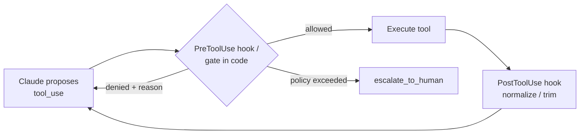
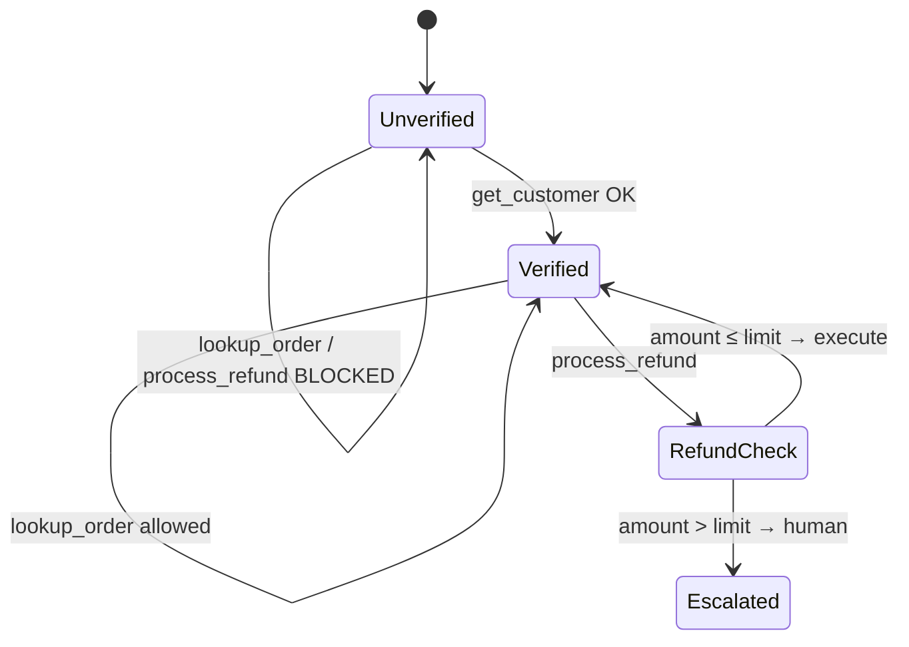
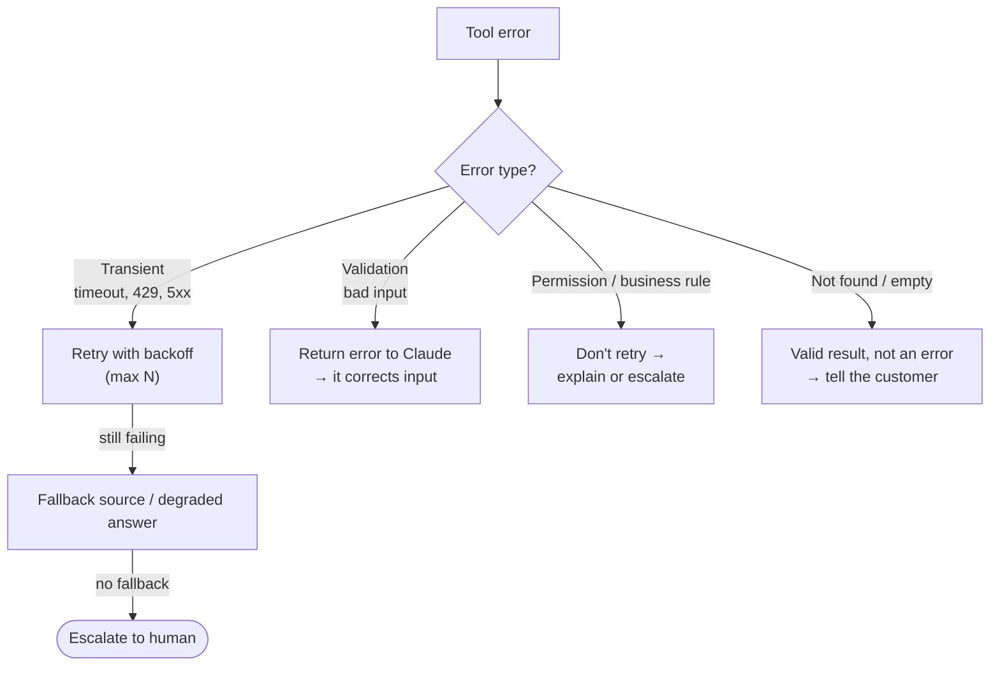

# Chapter 8 — Reliability, Enforcement & Human Oversight
{: .no_toc }

<details open markdown="block">
<summary>Contents</summary>
{: .text-delta }
1. TOC
{:toc}
</details>

---

## 🎯 Exam Snapshot

| Item | Detail |
|:--|:--|
| Domain | D1 (~27%). Heavily tested in the **customer support** scenario |
| The exam tests whether you can… | 1. Tell **prompt guidance** (probabilistic) from **code enforcement** (deterministic) |
| | 2. Use **prerequisite gates** and **hooks** for rules that must always hold |
| | 3. Classify errors and choose **retry, fallback or abort** |
| | 4. Know **when to escalate, and when not to** |

---

## 🧠 Core Concepts

1. **Prompts are probabilistic.** Even a well-written prompt is followed *most* of the time, not *every* time.
2. **High-stakes rules** (money, identity, compliance, irreversible actions) need a **code check** that cannot be skipped.
3. **Prerequisite gate**: code blocks tool B until tool A has succeeded. For example, no `lookup_order` or `process_refund` until `get_customer` has verified the customer.
4. **Hooks**: deterministic code that runs at **lifecycle events** (before or after a tool call, and so on). They can **block, change or log** actions.
5. **PreToolUse hook** → *block* or *redirect* a call before it runs (for example, a refund over the limit → deny and escalate).
6. **PostToolUse hook** → *clean up* results before Claude sees them (for example, convert mixed date formats to ISO 8601, or trim large payloads).
7. **Retry only transient errors** (timeouts, 429, 5xx) with **bounded exponential backoff**. Never retry validation, permission or business-rule errors unchanged.
8. **Fallback chain**: primary → alternative → degraded answer → human. Fail **visibly**, never silently.
9. **Escalation** is a designed path that comes with a **structured handoff summary**, because the human doesn't have the transcript.

{: .key }
**Judgment → prompt** (with explicit criteria and examples). **Guarantee → code** (gate or hook).

---

## 🔀 Diagrams

### Where enforcement lives



### Prerequisite gate (ShopAssist)



### Error handling decision



---

## 📊 Error Types

| Type | Example | Detect by | Response |
|:--|:--|:--|:--|
| **Tool (transient)** | Timeout, 429, 503 | Error code | Bounded retry with backoff → fallback |
| **Tool (permanent)** | Invalid ID, permission denied | Error code / validation | Return a structured error to Claude, no blind retry |
| **Reasoning** | Wrong tool, a fact made up, a step skipped | Validation in code, checks, evals | Gates, schema validation, review |
| **Environment** | Service down, stale data, quota used up | Health checks, timestamps | Fallback, degrade, or tell the user |

## 📊 Prompt vs Code — Which Goes Where?

| Requirement | Prompt | Code (gate / hook) |
|:--|:--:|:--:|
| Tone, empathy, explanation style | ✅ | |
| When to offer alternatives | ✅ | |
| Escalation *judgment* (policy gaps, complex cases) | ✅ explicit criteria + examples | |
| Verify identity **before** any account action | | ✅ |
| Refund **> $500** must never auto-execute | | ✅ |
| Block deleting production data | | ✅ |
| Normalize tool output formats | | ✅ PostToolUse |

## 📊 Hook Lifecycle Events (Agent SDK / Claude Code)

| Event | Fires | Typical use |
|:--|:--|:--|
| `PreToolUse` | Before a tool runs | **Block / allow / change** the call, enforce policy |
| `PostToolUse` | After a tool returns | Normalize or trim results, audit log |
| `UserPromptSubmit` | When the user sends a prompt | Add context, filter input |
| `Stop` / `SubagentStop` | When the agent or a subagent finishes | Final checks, "not done yet" enforcement |
| `PreCompact` | Before context is compacted | Save important facts |
| `SessionStart` / `SessionEnd` | Session boundaries | Load or save state |
| `Notification` | The agent needs attention | Alert a human |

## 📊 Escalation Rules

| Escalate ✅ | Don't escalate ❌ |
|:--|:--|
| The customer **explicitly asks for a human**: honour it right away | Only because the customer *sounds* frustrated (acknowledge it, then resolve) |
| A **policy gap or exception**: no rule covers the case | Simple cases that are fully within policy |
| The action is **beyond the agent's authority** (refund > limit) | Only because the model's *self-reported confidence* is low |
| No progress after reasonable attempts | On the first tool error that a retry or fallback could fix |
| Several customer matches and the identity is ambiguous | When one clarifying question would resolve it |

{: .trap }
**Sentiment scores** and the model's **self-rated confidence** are unreliable triggers for escalation. Use **explicit criteria** in the prompt with **few-shot examples** of escalate and don't-escalate cases.

### Handoff summary (what the human receives)

| Field | Example |
|:--|:--|
| Customer ID (verified) | C-88213 |
| Issue | Damaged item, wants a $740 refund |
| Actions taken | Order verified, photos received |
| Why escalated | Amount > $500 auto-refund limit |
| Recommended next step | Approve the refund or offer a replacement |

---

## 💻 Implementation

### A. Prerequisite gate + refund limit (plain API, in your tool runner)

```python
REFUND_LIMIT = 500

class Case:
    def __init__(self):
        self.verified_customer_id = None

def guarded_run_tool(case: Case, name: str, args: dict) -> dict:
    # Gate: no account actions before identity is verified
    if name in ("lookup_order", "process_refund") and not case.verified_customer_id:
        return {"error": {"code": "PREREQUISITE_MISSING", "retryable": True,
                          "message": "Call get_customer first to verify the customer."}}
    # Policy: large refunds never auto-execute
    if name == "process_refund" and args["amount"] > REFUND_LIMIT:
        return {"error": {"code": "NEEDS_HUMAN_APPROVAL", "retryable": False,
                          "message": "Over refund limit. Call escalate_to_human."}}
    result = run_tool(name, args)                  # your real backend call
    if name == "get_customer" and result.get("verified"):
        case.verified_customer_id = result["customer_id"]
    return result
```

### B. The same policy as a PreToolUse hook (Claude Agent SDK)

```python
from claude_agent_sdk import ClaudeAgentOptions, HookMatcher

async def refund_guard(input_data, tool_use_id, context):
    amount = input_data["tool_input"].get("amount", 0)
    if amount > 500:
        return {"hookSpecificOutput": {
            "hookEventName": "PreToolUse",
            "permissionDecision": "deny",
            "permissionDecisionReason": "Refund over $500: escalate to a human."}}
    return {}                                      # allow

options = ClaudeAgentOptions(hooks={
    "PreToolUse": [HookMatcher(matcher="mcp__shop__process_refund",
                               hooks=[refund_guard])]})
```

### C. Bounded retry for transient errors only

```python
import time, random

TRANSIENT = {"timeout", "rate_limited", "unavailable"}

def call_with_retry(fn, *args, attempts=3):
    for i in range(attempts):
        result = fn(*args)
        err = result.get("error", {}).get("code")
        if err not in TRANSIENT:
            return result                          # success, or a permanent error
        time.sleep((2 ** i) + random.random())     # exponential backoff + jitter
    return {"error": {"code": "unavailable", "retryable": False,
                      "message": f"Failed after {attempts} attempts"}}
```

1. **A** and **B** enforce the **same rule** in code. Claude cannot talk its way past them.
2. A denial goes **back to Claude with a reason**, so it can move on to escalation.
3. **C** retries only the errors where a retry can help, and gives up visibly.

---

## ⚠️ Exam Traps

| Distractor | Why it's wrong | Correct choice |
|:--|:--|:--|
| In 12% of cases the agent skips `get_customer` → "make the system prompt stronger" | Still probabilistic | A **programmatic prerequisite gate** |
| "Add few-shot examples showing verification first" | Helps, but **guarantees nothing** | Gate in code (examples are optional extras) |
| Escalate when the sentiment score is below a threshold | Frustration ≠ need for a human | Explicit escalation criteria |
| Escalate when the model reports low confidence | Self-reported confidence is poorly calibrated | Criteria + few-shot examples |
| Retry every failed tool call 5 times | Permanent errors never succeed, and cost grows | Retry transient errors only, bounded |
| Customer asks for a human → the agent tries to resolve it first | Ignores an explicit request | Escalate **immediately** |
| Escalate with "see chat" | The human has no transcript | A **structured handoff summary** |

---

## 🧩 Scenario Mini-Case

**ShopAssist:** *"I've asked three times! Refund my $740 order NOW."*

| Step | Correct behaviour | Enforced by |
|:--|:--|:--|
| 1 | Verify the customer (`get_customer`) | **Gate** in code |
| 2 | Look up the order and confirm the amount | Tool |
| 3 | Refund attempt for $740 is **denied** | **PreToolUse hook** (> $500) |
| 4 | Acknowledge the frustration and explain the next step | Prompt (tone) |
| 5 | `escalate_to_human` with a handoff summary | Prompt criteria + tool |

---

## 🔁 Quick Recall

| Q | A |
|:--|:--|
| A rule that must **never** be broken goes in…? | Code: a gate or a hook |
| Which hook blocks a tool call? | `PreToolUse` |
| Which hook normalizes tool output? | `PostToolUse` |
| Which errors should be retried? | Transient ones only (timeout, 429, 5xx), bounded |
| Two unreliable escalation triggers? | Sentiment, and self-reported confidence |
| An explicit "get me a human"? | Escalate immediately |

---

## 🔗 References

1. [Hooks — Agent SDK](https://docs.claude.com/en/docs/agent-sdk/hooks)
2. [Hooks reference — Claude Code](https://code.claude.com/docs/en/hooks)
3. [Handling errors / rate limits — Claude API](https://docs.claude.com/en/api/errors)
4. [Building Effective Agents — guardrails & human checkpoints](https://www.anthropic.com/engineering/building-effective-agents)
