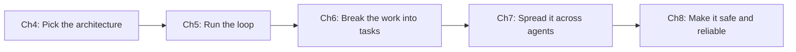

# Part B — Agentic Architecture & Orchestration
{: .no_toc }

**Domain 1 · ~27% of the exam: the largest domain.**
{: .fs-5 }

| Ch | Title | Pages | You must be able to… |
|:--|:--|:--|:--|
| 4 | [Agents vs Workflows vs Chatbots](04-agents-vs-workflows.html) | 4 | Choose the simplest architecture that solves the problem |
| 5 | [The Agentic Loop & Loop Control](05-agentic-loop.html) | 3 | Drive and stop a loop correctly using `stop_reason` |
| 6 | [Task Decomposition & Planning](06-task-decomposition.html) | 4 | Choose sequential, parallel or adaptive decomposition, without leaving gaps |
| 7 | [Multi-Agent Orchestration](07-multi-agent.html) | 5 | Design a coordinator with subagents: scope, context, failures |
| 8 | [Reliability, Enforcement & Oversight](08-reliability-oversight.html) | 4 | Put guarantees in code (gates and hooks) and escalate correctly |

**Running example: ShopAssist** (a customer support agent, one of the 6 official scenarios).
Tools: `get_customer`, `lookup_order`, `process_refund`, `escalate_to_human`.
